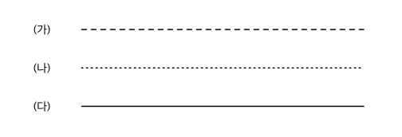
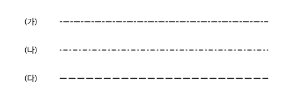
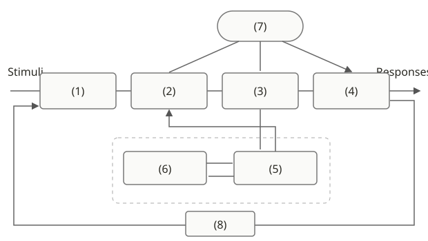

# 인터랙티브심리학 중간고사 · 단답형·서술형·R 코드 작성 문제

작성·검증일: 2026-10-18

총 197문항: 단답형 81 · 서술형 70 · R 코드 46.

1~6주차에 대해 기존 OX001–OX188 개념 목록과 대조한 자체 제작 문제은행이다. 이 전체 분량을 120분 실제 시험 한 회분으로 간주하지 않는다. 기출형 예상시험은 별도 120분·50문항·100점의 5회분으로 제공한다.

**답안 언어:** 교안에 영어로 제시한 용어의 명칭을 요구한 부분만 영문으로 쓴다. 정의·이유·계산·해석을 억지로 영어로 번역하지 않는다. 한글 명칭을 인정하는 문항은 문제에 표시했다. R 문법·함수·객체명은 제시 조건대로 작성한다.

**R 문항:** 부분 빈칸과 코드 한 줄 전체 작성으로 연습한다. 출력·해석을 추가로 요구하는 경우 별도 답안에 작성한다. 빈칸별 해설과 완성 코드는 정답 문서에서 확인한다.

**풀이:** 모범답안은 [04_정답과_해설.md](04_정답과_해설.md)에 분리했다. 웹에서는 답안을 먼저 작성한 뒤 정답·채점 기준을 열고 항목별 부분점수와 이해도를 직접 체크한다.

## SA001 · 단답형 · 개론·역사 · 3점

고객 생애주기에 따른 UX Scope의 세 가지 시간 범위를 강의의 영문 명칭으로 쓰시오. 경험이 형성되는 시간 순서대로 배열하시오.

답안 표기: 강의 영문 용어만 영어 표기. 설명은 한글로 작성.

[웹에서 이 문항 풀기](index.html?view=problems&question=SA001)

## SA002 · 단답형 · 개론·역사 · 4점

사용자 경험(UX)에서 브랜드 경험(Brand Experience)을 구성하는 네 가지 하위 요소를 강의의 영문 명칭으로 모두 적으시오.

답안 표기: 강의 영문 용어만 영어 표기. 설명은 한글로 작성.

[웹에서 이 문항 풀기](index.html?view=problems&question=SA002)

## SA003 · 단답형 · 개론·역사 · 3점

사용자 경험(UX)에서 제품·서비스 경험(Product/Service Experience)을 구성하는 세 가지 핵심 요소를 강의의 영문 명칭으로 모두 적으시오.

답안 표기: 강의 영문 용어만 영어 표기. 설명은 한글로 작성.

[웹에서 이 문항 풀기](index.html?view=problems&question=SA003)

## SA004 · 단답형 · 개론·역사 · 4점

Ergonomics를 이루는 두 어원 표기와 각각의 뜻을 적으시오. 뜻은 한글로 써도 된다.

답안 표기: 강의 영문 용어만 영어 표기. 설명은 한글로 작성.

[웹에서 이 문항 풀기](index.html?view=problems&question=SA004)

## SA005 · 단답형 · 개론·역사 · 3점

Frank & Lillian Gilbreth 부부가 시간 및 동작 연구(Time & Motion study)의 미세동작분석에서 고안한 18가지 기본 손동작 단위의 영문 명칭을 쓰고, 무엇을 분석하는 단위인지 한글 한 구절로 적으시오.

답안 표기: 강의 영문 용어만 영어 표기. 설명은 한글로 작성.

[웹에서 이 문항 풀기](index.html?view=problems&question=SA005)

## SA006 · 단답형 · 개론·역사 · 4점

인간공학(HFE)의 세부 영역 중 (가) 인체측정·생리·생체역학적 특성을 다루는 영역과 (나) 지각·기억·추론·운동반응 등 정신 과정을 다루는 영역의 영문 명칭을 각각 적으시오.

답안 표기: 강의 영문 용어만 영어 표기. 설명은 한글로 작성.

[웹에서 이 문항 풀기](index.html?view=problems&question=SA006)

## SA007 · 단답형 · HFE 연구방법론 · 3점

인간공학 연구의 3대 유형 중 (가) 성인의 손 치수·근력 분포를 측정·기술하는 연구, (나) 독립변수(화면 방향 등)를 조작해 종속변수(가독성 등) 효과를 검증하는 연구, (다) 완성된 제품의 효과성·사용성을 평가하는 연구의 영문 명칭을 각각 적으시오.

답안 표기: 강의 영문 용어만 영어 표기. 설명은 한글로 작성.

[웹에서 이 문항 풀기](index.html?view=problems&question=SA007)

## SA008 · 단답형 · HFE 연구방법론 · 4점

연구 환경(Research Settings) 중 (가) 외생변수 통제·반복 측정·정밀 데이터 확보에 유리한 환경과 (나) 실제 사용 맥락·높은 현실 충실도·일반화에 유리한 환경의 영문 명칭을 각각 쓰시오.

답안 표기: 강의 영문 용어만 영어 표기. 설명은 한글로 작성.

[웹에서 이 문항 풀기](index.html?view=problems&question=SA008)

## SA009 · 단답형 · HFE 연구방법론 · 4점

실험 설계에서 (가) 연구자가 의도적으로 조작하는 요인, (나) 그에 따라 측정되는 결과 변수, (다) 기타 외생변수의 조건을 하나로 고정하는 처리, (라) 모집단의 계층(성별·연령 등) 비율에 맞춰 표본을 배정하는 방법의 영문 용어를 각각 쓰시오.

답안 표기: 강의 영문 용어만 영어 표기. 설명은 한글로 작성.

[웹에서 이 문항 풀기](index.html?view=problems&question=SA009)

## SA010 · 단답형 · HFE 연구방법론 · 2점

연구 측정 기준의 6대 실무 요건(Objective, Quantitative 등) 중 “측정 장치나 절차가 작업자의 자연스러운 과업 수행을 방해하지 않아야 한다”는 요건을 뜻하는 영문 한 단어를 쓰시오.

답안 표기: 강의 영문 용어만 영어 표기. 설명은 한글로 작성.

[웹에서 이 문항 풀기](index.html?view=problems&question=SA010)

## SA011 · 단답형 · HFE 연구방법론 · 4점

측정 품질의 지표 중 (가) 반복 측정했을 때 측정값이 일관되고 안정적으로 나오는 정도와 (나) 측정값이 참값(목표 중심)에 가까운 정도를 뜻하는 영문 용어를 각각 쓰시오.

답안 표기: 강의 영문 용어만 영어 표기. 설명은 한글로 작성.

[웹에서 이 문항 풀기](index.html?view=problems&question=SA011)

## SA012 · 단답형 · HFE 연구방법론 · 3점

타당도(Validity)의 세 유형 중 (가) 실험 내 혼동변수(Confounding) 없이 결과를 독립변수 효과로 귀속할 수 있는 정도, (나) 연구 결과를 다른 집단·실제 환경으로 일반화할 수 있는 정도, (다) 측정 도구가 목표 구성개념을 충실히 측정하는 정도의 영문 명칭을 각각 쓰시오.

답안 표기: 강의 영문 용어만 영어 표기. 설명은 한글로 작성.

[웹에서 이 문항 풀기](index.html?view=problems&question=SA012)

## SA013 · 단답형 · HFE 연구방법론 · 4점

구성타당도(Construct Validity) 저하 요인 중 (가) 측정하려는 이론적 구성개념의 일부가 실제 측정에서 누락된 것과 (나) 구성개념과 무관한 외부 요소가 측정치에 섞여 들어간 것을 뜻하는 영문 용어를 각각 쓰시오.

답안 표기: 강의 영문 용어만 영어 표기. 설명은 한글로 작성.

[웹에서 이 문항 풀기](index.html?view=problems&question=SA013)

## SA014 · 단답형 · HFE 연구방법론 · 3점

키 180 cm, 체중 81 kg인 사람의 BMI와, 상위 25%의 경계에 해당하는 백분위수를 각각 구하시오.

답안 표기: 한글·수식·수치·단위로 작성.

[웹에서 이 문항 풀기](index.html?view=problems&question=SA014)

## SA015 · 단답형 · HFE 연구방법론 · 3점

파일럿 5명의 평균은 80, \(s=10\), \(z=2\), \(k=0.1\)이다. \(n=(zs/(k\bar{x}))^2\)로 최소 총 인원과 추가 모집 인원을 구하시오. 파일럿도 최종 표본에 포함한다.

답안 표기: 한글·수식·수치·단위로 작성.

[웹에서 이 문항 풀기](index.html?view=problems&question=SA015)

## SA016 · 단답형 · HFE 연구방법론 · 3점

표본 SD가 12이고 \(n = 36\)이다. 평균의 SE를 구하고 SD와 각각 무엇을 나타내는지 한글로 짧게 적으시오.

답안 표기: 한글·수식·수치·단위로 작성.

[웹에서 이 문항 풀기](index.html?view=problems&question=SA016)

## SA017 · 단답형 · 정보량·중복도 · 3점

강의의 인간 정보처리 모형에서 감각저장 이후 외현적 반응이 완성되기까지의 세 처리 단계를 순서대로 쓰시오. 각 단계는 강의의 영문 명칭으로 적으시오.

답안 표기: 강의 영문 용어만 영어 표기. 설명은 한글로 작성.

[웹에서 이 문항 풀기](index.html?view=problems&question=SA017)

## SA018 · 단답형 · 정보량·중복도 · 4점

인간 정보처리 모형(Information Processing Model)에서 (가) 시연이 없을 때 약 20~30초간 정보를 유지·처리하는 기억, (나) 지식과 경험을 장기 저장하는 기억, (다) 지각·결정·실행 등 여러 처리 단계에 배분되는 정신적 자원, (라) 반응 실행의 결과가 다시 감각 입력으로 되돌아가는 연결의 영문 표기를 각각 쓰시오.

답안 표기: 강의 영문 용어만 영어 표기. 설명은 한글로 작성.

[웹에서 이 문항 풀기](index.html?view=problems&question=SA018)

## SA019 · 단답형 · 정보량·중복도 · 3점

등확률 대안 16개의 정보량과, 대안이 32개가 되었을 때 증가한 정보량을 구하시오.

답안 표기: 한글·수식·수치·단위로 작성.

[웹에서 이 문항 풀기](index.html?view=problems&question=SA019)

## SA020 · 단답형 · 정보량·중복도 · 3점

두 사건 확률은 0.2·0.8이다. 손계산용 \(\log_2 5\approx2.3\), \(\log_2 1.25\approx0.3\)을 그대로 사용해 평균 정보량 H, 두 대안의 최대 정보량, 중복도를 구하시오. 최종 소수 답은 첫째 자리까지 쓴다.

답안 표기: 한글·수식·수치·단위로 작성.

[웹에서 이 문항 풀기](index.html?view=problems&question=SA020)

## SA021 · 단답형 · 정보량·중복도 · 3점

중복도 \(R=(1-H/H_{\max})\times100\)을 구하시오. (가) 두 대안의 손계산용 제시값 \(H=0.4\) bit, \(H_{\max}=1\) bit (나) 8개 대안의 손계산용 제시값 \(H=2.4\) bits. 최종 소수 답은 첫째 자리까지 쓴다.

답안 표기: 한글·수식·수치·단위로 작성.

[웹에서 이 문항 풀기](index.html?view=problems&question=SA021)

## SA022 · 단답형 · 정보전달·기억·Hick · 4점

정보전달이론에서 (가) 입력 정보 중 출력으로 전달되지 못하고 손실된 불확실성 \(H\left(X\mid Y\right)\)와 (나) 입력과 무관하게 출력에 끼어든 조건부 불확실성 \(H\left(Y\mid X\right)\)의 영문 명칭을 각각 적고, 전달정보량 \(I(X;Y)\) 공식을 쓰시오.

답안 표기: 강의 영문 용어만 영어 표기. 설명은 한글로 작성.

[웹에서 이 문항 풀기](index.html?view=problems&question=SA022)

## SA023 · 단답형 · 정보전달·기억·Hick · 4점

등확률 이항 입력에서 (가) 모든 반응 라벨을 항상 반대로 답함 (나) 항상 한 반응만 답함의 전달정보량을 구하시오.

답안 표기: 한글·수식·수치·단위로 작성.

[웹에서 이 문항 풀기](index.html?view=problems&question=SA023)

## SA024 · 단답형 · 정보전달·기억·Hick · 3점

작업기억 및 판단 지원 전략 중 (가) 정보를 속으로 되뇌어 기억 유지 시간을 늘리는 것, (나) 기억 속 기준과 단독 비교하는 절대 판단 대신 두 자극을 나란히 직접 비교하게 하는 것, (다) 개별 항목들을 기존 장기기억 지식과 연결해 의미 있는 묶음 단위로 구성하는 것의 영문 용어를 각각 쓰시오.

답안 표기: 강의 영문 용어만 영어 표기. 설명은 한글로 작성.

[웹에서 이 문항 풀기](index.html?view=problems&question=SA024)

## SA025 · 단답형 · 정보전달·기억·Hick · 2점

Sternberg 과제에서 검사 항목과 기억집합 크기를 나타내는 표기 두 가지를 쓰시오.

답안 표기: 강의 영문 용어만 영어 표기. 설명은 한글로 작성.

[웹에서 이 문항 풀기](index.html?view=problems&question=SA025)

## SA026 · 단답형 · 정보전달·기억·Hick · 4점

Sternberg 기억탐색 과제에서 (가) 목표 항목을 찾는 즉시 비교를 멈추는 탐색 방식과 (나) 목표를 찾더라도 기억집합의 끝까지 모두 비교한 뒤 응답하는 탐색 방식의 영문 표현을 순서대로 쓰시오.

답안 표기: 강의 영문 용어만 영어 표기. 설명은 한글로 작성.

[웹에서 이 문항 풀기](index.html?view=problems&question=SA026)

## SA027 · 단답형 · 정보전달·기억·Hick · 4점

Donders \(A = 200\), \(C = 260\), \(B = 350\) ms다. 단계 가정 아래 자극 식별 시간과 반응 선택 시간을 구하시오.

답안 표기: 한글·수식·수치·단위로 작성.

<figure class="visual-box"><figcaption>Donders 과업의 실측 시간 — 인지 단계는 직접 판별</figcaption><div class="table-scroll"><table><thead><tr><th>과업</th><th>제시 자극</th><th>가능 반응</th><th>RT(ms)</th></tr></thead><tbody><tr><td>A</td><td>1종</td><td>1종</td><td>200</td></tr><tr><td>C</td><td>여러 종</td><td>특정 자극에만 1종</td><td>260</td></tr><tr><td>B</td><td>여러 종</td><td>각 자극마다 다른 반응</td><td>350</td></tr></tbody></table></div></figure>

[웹에서 이 문항 풀기](index.html?view=problems&question=SA027)

## SA028 · 단답형 · 정보전달·기억·Hick · 4점

Hick 모형 \(\mathrm{RT} = 200 + 150\,H\)(ms, 단 \(H = \log_2 N\))일 때 등확률 4개·8개 대안의 예측 RT(ms)와 기울기 역수(\(1/b\))의 초당 정보처리율(bits/s)을 구하시오. 처리율은 정확한 분수 또는 소수점 첫째 자리까지 쓴다.

답안 표기: 한글·수식·수치·단위로 작성.

[웹에서 이 문항 풀기](index.html?view=problems&question=SA028)

## SA029 · 단답형 · 정보전달·기억·Hick · 3점

Hick의 법칙 \(\mathrm{RT}=a+bH\)에서 ① 감각 자극 양식 세 가지(시각·촉각·청각)를 반응이 빠른 순서로, ② 반응 기관 세 가지(발·눈·손)를 반응이 빠른 순서로 배열하시오. ③ 완전히 예상하지 못한 사건에 대해 교안에서 제시한 절편 \(a\)의 대표 수치(ms)를 적으시오. 한글 답안을 인정한다.

답안 표기: 한글·수식·수치·단위로 작성.

[웹에서 이 문항 풀기](index.html?view=problems&question=SA029)

## SA030 · 단답형 · Fitts·운동·양립성 · 3점

Fitts가 1954년에 제안한 원형 난이도 지수(ID) 공식과 국제표준(ISO 9241-9, Shannon형) 난이도 지수(ID) 공식을 각각 적고, 거리(\(A, D\))와 표적 너비(\(W\))의 단위 조건을 쓰시오.

답안 표기: 한글·수식·수치·단위로 작성.

[웹에서 이 문항 풀기](index.html?view=problems&question=SA030)

## SA031 · 단답형 · Fitts·운동·양립성 · 3점

ISO형 \(MT=50+150\log_2(D/W+1)\) ms에서 (가) \(D=80,W=20\), (나) \(D=100,W=10\)이다. 같은 길이 단위를 사용한다. 손계산용 \(\log_2 5\approx2.3\), \(\log_2 11\approx3.5\)를 그대로 사용해 MT를 각각 구하시오.

답안 표기: 한글·수식·수치·단위로 작성.

<figure class="visual-box"><figcaption>같은 시작점에서 두 표적으로 이동 — 거리와 너비의 전체 비교</figcaption><svg role="img" aria-label="같은 시작점에서 두 표적으로 이동 — 거리와 너비의 전체 비교" viewBox="0 0 600 220" xmlns="http://www.w3.org/2000/svg"><circle cx="45" cy="65" r="6" fill="#333"/><circle cx="45" cy="145" r="6" fill="#333"/><path d="M55 65H365M55 145H445" stroke="#7c8fa6" stroke-width="2"/><rect x="325" y="40" width="80" height="50" fill="#c4cfdb"/><rect x="425" y="120" width="40" height="50" fill="#c4cfdb"/><text x="65" y="32">(가) D=80, W=20</text><text x="65" y="112">(나) D=100, W=10</text><text x="65" y="195">공통: a=50 ms, b=150 ms/bit, ISO형</text></svg></figure>

[웹에서 이 문항 풀기](index.html?view=problems&question=SA031)

## SA032 · 단답형 · Fitts·운동·양립성 · 4점

운동 제어(Motor Control)에서 (가) 시각 등 감각 피드백을 실시간으로 받아 목표 근처 오차를 교정하는 운동과 (나) 실행 중 피드백 교정 없이 사전 계획대로 빠르게 실행하는 운동의 영문 명칭 및 제어 회로(Open/Closed loop) 유형을 각각 적으시오.

답안 표기: 강의 영문 용어만 영어 표기. 설명은 한글로 작성.

[웹에서 이 문항 풀기](index.html?view=problems&question=SA032)

## SA033 · 단답형 · Fitts·운동·양립성 · 4점

운동 제어의 범위 효과(Range effect)에서 짧은 이동거리(short distance)와 긴 이동거리(long distance)일 때 나타나는 대표적 도달 오류 경향을 각각 영문 용어로 쓰시오.

답안 표기: 강의 영문 용어만 영어 표기. 설명은 한글로 작성.

[웹에서 이 문항 풀기](index.html?view=problems&question=SA033)

## SA034 · 단답형 · Fitts·운동·양립성 · 4점

제어장치와 표시장치 설계에서 (가) 특정 인구 집단이 공통으로 가지고 있는 조작–표시 기대와 (나) 사물의 형태가 특정 행동을 직관적으로 유도하는 성질을 뜻하는 영문 용어를 각각 쓰시오.

답안 표기: 강의 영문 용어만 영어 표기. 설명은 한글로 작성.

[웹에서 이 문항 풀기](index.html?view=problems&question=SA034)

## SA035 · 단답형 · Fitts·운동·양립성 · 4점

제어–표시 양립성(Compatibility)의 4가지 유형 중 (가) 가스레인지 화구와 조절 노브의 물리적 배열 일치, (나) 다이얼 회전 방향과 눈금 이동 방향의 일치, (다) 온수에 빨간색·냉수에 파란색을 부여하는 의미적 연상 일치, (라) 음성 지시에 음성으로 응답하는 감각-반응 양식 일치의 영문 명칭을 각각 쓰시오.

답안 표기: 강의 영문 용어만 영어 표기. 설명은 한글로 작성.

[웹에서 이 문항 풀기](index.html?view=problems&question=SA035)

## SA036 · 단답형 · 기초통계·T검정 · 3점

한 집단과 기준값 비교, 서로 다른 독립 집단 비교, 같은 대상 전후 비교에 맞는 t-검정 명칭을 쓰시오. 이 문항은 한글 명칭을 인정한다.

답안 표기: 한글·수식·수치·단위로 작성.

[웹에서 이 문항 풀기](index.html?view=problems&question=SA036)

## SA037 · 단답형 · 기초통계·T검정 · 4점

\(a = \left(2, 4, 6\right)\)의 표본평균·중앙값·표본분산·표준편차를 구하시오. 단위는 cm다.

답안 표기: 한글·수식·수치·단위로 작성.

[웹에서 이 문항 풀기](index.html?view=problems&question=SA037)

## SA038 · 단답형 · 회귀·실험실습 · 3점

절편을 포함한 단순선형회귀에서 \(\bar{x}=2\), \(\bar{y}=5\), \(S_{xx}=2\), \(S_{xy}=4\)다. 최소제곱법으로 기울기와 절편을 구하고, \(x=4\)일 때의 예측값을 계산하시오.

답안 표기: 한글·수식·수치·단위로 작성.

[웹에서 이 문항 풀기](index.html?view=problems&question=SA038)

## SA039 · 단답형 · 회귀·실험실습 · 5점

절편 포함 단순 OLS에서 \(n = 12\), \(\mathrm{SST} = 100\), \(\mathrm{SSE} = 30\)이다. SSR·잔차 자유도·MSE·F·\(R^2\)를 구하시오. F는 정확한 분수 또는 소수점 첫째 자리까지 쓴다.

답안 표기: 한글·수식·수치·단위로 작성.

[웹에서 이 문항 풀기](index.html?view=problems&question=SA039)

## SA040 · 단답형 · 기초통계·T검정 · 3점

RStudio에서 선택 코드를 실행하는 단축키, 스크립트 기본 확장자, 객체 목록을 확인하는 창을 쓰시오. 창 이름만 화면 영어 표기로 적으시오.

답안 표기: 강의 영문 용어만 영어 표기. 설명은 한글로 작성.

[웹에서 이 문항 풀기](index.html?view=problems&question=SA040)

## SA041 · 단답형 · 회귀·실험실습 · 3점

등확률 대안 \(N = 1\)·2·4의 H(bit)를 쓰고, 회귀 \(p = 0.16\)·\(R^{2} = 0.03\)을 \(\alpha = 0.05\)에서 한 문장으로 판독하시오.

답안 표기: 한글·수식·수치·단위로 작성.

<figure class="visual-box analysis-material"><figcaption>SRT·CRT 수업 실습 예시 · 등확률 대안과 회귀 요약</figcaption><div class="table-scroll"><table><thead><tr><th scope="col">항목</th><th scope="col">제시자료</th></tr></thead><tbody><tr><td>등확률 대안 수 N</td><td>1, 2, 4</td></tr><tr><td>반응변수</td><td>Time (ms)</td></tr><tr><td>설명변수</td><td>H (bit)</td></tr><tr><td>추정식</td><td>\(\widehat{\mathrm{Time}}=424+78H\)</td></tr><tr><td>모형 p-value</td><td>0.16</td></tr><tr><td>Multiple R-squared</td><td>0.03</td></tr><tr><td>판정 유의수준 α</td><td>0.05</td></tr></tbody></table></div><p class="analysis-note">실습 전사에 주어진 요약값이다. 아래 Sternberg 로그와는 별개의 분석이며, 원자료가 없는 이 회귀를 로그 4행에서 산출한 것으로 간주하지 않는다.</p></figure>

[웹에서 이 문항 풀기](index.html?view=problems&question=SA041)

## SA042 · 단답형 · 회귀·실험실습 · 4점

집합 {2,5,8}, Probe=4, User Input=False, T/F=True, Time=620 ms다. YES/NO 조건·정오·PSS를 적으시오. TimeOut의 Time=5000도 초로 바꾸시오.

답안 표기: 한글·수식·수치·단위로 작성.

<figure class="visual-box"><figcaption>Sternberg 로그 두 시행 — Time 단위 ms</figcaption><div class="table-scroll"><table><thead><tr><th>집합</th><th>Probe</th><th>User Input</th><th>T/F</th><th>Time</th></tr></thead><tbody><tr><td>2,5,8</td><td>4</td><td>False</td><td>True</td><td>620</td></tr><tr><td>2,5,8</td><td>7</td><td>TimeOut</td><td>False</td><td>5000</td></tr></tbody></table></div></figure>

[웹에서 이 문항 풀기](index.html?view=problems&question=SA042)

## SA043 · 단답형 · 개론·역사 · 3점

제시된 Windows 95 보충영상 사례에서 DOS 명령어 입력과 Start 버튼·아이콘 선택을 회상·재인으로 구별하시오. 이어 영상 속 PC의 물리·전원 제약 한 가지와 통신·접속 제약 한 가지를 쓰시오.

답안 표기: 한글·수식·수치·단위로 작성.

<figure class="visual-box analysis-material"><figcaption>보충영상 1 · 자막에서 확인한 사례</figcaption><div class="table-scroll"><table><thead><tr><th>구간</th><th>영상에서 확인한 사례</th></tr></thead><tbody><tr><td>00:49–01:18</td><td>본체와 모니터 전원을 혼동하며 PC를 켠다.</td></tr><tr><td>03:19–04:39</td><td>브라우저 실행 후 연결에 실패하고 전화선 모뎀·AOL 절차를 설명받는다.</td></tr><tr><td>04:41–05:42</td><td>진행자가 Start 버튼과 이전 DOS의 명령어 입력 방식을 대비해 설명한다.</td></tr><tr><td>07:25–08:00</td><td>종료 안내 후 수동으로 전원을 끈다.</td></tr></tbody></table></div></figure>

[웹에서 이 문항 풀기](index.html?view=problems&question=SA043)

## SA044 · 단답형 · 개론·역사 · 3점

제시된 Gen Z Vs Old Technology 사례에서 Nokia에 시도한 현대식 조작 두 가지를 적고, 플로피·VHS·키패드 조작의 어려움을 이전 경험과 행동유도성 또는 집단 기대의 관점에서 설명하시오.

답안 표기: 한글·수식·수치·단위로 작성.

<figure class="visual-box analysis-material"><figcaption>보충영상 2 · 자막에서 확인한 사례</figcaption><div class="table-scroll"><table><thead><tr><th>구간</th><th>영상에서 확인한 사례</th></tr></thead><tbody><tr><td>00:20–03:20</td><td>VHS의 용도와 물리 매체 사용·보관을 낯설어한다.</td></tr><tr><td>03:37–05:42</td><td>Nokia 화면 터치와 음성 호출을 시도하고 숫자 키패드 문자 입력을 어려워한다.</td></tr><tr><td>06:04–07:24</td><td>플로피의 화살표로 삽입 용도는 추측하지만 매체의 정체는 바로 알지 못한다.</td></tr></tbody></table></div></figure>

[웹에서 이 문항 풀기](index.html?view=problems&question=SA044)

## ES001 · 서술형 · 개론·역사 · 4점

쇼핑 앱을 평가하면서 결제 버튼을 누르는 데 걸린 시간만 측정했다. 이 평가만으로 앱의 전반적인 UX를 판단하기 어려운 이유를 UX의 시간 범위와 연결하여 설명하시오.

답안 표기: 설명은 한글로 작성. 필요한 수식·수치·단위는 함께 표기.

[웹에서 이 문항 풀기](index.html?view=problems&question=ES001)

## ES002 · 서술형 · 개론·역사 · 4점

참가자에게 흰옷을 입은 팀의 패스 횟수를 세도록 지시했다. 영상 도중 고릴라가 화면 중앙을 지나갔지만 일부 참가자는 보지 못했다고 답했다. 이 결과가 나타난 이유를 주의의 특성과 연결하여 설명하시오.

답안 표기: 설명은 한글로 작성. 필요한 수식·수치·단위는 함께 표기.

[웹에서 이 문항 풀기](index.html?view=problems&question=ES002)

## ES003 · 서술형 · 개론·역사 · 4점

제2차 세계대전 이후 1945~1960년은 인간공학이 전문 학문으로 자리 잡은 시기다. 이 시기의 변화가 사람과 장비의 관계를 연구하는 데 어떤 의미가 있었는지 설명하시오.

답안 표기: 설명은 한글로 작성. 필요한 수식·수치·단위는 함께 표기.

[웹에서 이 문항 풀기](index.html?view=problems&question=ES003)

## ES004 · 서술형 · 개론·역사 · 4점

의자를 바꾼 뒤 시간당 생산량은 늘었지만 작업자의 근육 통증도 심해졌다. 이 결과를 인간공학의 목표에 비추어 평가하시오.

답안 표기: 설명은 한글로 작성. 필요한 수식·수치·단위는 함께 표기.

[웹에서 이 문항 풀기](index.html?view=problems&question=ES004)

## ES005 · 서술형 · 개론·역사 · 4점

기존 플러그는 손가락 힘이 약한 사용자가 뽑기 어려웠다. 사용자를 훈련하는 대신 손가락을 걸 수 있는 당김 고리를 추가했다. 이 개선이 인간공학의 설계 철학을 어떻게 반영하는지 설명하시오.

답안 표기: 설명은 한글로 작성. 필요한 수식·수치·단위는 함께 표기.

[웹에서 이 문항 풀기](index.html?view=problems&question=ES005)

## ES006 · 서술형 · HFE 연구방법론 · 6점

주방 손잡이를 개발하며 먼저 사용자의 손 치수를 조사했다. 다음에는 손잡이 굵기만 달리하여 파지력을 비교했고, 마지막에는 완성품의 사용성을 확인했다. 이 세 활동이 각각 어떤 연구 유형에 해당하는지 그 목적을 근거로 설명하시오.

답안 표기: 설명은 한글로 작성. 필요한 수식·수치·단위는 함께 표기.

[웹에서 이 문항 풀기](index.html?view=problems&question=ES006)

## ES007 · 서술형 · HFE 연구방법론 · 4점

스마트글래스의 무게 위치만 바꾸고 코에 걸리는 하중을 측정했다. 아래는 평균 결과이며 오차막대의 종류는 SE로 보고되었다. 이 자료만으로 Rear가 Front보다 모든 참가자에게 더 편하고, 통계적으로도 유의하게 우수하다고 결론 내릴 수 있는지 설명하시오.

답안 표기: 설명은 한글로 작성. 필요한 수식·수치·단위는 함께 표기.

<figure class="visual-box analysis-material"><figcaption>스마트글래스 무게 위치 실험 · 코 하중 평균 (N)</figcaption><div class="table-scroll"><table><thead><tr><th scope="col">위치</th><th scope="col">Front</th><th scope="col">Middle</th><th scope="col">Ear</th><th scope="col">Rear</th></tr></thead><tbody><tr><td>평균 코 하중 (N)</td><td>0.34</td><td>0.22</td><td>0.2</td><td>0.16</td></tr><tr><td>오차막대</td><td>SE</td><td>SE</td><td>SE</td><td>SE</td></tr></tbody></table></div></figure>

[웹에서 이 문항 풀기](index.html?view=problems&question=ES007)

## ES008 · 서술형 · HFE 연구방법론 · 4점

조용한 실험실에서는 새 입력 UI의 오류율이 낮았지만, 실제 병원에서는 같은 UI의 오류율이 높아졌다. 연구 환경의 차이를 근거로 이 결과를 설명하시오.

답안 표기: 설명은 한글로 작성. 필요한 수식·수치·단위는 함께 표기.

[웹에서 이 문항 풀기](index.html?view=problems&question=ES008)

## ES009 · 서술형 · HFE 연구방법론 · 4점

새 마우스의 사용성을 기존 제품과 비교하려 한다. 연구자는 과업 완료시간만 측정하려고 한다. 이 지표만으로 평가할 때의 문제를 설명하고, 이를 보완할 종속변수 두 가지를 제안하시오.

답안 표기: 설명은 한글로 작성. 필요한 수식·수치·단위는 함께 표기.

[웹에서 이 문항 풀기](index.html?view=problems&question=ES009)

## ES010 · 서술형 · HFE 연구방법론 · 4점

표본 수를 \(n=\left(\frac{zs}{k\bar{x}}\right)^2\)로 계획한다. 다른 값은 그대로 두고 허용 상대오차 \(k\)만 절반으로 줄이면 필요한 표본 수는 어떻게 달라지는가? 식을 이용하여 이유를 설명하시오.

답안 표기: 설명은 한글로 작성. 필요한 수식·수치·단위는 함께 표기.

[웹에서 이 문항 풀기](index.html?view=problems&question=ES010)

## ES011 · 서술형 · HFE 연구방법론 · 4점

참값이 100인 표준물을 반복 측정하자 센서가 110, 110, 110을 기록했다. 이 측정의 신뢰도와 정확도를 구별하여 평가하고, 가장 먼저 필요한 개선을 설명하시오.

답안 표기: 설명은 한글로 작성. 필요한 수식·수치·단위는 함께 표기.

[웹에서 이 문항 풀기](index.html?view=problems&question=ES011)

## ES012 · 서술형 · HFE 연구방법론 · 4점

새 UI에는 전문가만, 기존 UI에는 초보자만 배정했다. 새 UI 집단의 과업 완료시간이 더 짧았다. 이를 UI 개선 효과라고 결론 내리기 어려운 이유와 배정 방법의 개선안을 설명하시오.

답안 표기: 설명은 한글로 작성. 필요한 수식·수치·단위는 함께 표기.

[웹에서 이 문항 풀기](index.html?view=problems&question=ES012)

## ES013 · 서술형 · 정보량·중복도 · 4점

경고음을 들은 작업자가 정지 버튼을 누른 뒤 장치가 멈췄는지 확인했다. 이 과정을 인간 정보처리 모형의 주요 단계와 피드백을 이용하여 설명하시오.

답안 표기: 설명은 한글로 작성. 필요한 수식·수치·단위는 함께 표기.

[웹에서 이 문항 풀기](index.html?view=problems&question=ES013)

## ES014 · 서술형 · 정보량·중복도 · 4점

두 경고 A와 B의 발생 확률은 각각 0.2와 0.8이다. 평균 정보량을 구하고, 두 경고가 등확률인 경우보다 값이 작은 이유를 설명하시오. 손계산에는 \(\log_2 5\approx2.3\), \(\log_2 1.25\approx0.3\)을 그대로 사용하고 소수 첫째 자리까지 쓰시오.

답안 표기: 설명은 한글로 작성. 필요한 수식·수치·단위는 함께 표기.

[웹에서 이 문항 풀기](index.html?view=problems&question=ES014)

## ES015 · 서술형 · 정보량·중복도 · 4점

앞면이 나올 확률을 \(p\)라 할 때 이항 엔트로피 곡선의 형태를 설명하시오. \(p=0,\;0.5,\;1\)에서의 값을 근거로, 어느 조건에서 결과를 가장 예측하기 어려운지 쓰시오.

답안 표기: 설명은 한글로 작성. 필요한 수식·수치·단위는 함께 표기.

[웹에서 이 문항 풀기](index.html?view=problems&question=ES015)

## ES016 · 서술형 · 정보량·중복도 · 4점

8종 경고의 평균 정보량을 손계산용 값 \(H=2.4\) bits로 제시한다. 최대 정보량과 중복도를 구하고, 중복도의 뜻을 이 분포의 예측 가능성과 연결하여 설명하시오. 중복도는 소수 첫째 자리까지 쓰시오.

답안 표기: 설명은 한글로 작성. 필요한 수식·수치·단위는 함께 표기.

[웹에서 이 문항 풀기](index.html?view=problems&question=ES016)

## ES017 · 서술형 · 정보량·중복도 · 4점

한 시점에 신호등이 바뀔지 안 바뀔지를 예측한다. 두 사건이 등확률이면 \(H=1\) bit다. 정확한 카운트다운으로 그 시점의 변경 여부를 확실히 알게 되었다면 이 불확실성에 대한 정보량은 어떻게 달라지는가? 이유를 설명하시오.

답안 표기: 설명은 한글로 작성. 필요한 수식·수치·단위는 함께 표기.

[웹에서 이 문항 풀기](index.html?view=problems&question=ES017)

## ES018 · 서술형 · 정보전달·기억·Hick · 4점

아래 표는 16회 시행에서 자극 \(X\)와 반응 \(Y\)의 빈도다. \(Y=1\)을 관찰했을 때 어떤 자극이었는지 확정할 수 있는가? 이 점을 이용하여 \(H(X\mid Y)\)를 구하고 그 의미를 설명하시오.

답안 표기: 설명은 한글로 작성. 필요한 수식·수치·단위는 함께 표기.

<figure class="visual-box"><figcaption>16회 시행 혼동행렬 — 행: 자극 X / 열: 반응 Y</figcaption><div class="table-scroll"><table><thead><tr><th>X \ Y</th><th>1</th><th>2</th><th>3</th><th>4</th></tr></thead><tbody><tr><td>1</td><td>4</td><td>0</td><td>0</td><td>0</td></tr><tr><td>2</td><td>4</td><td>0</td><td>0</td><td>0</td></tr><tr><td>3</td><td>0</td><td>0</td><td>4</td><td>0</td></tr><tr><td>4</td><td>0</td><td>0</td><td>0</td><td>4</td></tr></tbody></table></div></figure>

[웹에서 이 문항 풀기](index.html?view=problems&question=ES018)

## ES019 · 서술형 · 정보전달·기억·Hick · 4점

입력 1과 2는 등확률이다. 방식 A는 입력 1에 항상 2로, 입력 2에 항상 1로 반응한다. 방식 B는 어느 입력에도 항상 1로 반응한다. 두 방식의 정답률과 전달정보량을 비교하여, 정답률이 높은 방식이 반드시 더 많은 정보를 전달하는지 설명하시오.

답안 표기: 설명은 한글로 작성. 필요한 수식·수치·단위는 함께 표기.

[웹에서 이 문항 풀기](index.html?view=problems&question=ES019)

## ES020 · 서술형 · 정보전달·기억·Hick · 4점

감각–운동 과업에서 입력 정보율을 계속 높였지만 일정 수준 이후에는 전달 정보율이 거의 증가하지 않았다. 이 현상을 채널 용량의 관점에서 설명하시오.

답안 표기: 설명은 한글로 작성. 필요한 수식·수치·단위는 함께 표기.

[웹에서 이 문항 풀기](index.html?view=problems&question=ES020)

## ES021 · 서술형 · 정보전달·기억·Hick · 4점

화면 A의 밝기를 본 뒤 화면을 닫고 화면 B가 더 밝은지 판단하게 했다. 연구자는 A와 B를 나란히 보여 주는 방식으로 바꾸려 한다. 이 변경이 판단에 도움이 될 수 있는 이유를 설명하시오.

답안 표기: 설명은 한글로 작성. 필요한 수식·수치·단위는 함께 표기.

[웹에서 이 문항 풀기](index.html?view=problems&question=ES021)

## ES022 · 서술형 · 정보전달·기억·Hick · 4점

아래는 기억집합 크기(PSS)에 따른 반응시간(RT)을 나타낸 교안의 개념 도식이다. 기억집합이 커질수록 RT가 증가하는 양상을 기억 항목의 비교 과정과 연결하여 설명하시오.

답안 표기: 설명은 한글로 작성. 필요한 수식·수치·단위는 함께 표기.

<figure class="visual-box analysis-material"><figcaption>Sternberg 과제의 두 조건 · 교안 p.31 관계도 재구성</figcaption><svg viewBox="0 0 720 290" role="img" aria-label="PSS에 따른 YES와 NO 조건의 RT 관계도"><line x1="85" y1="235" x2="610" y2="235" stroke="currentColor"/><line x1="85" y1="235" x2="85" y2="35" stroke="currentColor"/><text x="620" y="241">PSS</text><text x="30" y="35">RT</text><path d="M85 180 L505 75" fill="none" stroke="#37352f" stroke-width="3"/><path d="M85 225 L505 120" fill="none" stroke="#6b6b67" stroke-width="3"/><text x="520" y="80">NO</text><text x="520" y="125">YES</text></svg><p class="analysis-note">교안의 두 조건 관계를 다시 그린 개념 도식이다. 실제 관측값이나 계수 추정용 수치 자료가 아니다.</p></figure>

[웹에서 이 문항 풀기](index.html?view=problems&question=ES022)

## ES023 · 서술형 · 정보전달·기억·Hick · 4점

같은 참가자가 두 과업을 수행했다. C는 여러 자극 중 지정된 자극에만 하나의 키로 반응하고, B는 각 자극에 대응하는 서로 다른 키로 반응한다. 평균 RT는 C가 300 ms, B가 380 ms였다. 차감법으로 추가 반응 선택 시간을 추정하고, 이 추정에 필요한 가정을 설명하시오.

답안 표기: 설명은 한글로 작성. 필요한 수식·수치·단위는 함께 표기.

[웹에서 이 문항 풀기](index.html?view=problems&question=ES023)

## ES024 · 서술형 · 정보전달·기억·Hick · 4점

등확률 대안 수 \(N=1,2,4\)일 때 평균 RT가 각각 300, 425, 550 ms였다. \(H=\log_2N\)을 사용하여 Hick 모형 \(\mathrm{RT}=a+bH\)를 구하고, 같은 관계가 유지될 때 \(N=8\)의 RT를 예측하시오.

답안 표기: 설명은 한글로 작성. 필요한 수식·수치·단위는 함께 표기.

[웹에서 이 문항 풀기](index.html?view=problems&question=ES024)

## ES025 · 서술형 · 정보전달·기억·Hick · 4점

같은 선택 과업에서 연습 전후의 Hick 모형을 비교했더니 절편은 같고 기울기 \(b\)만 작아졌다. 이 변화가 뜻하는 바를 설명하시오.

답안 표기: 설명은 한글로 작성. 필요한 수식·수치·단위는 함께 표기.

[웹에서 이 문항 풀기](index.html?view=problems&question=ES025)

## ES026 · 서술형 · 정보전달·기억·Hick · 4점

한 메뉴에서 선택지 수만 줄인 개선 A와, 선택지 수는 그대로 두고 버튼의 너비만 넓힌 개선 B를 비교한다. 각각 주로 어떤 시간 부담을 줄이는지 적절한 법칙과 연결하여 설명하시오.

답안 표기: 설명은 한글로 작성. 필요한 수식·수치·단위는 함께 표기.

[웹에서 이 문항 풀기](index.html?view=problems&question=ES026)

## ES027 · 서술형 · Fitts·운동·양립성 · 4점

ISO형 Fitts 모형은 \(\mathrm{MT}=a+b\log_2(D/W+1)\)이다. 같은 \(a,b\)를 유지하면서 거리 \(D\)와 표적 너비 \(W\)를 모두 두 배로 바꾸면 예측 운동시간은 어떻게 되는가? 식을 이용하여 설명하시오.

답안 표기: 설명은 한글로 작성. 필요한 수식·수치·단위는 함께 표기.

[웹에서 이 문항 풀기](index.html?view=problems&question=ES027)

## ES028 · 서술형 · Fitts·운동·양립성 · 4점

팔뚝·손목·손가락의 Fitts 기울기는 각각 105, 43, 26 ms/bit다. 세 부위의 절편이 같다고 할 때, ID가 1 bit 증가하면 추가 운동시간이 가장 작은 부위는 어디인가? 관절과 정보처리 부담에 관한 강의 설명과 연결하시오.

답안 표기: 설명은 한글로 작성. 필요한 수식·수치·단위는 함께 표기.

[웹에서 이 문항 풀기](index.html?view=problems&question=ES028)

## ES029 · 서술형 · Fitts·운동·양립성 · 4점

포인터를 움직일 때 목표 부근까지는 빠르게 이동하지만 마지막에는 속도를 낮춰 위치를 맞춘다. 두 구간의 제어 방식이 어떻게 다른지 피드백의 사용을 중심으로 설명하시오.

답안 표기: 설명은 한글로 작성. 필요한 수식·수치·단위는 함께 표기.

[웹에서 이 문항 풀기](index.html?view=problems&question=ES029)

## ES030 · 서술형 · Fitts·운동·양립성 · 4점

서로 다른 거리의 표적에 손을 뻗게 했더니 짧은 거리에서는 목표를 지나치고 긴 거리에서는 목표에 못 미치는 경향이 나타났다. 이 결과를 강의에서 다룬 범위 효과로 설명하시오.

답안 표기: 설명은 한글로 작성. 필요한 수식·수치·단위는 함께 표기.

[웹에서 이 문항 풀기](index.html?view=problems&question=ES030)

## ES031 · 서술형 · Fitts·운동·양립성 · 4점

네 개 화구가 정사각형으로 놓인 전기레인지의 조작 손잡이는 일렬로 배열되어 있어 사용자가 화구를 자주 혼동한다. 양립성의 관점에서 문제를 설명하고 배열을 개선하시오.

답안 표기: 설명은 한글로 작성. 필요한 수식·수치·단위는 함께 표기.

[웹에서 이 문항 풀기](index.html?view=problems&question=ES031)

## ES032 · 서술형 · Fitts·운동·양립성 · 4점

빨간 표시를 상승과 연결하는 주식 투자자와 위험과 연결하는 사용자가 같은 화면을 다르게 해석했다. 이 차이가 생길 수 있는 이유를 양립성의 관점에서 설명하시오.

답안 표기: 설명은 한글로 작성. 필요한 수식·수치·단위는 함께 표기.

[웹에서 이 문항 풀기](index.html?view=problems&question=ES032)

## ES033 · 서술형 · Fitts·운동·양립성 · 4점

아래 VR 틸트 지각 과업 결과에서 Compatible 조건의 AE가 더 높게 나타났다. 이 결과를 “양립 조건에서 통계적으로 유의하게 더 정확해졌다”라고 해석해도 되는지, 지표의 의미와 그림을 근거로 설명하시오.

답안 표기: 설명은 한글로 작성. 필요한 수식·수치·단위는 함께 표기.

<figure class="visual-box analysis-material"><figcaption>VR 틸트 연구의 지각 과업(perception task) 결과 · 교안 p.66</figcaption><a href="assets/question-data/information-processing-p66.png" target="_blank" rel="noopener"></a><p class="analysis-note">Compatible/ Incompatible은 몸과 보이는 패널의 기울임 방향의 일치/불일치다. Accuracy(AE)의 단위는 도(°)이며 절대 각도오차를 측정했다. 오차막대는 SE, 별표는 해당 비교에서 p&lt;.05다. 이 도표를 레버 수동 조작 과업의 결과로 바꾸어 읽지 않는다.</p></figure>

[웹에서 이 문항 풀기](index.html?view=problems&question=ES033)

## ES034 · 서술형 · 기초통계·T검정 · 4점

\(A=(50,50,50)\), \(B=(40,50,60)\)이다. 두 자료의 평균과 표본표준편차를 구하고, 평균만 비교하면 놓치는 차이를 설명하시오.

답안 표기: 설명은 한글로 작성. 필요한 수식·수치·단위는 함께 표기.

[웹에서 이 문항 풀기](index.html?view=problems&question=ES034)

## ES035 · 서술형 · 기초통계·T검정 · 4점

동일한 환자 12명의 치료 전후 반응시간을 비교하려 한다. 어떤 t-검정을 사용해야 하는지 설명하고, 정규성은 어떤 자료에 대해 확인해야 하는지 쓰시오.

답안 표기: 설명은 한글로 작성. 필요한 수식·수치·단위는 함께 표기.

[웹에서 이 문항 풀기](index.html?view=problems&question=ES035)

## ES036 · 서술형 · 기초통계·T검정 · 4점

독립된 두 집단의 정규성은 별도로 점검했다고 하자. Levene 검정에서 \(p=0.1742\)가 나왔다. \(\alpha=0.05\)에서 등분산 가설을 어떻게 판단하는지 설명하고, 강의의 등분산 가정형 t-검정을 사용할 때 R의 옵션을 쓰시오.

답안 표기: 설명은 한글로 작성. 필요한 수식·수치·단위는 함께 표기.

[웹에서 이 문항 풀기](index.html?view=problems&question=ES036)

## ES037 · 서술형 · 기초통계·T검정 · 4점

같은 사람의 반응시간을 전후 비교했다. 차이를 \(d=\text{after}-\text{before}\)로 정의한 양측 t-검정에서 평균 차이는 −33.65 ms, \(p=2.97\times10^{-7}\)이었다. \(\alpha=0.05\)에서 결과를 해석하시오.

답안 표기: 설명은 한글로 작성. 필요한 수식·수치·단위는 함께 표기.

[웹에서 이 문항 풀기](index.html?view=problems&question=ES037)

## ES038 · 서술형 · 회귀·실험실습 · 4점

세 관측값이 \((x,y)=(-1,1),(0,0),(1,1)\)이고 Pearson 상관계수는 0이다. 연구자는 “두 변수 사이에는 아무 관계도 없다”고 결론 내렸다. 이 결론이 적절한지 자료를 근거로 설명하시오.

답안 표기: 설명은 한글로 작성. 필요한 수식·수치·단위는 함께 표기.

[웹에서 이 문항 풀기](index.html?view=problems&question=ES038)

## ES039 · 서술형 · 회귀·실험실습 · 4점

아래 세 관측값에 절편을 포함한 최소제곱 직선을 적합하시오. 기울기와 절편의 계산 과정을 보이고 \(x=2\)인 관측값의 잔차를 구하시오.

답안 표기: 설명은 한글로 작성. 필요한 수식·수치·단위는 함께 표기.

<figure class="visual-box analysis-material"><figcaption>OLS 계산용 전체 관측값 · 3쌍</figcaption><div class="table-scroll"><table><thead><tr><th>관측</th><th>x</th><th>y</th></tr></thead><tbody><tr><td>1</td><td>1</td><td>2</td></tr><tr><td>2</td><td>2</td><td>3</td></tr><tr><td>3</td><td>3</td><td>7</td></tr></tbody></table></div></figure>

[웹에서 이 문항 풀기](index.html?view=problems&question=ES039)

## ES040 · 서술형 · 회귀·실험실습 · 4점

아래는 한 설명변수를 사용한 선형회귀의 요약이다. “모형이 유의하므로 미래 관측값의 약 68.3%를 정확히 맞힌다”는 해석이 적절한지, 제시된 통계량의 의미를 근거로 설명하시오. \(\alpha=0.05\)다.

답안 표기: 설명은 한글로 작성. 필요한 수식·수치·단위는 함께 표기.

<figure class="visual-box analysis-material"><figcaption>단순선형회귀 요약 · 한 설명변수와 절편 포함</figcaption><div class="table-scroll"><table><thead><tr><th scope="col">항목</th><th scope="col">값</th></tr></thead><tbody><tr><td>Multiple R-squared</td><td>0.6828</td></tr><tr><td>모형 F-statistic</td><td>21.53</td></tr><tr><td>모형 p-value</td><td>0.0009223</td></tr></tbody></table></div></figure>

[웹에서 이 문항 풀기](index.html?view=problems&question=ES040)

## ES041 · 서술형 · 회귀·실험실습 · 4점

아래 SRT·CRT 실습 요약을 보고 연구자는 “기울기가 양수이므로 정보량이 늘면 반응시간이 유의하게 증가한다고 확인했다”고 썼다. \(\alpha=0.05\)에서 이 결론이 타당한지 설명하시오.

답안 표기: 설명은 한글로 작성. 필요한 수식·수치·단위는 함께 표기.

<figure class="visual-box analysis-material"><figcaption>SRT·CRT 실습의 회귀 요약 · 반응시간(ms)을 H(bit)로 설명</figcaption><div class="table-scroll"><table><thead><tr><th scope="col">항목</th><th scope="col">값</th></tr></thead><tbody><tr><td>추정식</td><td>\(\widehat{\mathrm{Time}}=424+78H\)</td></tr><tr><td>모형 p-value</td><td>0.16</td></tr><tr><td>Multiple R-squared</td><td>0.03</td></tr></tbody></table></div></figure>

[웹에서 이 문항 풀기](index.html?view=problems&question=ES041)

## ES042 · 서술형 · 개론·역사 · 4점

보충영상에서 진행자는 프로그램을 실행할 때 정확한 명령어를 입력하던 방식과 Start 메뉴에서 보이는 항목을 고르는 방식을 비교한다. 두 방식이 사용자의 기억에 요구하는 부담이 어떻게 다른지 설명하시오.

답안 표기: 설명은 한글로 작성. 필요한 수식·수치·단위는 함께 표기.

[웹에서 이 문항 풀기](index.html?view=problems&question=ES042)

## RC001 · R 코드 작성 · 기초통계·T검정 · 5점

주어진 벡터 score <- c(20, 80, 40)을 오름차순으로 정렬한 ascending과 내림차순으로 정렬한 ordered를 만들고, ordered의 첫 원소를 출력하려 한다.
다음 R 코드의 번호가 붙은 빈칸에 들어갈 코드를 적으시오.

답안 표기: 각 빈칸에 실제 R 문법으로 작성. 문자열은 필요한 따옴표까지 포함한다. 추가 답안은 한글·수식·단위를 사용한다.

```r
score <- c(20, 80, 40)

ascending <- ____(1)____(score)
ordered <- sort( score, decreasing = ____(2)____)

ordered[____(3)____]
```

추가 답안: 마지막 줄의 출력값을 적으시오.

[웹에서 이 문항 풀기](index.html?view=problems&question=RC001)

## RC002 · R 코드 작성 · 기초통계·T검정 · 4점

주어진 벡터 a <- c(1, 2, 3, 4, 100)의 최솟값·최댓값·평균·중앙값을 차례로 출력하려 한다.
다음 R 코드의 번호가 붙은 빈칸에 들어갈 코드를 적으시오.

답안 표기: 각 빈칸에 실제 R 문법으로 작성. 문자열은 필요한 따옴표까지 포함한다. 추가 답안은 한글·수식·단위를 사용한다.

```r
a <- c(1, 2, 3, 4, 100)

____(1)____(a)
____(2)____(a)
____(3)____(a)
____(4)____(a)
```

추가 답안: 네 함수의 출력값을 실행 순서대로 적으시오.

[웹에서 이 문항 풀기](index.html?view=problems&question=RC002)

## RC003 · R 코드 작성 · 기초통계·T검정 · 4점

단위가 cm인 벡터 a <- c(2, 4, 6)의 표본분산 v와 표준편차 s를 계산하려 한다.
다음 R 코드의 번호가 붙은 빈칸에 들어갈 코드를 적으시오.

답안 표기: 각 빈칸에 실제 R 문법으로 작성. 문자열은 필요한 따옴표까지 포함한다. 추가 답안은 한글·수식·단위를 사용한다.

```r
a <- c(2, 4, 6)

v <- ____(1)____(a)
s <- ____(2)____(a)
```

추가 답안: v와 s의 값·단위를 적고, v를 구할 때 사용한 분모가 무엇인지 설명하시오.

[웹에서 이 문항 풀기](index.html?view=problems&question=RC003)

## RC004 · R 코드 작성 · 기초통계·T검정 · 3점

아래 준비 코드에 결측값이 없는 수치 벡터 a와 데이터프레임 dat를 제시했다. a의 기본 분위수·상자그림, dat의 열별 요약을 차례로 확인하려 한다.
다음 R 코드의 번호가 붙은 빈칸에 들어갈 코드를 적으시오.

답안 표기: 각 빈칸에 실제 R 문법으로 작성. 문자열은 필요한 따옴표까지 포함한다.

### 분석자료 · 준비 코드

분위수를 구할 수치 벡터 a와 열별 요약 대상 dat 전체다. condition은 범주형이다.

```r
a <- c(1, 2, 3, 4, 100)

dat <- data.frame(
  value = a,
  condition = factor(c("A", "A", "B", "B", "B"))
)
```

```r
____(1)____(a)
____(2)____(a)
____(3)____(dat)
```

[웹에서 이 문항 풀기](index.html?view=problems&question=RC004)

## RC005 · R 코드 작성 · 기초통계·T검정 · 5점

아래 준비 코드에 정렬할 score 전체를 제시했다. 잘못 쓴 Sort(score, decreasing=True)[0]을 고쳐 최댓값을 출력하려 한다. 함수명·논리 상수·인덱스 표기를 사용하시오.
다음 R 코드의 번호가 붙은 빈칸에 들어갈 코드를 적으시오.

답안 표기: 각 빈칸에 실제 R 문법으로 작성. 문자열은 필요한 따옴표까지 포함한다. 추가 답안은 한글·수식·단위를 사용한다.

### 분석자료 · 준비 코드

정렬 대상 score의 전체 값이다.

```r
score <- c(20, 80, 40)
```

```r
____(1)____( score, decreasing = ____(2)____ )[____(3)____]
```

추가 답안: 교안에 제시된 Script의 선택 코드 실행 단축키를 쓰고, R과 RStudio의 역할을 한 문장으로 구별하시오.

[웹에서 이 문항 풀기](index.html?view=problems&question=RC005)

## RC006 · R 코드 작성 · 기초통계·T검정 · 4점

아래 준비 코드로 제시한 수치 벡터 x의 정규성을 함수로 점검하려 한다.
다음 R 코드의 번호가 붙은 빈칸에 들어갈 코드를 적으시오.

답안 표기: 각 빈칸에 실제 R 문법으로 작성. 문자열은 필요한 따옴표까지 포함한다. 추가 답안은 한글·수식·단위를 사용한다.

### 분석자료 · 준비 코드

정규성 검정용 수치 벡터 전체 20개다. 이 문항용 구성자료의 Shapiro–Wilk p값은 소수 둘째 자리로 0.08이다.

```r
x <- c(
  -1.959964, -1.439531, -1.150349, -0.934589, -0.755415, -0.59776, -0.453762, -0.318639,
  -0.189118, -0.062707, 0.062707, 0.189118, 0.318639, 0.453762, 0.59776, 0.755415,
  0.934589, 1.150349, 1.439531, 3.962243
)
```

```r
____(1)____(x)
```

추가 답안: 결과가 \(p = 0.08\)이면 \(\alpha = .05\)에서 어떻게 판단하는지 쓰고, \(n \ge 20\) 경험칙의 한계를 설명하시오.

[웹에서 이 문항 풀기](index.html?view=problems&question=RC006)

## RC007 · R 코드 작성 · 기초통계·T검정 · 4점

datat의 group이 "Deagu"인 행에서 height의 평균이 150 cm인지 단일표본 양측 t-검정으로 확인하려 한다. 제공된 그룹 철자 "Deagu"를 그대로 사용하시오.
다음 R 코드의 번호가 붙은 빈칸에 들어갈 코드를 적으시오.

답안 표기: 각 빈칸에 실제 R 문법으로 작성. 문자열은 필요한 따옴표까지 포함한다.

### 분석자료 · 준비 코드

키 height의 단위는 cm다. Deagu·Seoul 각 20명이며 결측값이 없다. 이 문항용 구성자료 전체를 제시한다.

```r
datat <- data.frame(
  group = rep(c("Deagu", "Seoul"), each = 20),
  height = c(
    141.977269, 145.731682, 147.81785, 149.374348, 150.666916, 151.804243, 152.843048, 153.817827,
    154.752195, 155.664132, 156.568868, 157.480805, 158.415173, 159.389952, 160.428757, 161.566084,
    162.858652, 164.41515, 166.501318, 170.255731, 144.316825, 149.543331, 152.447477, 154.614274,
    156.413653, 157.996922, 159.443038, 160.800026, 162.100755, 163.37026, 164.62974, 165.899245,
    167.199974, 168.556962, 170.003078, 171.586347, 173.385726, 175.552523, 178.456669, 183.683175
  )
)
```

```r
____(1)____( datat[____(2)____, ]$____(3)____, mu = ____(4)____)
```

[웹에서 이 문항 풀기](index.html?view=problems&question=RC007)

## RC008 · R 코드 작성 · 기초통계·T검정 · 4점

datat의 독립된 Deagu·Seoul 집단에서 height의 정규성을 집단별로 점검하려 한다. 첫 줄은 Deagu, 둘째 줄은 Seoul을 대상으로 하시오.
다음 R 코드의 번호가 붙은 빈칸에 들어갈 코드를 적으시오.

답안 표기: 각 빈칸에 실제 R 문법으로 작성. 문자열은 필요한 따옴표까지 포함한다.

### 분석자료 · 준비 코드

키 height(cm), 집단 group(Deagu·Seoul 각 20명)의 문항용 구성자료 전체다. 같은 순번을 서로 대응시키는 자료가 아니다.

```r
datat <- data.frame(
  group = rep(c("Deagu", "Seoul"), each = 20),
  height = c(
    141.977269, 145.731682, 147.81785, 149.374348, 150.666916, 151.804243, 152.843048, 153.817827,
    154.752195, 155.664132, 156.568868, 157.480805, 158.415173, 159.389952, 160.428757, 161.566084,
    162.858652, 164.41515, 166.501318, 170.255731, 144.316825, 149.543331, 152.447477, 154.614274,
    156.413653, 157.996922, 159.443038, 160.800026, 162.100755, 163.37026, 164.62974, 165.899245,
    167.199974, 168.556962, 170.003078, 171.586347, 173.385726, 175.552523, 178.456669, 183.683175
  )
)
```

```r
____(1)____( datat[____(2)____, ]$height)

____(3)____( datat[____(4)____, ]$height)
```

[웹에서 이 문항 풀기](index.html?view=problems&question=RC008)

## RC009 · R 코드 작성 · 기초통계·T검정 · 4점

lawstat는 이미 설치되어 있다. 패키지를 불러온 뒤 datat의 height를 group별로 비교하는 평균 중심 Levene 검정을 수행하려 한다.
다음 R 코드의 번호가 붙은 빈칸에 들어갈 코드를 적으시오.

답안 표기: 각 빈칸에 실제 R 문법으로 작성. 문자열은 필요한 따옴표까지 포함한다. 추가 답안은 한글·수식·단위를 사용한다.

### 분석자료 · 준비 코드

집단별 키(cm)의 문항용 구성자료 전체다. lawstat가 설치되어 있다고 가정하며 패키지 불러오기는 아래 빈칸에서 작성한다.

```r
datat <- data.frame(
  group = rep(c("Deagu", "Seoul"), each = 20),
  height = c(
    141.977269, 145.731682, 147.81785, 149.374348, 150.666916, 151.804243, 152.843048, 153.817827,
    154.752195, 155.664132, 156.568868, 157.480805, 158.415173, 159.389952, 160.428757, 161.566084,
    162.858652, 164.41515, 166.501318, 170.255731, 144.316825, 149.543331, 152.447477, 154.614274,
    156.413653, 157.996922, 159.443038, 160.800026, 162.100755, 163.37026, 164.62974, 165.899245,
    167.199974, 168.556962, 170.003078, 171.586347, 173.385726, 175.552523, 178.456669, 183.683175
  )
)
```

```r
library(____(1)____)

levene.test( ____(2)____, ____(3)____, location = ____(4)____)
```

추가 답안: 이 Levene 검정의 귀무가설을 한글로 쓰시오.

[웹에서 이 문항 풀기](index.html?view=problems&question=RC009)

## RC010 · R 코드 작성 · 기초통계·T검정 · 4점

datat의 두 독립 집단에서 height의 정규성을 점검했고 Levene 검정 p=0.1742였다. 강의처럼 등분산을 가정한 양측 평균 비교를 하려 한다. 빈칸 (1)에는 데이터 인자, (2)에는 포뮬러를 쓰시오. 다음 R 코드의 번호별 빈칸을 채우시오.

답안 표기: 각 빈칸에 실제 R 문법으로 작성. 문자열은 필요한 따옴표까지 포함한다. 추가 답안은 한글·수식·단위를 사용한다.

### 분석자료 · 준비 코드

독립된 두 집단 각 20명의 키(cm) 전체다. 이 문항용 구성자료에서 평균 중심 Levene 검정 \(p=0.1742\)(반올림)이며 집단별 정규성 검정은 비기각이다.

```r
datat <- data.frame(
  group = rep(c("Deagu", "Seoul"), each = 20),
  height = c(
    141.977269, 145.731682, 147.81785, 149.374348, 150.666916, 151.804243, 152.843048, 153.817827,
    154.752195, 155.664132, 156.568868, 157.480805, 158.415173, 159.389952, 160.428757, 161.566084,
    162.858652, 164.41515, 166.501318, 170.255731, 144.316825, 149.543331, 152.447477, 154.614274,
    156.413653, 157.996922, 159.443038, 160.800026, 162.100755, 163.37026, 164.62974, 165.899245,
    167.199974, 168.556962, 170.003078, 171.586347, 173.385726, 175.552523, 178.456669, 183.683175
  )
)
```

```r
t.test(____(1)____, ____(2)____, var.equal = ____(3)____)
```

[웹에서 이 문항 풀기](index.html?view=problems&question=RC010)

## RC011 · R 코드 작성 · 기초통계·T검정 · 4점

datat2는 같은 사람의 before와 after를 같은 행에 저장했다. 강의처럼 차이를 datadiff에 저장하고 차이의 정규성, 평균차 0 여부를 차례로 확인하려 한다. 다음 R 코드의 번호별 빈칸을 채우시오.

답안 표기: 각 빈칸에 실제 R 문법으로 작성. 문자열은 필요한 따옴표까지 포함한다.

### 분석자료 · 준비 코드

같은 행의 before·after는 같은 사람의 수행시간(ms)이다. 20쌍의 문항용 구성자료 전체이며 결측값이 없다.

```r
datat2 <- data.frame(
  before = c(
    181, 182, 183, 184, 185, 186, 187, 188,
    189, 190, 191, 192, 193, 194, 195, 196,
    197, 198, 199, 200
  ),
  after = c(
    108.787481, 120.027051, 126.716742, 131.961847, 136.487122, 140.589, 144.422176, 148.080733,
    151.629073, 155.116237, 158.583763, 162.070927, 165.619267, 169.277824, 173.111, 177.212878,
    181.738153, 186.983258, 193.672949, 204.912519
  )
)
```

```r
datadiff = ____(1)____
____(2)____(datadiff)
____(3)____(datadiff)
```

[웹에서 이 문항 풀기](index.html?view=problems&question=RC011)

## RC012 · R 코드 작성 · 기초통계·T검정 · 4점

아래 코드는 (가) 평균 중심 Levene 검정, (나) 등분산형 독립표본 t-검정, (다) 대응검정용 차이의 정규성 점검을 수행하려 한다. 모든 객체와 필요한 패키지는 준비되어 있다. 문자열 따옴표·포뮬러 방향·정규성 검정 대상을 올바르게 작성하시오.
다음 R 코드의 번호가 붙은 빈칸에 들어갈 코드를 적으시오.

답안 표기: 각 빈칸에 실제 R 문법으로 작성. 문자열은 필요한 따옴표까지 포함한다.

### 분석자료 · 준비 코드

(가)·(나)는 독립된 두 집단의 키(cm), (다)는 같은 사람의 전후 수행시간(ms)이다. 각 자료는 서로 다른 연구의 문항용 구성자료이며 전체 관측을 제시했다.

```r
library(lawstat)

datat <- data.frame(
  group = rep(c("Deagu", "Seoul"), each = 20),
  height = c(
    141.977269, 145.731682, 147.81785, 149.374348, 150.666916, 151.804243, 152.843048, 153.817827,
    154.752195, 155.664132, 156.568868, 157.480805, 158.415173, 159.389952, 160.428757, 161.566084,
    162.858652, 164.41515, 166.501318, 170.255731, 144.316825, 149.543331, 152.447477, 154.614274,
    156.413653, 157.996922, 159.443038, 160.800026, 162.100755, 163.37026, 164.62974, 165.899245,
    167.199974, 168.556962, 170.003078, 171.586347, 173.385726, 175.552523, 178.456669, 183.683175
  )
)

datat2 <- data.frame(
  before = c(
    181, 182, 183, 184, 185, 186, 187, 188,
    189, 190, 191, 192, 193, 194, 195, 196,
    197, 198, 199, 200
  ),
  after = c(
    108.787481, 120.027051, 126.716742, 131.961847, 136.487122, 140.589, 144.422176, 148.080733,
    151.629073, 155.116237, 158.583763, 162.070927, 165.619267, 169.277824, 173.111, 177.212878,
    181.738153, 186.983258, 193.672949, 204.912519
  )
)
```

```r
# (가) 평균 중심 Levene 검정
levene.test(datat$height, datat$group, location = ____(1)____)

# (나) 등분산 가정형 독립표본 t-검정
t.test(data = datat, ____(2)____, var.equal = TRUE)

# (다) 같은 사람의 전후 차이 정규성
datadiff = ____(3)____
shapiro.test(____(4)____)
```

[웹에서 이 문항 풀기](index.html?view=problems&question=RC012)

## RC013 · R 코드 작성 · 회귀·실험실습 · 4점

같은 사람에게서 얻은 수치 벡터 x는 적성점수, y는 업무만족도다. 산점도를 그리고 y를 x로 예측하는 model을 적합한 뒤 요약을 확인하려 한다. 빈칸 (1)에는 두 인자를 쉼표로 구분하여 쓰시오.
다음 R 코드의 번호가 붙은 빈칸에 들어갈 코드를 적으시오.

답안 표기: 각 빈칸에 실제 R 문법으로 작성. 문자열은 필요한 따옴표까지 포함한다.

### 분석자료 · 준비 코드

regression1.xlsx의 실제 12행을 순서대로 옮겼다. x는 적성검사 점수, y는 업무만족도다.

```r
x <- c(
  65, 50, 55, 65, 55, 70, 65, 70,
  65, 70, 50, 55
)
y <- c(
  85, 74, 76, 90, 85, 87, 94, 98,
  81, 91, 76, 74
)
```

```r
plot(____(1)____)

model <- ____(2)____( ____(3)____)

____(4)____(model)
```

[웹에서 이 문항 풀기](index.html?view=problems&question=RC013)

## RC014 · R 코드 작성 · 회귀·실험실습 · 3점

plot(x,y) 산점도가 열려 있고 model <- lm(y~x)가 적합되어 있다. lty·col 인자로 파란 실선 회귀선을 추가하려 한다. 색은 이름 문자열로 쓰시오.
다음 R 코드의 번호가 붙은 빈칸에 들어갈 코드를 적으시오.

답안 표기: 각 빈칸에 실제 R 문법으로 작성. 문자열은 필요한 따옴표까지 포함한다.

### 분석자료 · 준비 코드

regression1.xlsx의 실제 12행이다. 이 준비 코드를 실행해 model을 적합하고 산점도를 연 상태에서 빈칸 코드를 이어서 실행한다.

```r
x <- c(
  65, 50, 55, 65, 55, 70, 65, 70,
  65, 70, 50, 55
)
y <- c(
  85, 74, 76, 90, 85, 87, 94, 98,
  81, 91, 76, 74
)

model <- lm(y ~ x)
plot(x, y)
```

```r
____(1)____( model, lty = ____(2)____, col = ____(3)____)
```

[웹에서 이 문항 풀기](index.html?view=problems&question=RC014)

## RC015 · R 코드 작성 · 회귀·실험실습 · 4점

이미 적합한 model의 회귀분석 요약을 result에 저장하고 화면에 출력하려 한다.
다음 R 코드의 번호가 붙은 빈칸에 들어갈 코드를 적으시오.

답안 표기: 각 빈칸에 실제 R 문법으로 작성. 문자열은 필요한 따옴표까지 포함한다. 추가 답안은 한글·수식·단위를 사용한다.

### 분석자료 · 준비 코드

regression1.xlsx의 실제 12행으로 적합한 model이다. x는 적성검사 점수, y는 업무만족도다.

```r
x <- c(
  65, 50, 55, 65, 55, 70, 65, 70,
  65, 70, 50, 55
)
y <- c(
  85, 74, 76, 90, 85, 87, 94, 98,
  81, 91, 76, 74
)

model <- lm(y ~ x)
```

```r
result <- ____(1)____(model)
result
```

추가 답안: 출력의 Estimate·Pr(>|t|), \(R^2\), F와 모형 p값이 각각 무엇을 판단하기 위한 것인지 한글로 설명하시오.

[웹에서 이 문항 풀기](index.html?view=problems&question=RC015)

## RC016 · R 코드 작성 · 회귀·실험실습 · 3점

아래 준비 코드에 수치 벡터 y, x1, x2 전체를 제시했다. y를 두 설명변수 x1·x2의 주효과로 설명하는 다중선형회귀를 적합해 model2에 저장하려 한다. 상호작용은 포함하지 않는다.
다음 R 코드의 번호가 붙은 빈칸에 들어갈 코드를 적으시오.

답안 표기: 각 빈칸에 실제 R 문법으로 작성. 문자열은 필요한 따옴표까지 포함한다.

### 분석자료 · 준비 코드

regression1.xlsx의 실제 12행이다. x1은 적성검사 점수, x2는 결근횟수, y는 업무만족도다.

```r
x1 <- c(
  65, 50, 55, 65, 55, 70, 65, 70,
  65, 70, 50, 55
)
x2 <- c(
  3, 7, 5, 1, 3, 3, 1, 2,
  4, 2, 3, 4
)
y <- c(
  85, 74, 76, 90, 85, 87, 94, 98,
  81, 91, 76, 74
)
```

```r
model2 <- ____(1)____( ____(2)____)
```

[웹에서 이 문항 풀기](index.html?view=problems&question=RC016)

## RC017 · R 코드 작성 · 정보전달·기억·Hick · 4점

등확률 대안 수 N <- c(1, 2, 4)와 반응시간 RT <- c(300, 430, 560)(ms)가 주어져 있다. 정보량 bit를 산출하고 RT를 bit로 예측하는 Hick 회귀모형을 적합한 뒤 요약을 출력하려 한다.
다음 R 코드의 번호가 붙은 빈칸에 들어갈 코드를 적으시오.

답안 표기: 각 빈칸에 실제 R 문법으로 작성. 문자열은 필요한 따옴표까지 포함한다. 추가 답안은 한글·수식·단위를 사용한다.

```r
N <- c(1, 2, 4)
RT <- c(300, 430, 560)

bit <- ____(1)____(N)

model <- lm( ____(2)____)

____(3)____(model)
```

추가 답안: \(\mathrm{RT}=a+b\,\mathrm{bit}\)에서 a와 b의 예상값 및 단위를 적으시오.

[웹에서 이 문항 풀기](index.html?view=problems&question=RC017)

## RC018 · R 코드 작성 · Fitts·운동·양립성 · 4점

같은 길이 단위의 거리 D <- c(60, 140), 너비 W <- c(20, 20)가 주어져 있다. ISO형 난이도 ID와 절편 a=50 ms·기울기 b=150 ms/bit인 모형의 MT 벡터를 구하려 한다. 각 빈칸에는 오른쪽 식 전체를 쓰시오. 다음 R 코드의 번호가 붙은 빈칸에 들어갈 코드를 적으시오.

답안 표기: 각 빈칸에 실제 R 문법으로 작성. 문자열은 필요한 따옴표까지 포함한다. 추가 답안은 한글·수식·단위를 사용한다.

```r
D <- c(60, 140)
W <- c(20, 20)

ID <- ____(1)____
MT <- ____(2)____

MT
```

추가 답안: 두 MT 값과 단위를 적으시오. 정수로 답해도 된다.

[웹에서 이 문항 풀기](index.html?view=problems&question=RC018)

## RC019 · R 코드 작성 · 회귀·실험실습 · 6점

표는 문항용으로 구성한 분석용 dat의 전체 8행이다. PSS는 집합크기, Present는 실제 포함 여부, Correct는 정오, Timeout은 타임아웃, Time은 반응시간(ms)이다. Present·Correct·Timeout은 논리형이다. 정답이며 타임아웃이 아닌 시행만 clean으로 만든 뒤, YES(실제 포함)·NO(실제 미포함)별 PSS–Time 회귀를 적합하려 한다. 원본 dat를 보존하시오.
다음 R 코드의 번호가 붙은 빈칸에 들어갈 코드를 적으시오.

답안 표기: 각 빈칸에 실제 R 문법으로 작성. 문자열은 필요한 따옴표까지 포함한다.

<figure class="visual-box"><figcaption>문항용 구성자료 dat 전체 8행 — 열 정의와 두 조건의 관측을 함께 제시</figcaption><div class="table-scroll"><table><thead><tr><th>PSS</th><th>Present</th><th>Correct</th><th>Timeout</th><th>Time(ms)</th></tr></thead><tbody><tr><td>3</td><td>TRUE</td><td>TRUE</td><td>FALSE</td><td>500</td></tr><tr><td>4</td><td>TRUE</td><td>TRUE</td><td>FALSE</td><td>550</td></tr><tr><td>5</td><td>TRUE</td><td>TRUE</td><td>FALSE</td><td>590</td></tr><tr><td>3</td><td>FALSE</td><td>TRUE</td><td>FALSE</td><td>650</td></tr><tr><td>4</td><td>FALSE</td><td>TRUE</td><td>FALSE</td><td>690</td></tr><tr><td>5</td><td>FALSE</td><td>TRUE</td><td>FALSE</td><td>740</td></tr><tr><td>3</td><td>TRUE</td><td>FALSE</td><td>FALSE</td><td>850</td></tr><tr><td>3</td><td>FALSE</td><td>FALSE</td><td>TRUE</td><td>5000</td></tr></tbody></table></div></figure>

### 분석자료 · 준비 코드

위 표의 전체 8행을 그대로 생성하는 R 코드다. Present·Correct·Timeout은 논리형, PSS·Time은 수치형이다.

```r
dat <- data.frame(
  PSS = c(3, 4, 5, 3, 4, 5, 3, 3),
  Present = c(TRUE, TRUE, TRUE, FALSE, FALSE, FALSE, TRUE, FALSE),
  Correct = c(TRUE, TRUE, TRUE, TRUE, TRUE, TRUE, FALSE, FALSE),
  Timeout = c(FALSE, FALSE, FALSE, FALSE, FALSE, FALSE, FALSE, TRUE),
  Time = c(500, 550, 590, 650, 690, 740, 850, 5000)
)
```

```r
clean <- dat[____(1)____, ]
yes <- clean[____(2)____, ]
no <- clean[____(3)____, ]

model_yes <- lm( ____(4)____, data = yes)

model_no <- lm( ____(5)____, data = no)
```

[웹에서 이 문항 풀기](index.html?view=problems&question=RC019)

## RC020 · R 코드 작성 · 회귀·실험실습 · 4점

아래 준비 코드에 정보량 bit와 반응시간 Time(ms)을 포함한 dat 전체를 제시했다. Hick 모형에서 잘못된 lm(bit ~ Time, data=dat)의 방향을 고쳐 적합하고 요약을 출력하려 한다. 빈칸 (2)에는 인자 이름과 값을 함께 쓰시오.
다음 R 코드의 번호가 붙은 빈칸에 들어갈 코드를 적으시오.

답안 표기: 각 빈칸에 실제 R 문법으로 작성. 문자열은 필요한 따옴표까지 포함한다. 추가 답안은 한글·수식·단위를 사용한다.

### 분석자료 · 준비 코드

분석 대상 dat 전체 68행을 생성한다. bit는 등확률 대안의 정보량, Time은 ms 단위의 반응시간이다. 이 문항용 구성자료로 원자료가 없는 수업 예시를 대체했으며, 추가 답안에 제시한 p값·R²는 이 자료의 실제 R 출력 반올림값이다.

```r
dat <- data.frame(
  bit = rep(c(0, 1, 2, 3), length.out = 68),
  Time = c(
    738.365438, 530.583421, 381.002946, 511.424853, 484.900259, 333.857896, 422.000592, 701.385062,
    664.253413, 529.086994, 620.21446, 715.141997, 454.896151, 296.93615, 456.871599, 562.746763,
    400.562374, 474.729504, 740.755222, 745.408192, 494.978814, 521.550695, 619.078857, 451.573622,
    257.709667, 452.454909, 623.492985, 538.523197, 512.240755, 735.603176, 718.741835, 478.32042,
    409.718939, 537.910292, 435.525772, 327.608591, 487.469376, 695.166937, 604.509576, 564.450433,
    677.452872, 650.465911, 395.672985, 372.785963, 497.103874, 470.022725, 384.644709, 590.232734,
    745.181226, 628.125222, 512.96088, 633.70128, 567.714723, 334.423514, 325.765412, 559.982701,
    542.525322, 456.366657, 618.356426, 803.826213, 601.251341, 425.499702, 522.069334, 557.840703,
    318.934767, 331.617215, 603.756637, 679.966817
  )
)
```

```r
model <- lm( ____(1)____, ____(2)____)

____(3)____(model)
```

추가 답안: 모형 \(p = .16\), \(R^{2} = .03\)이면 \(\alpha = .05\)에서 어떻게 판독하는지 한글로 쓰시오. 이 결과로 Hick 법칙 전체를 부정할 수 있는지도 포함하시오.

[웹에서 이 문항 풀기](index.html?view=problems&question=RC020)

## SA045 · 단답형 · 회귀·실험실습 · 6점

R의 선 종류를 묻는다. 그림의 (가)·(나)·(다)에 해당하는 lty의 숫자 코드와 문자열 이름을 각각 빈칸에 쓰시오. 선 굵기와 색은 모두 같다.

답안 표기: 교안의 R 이름·코드·출력 항목은 원래 표기로, 설명은 한글로 쓴다.

<figure class="analysis-material"><figcaption>(가)·(나)·(다)의 선 종류 — 동일한 색과 굵기</figcaption></figure>

| 빈칸 | 답안 |
|---|---|
| (가) 숫자 코드 | __________ |
| (가) 문자열 이름 | __________ |
| (나) 숫자 코드 | __________ |
| (나) 문자열 이름 | __________ |
| (다) 숫자 코드 | __________ |
| (다) 문자열 이름 | __________ |

[웹에서 이 문항 풀기](index.html?view=problems&question=SA045)

## SA046 · 단답형 · 회귀·실험실습 · 6점

그림의 (가)·(나)·(다)에 해당하는 R lty의 숫자 코드와 문자열 이름을 각각 쓰시오. 선 길이 전체에서 반복되는 무늬를 판독하시오.

답안 표기: 교안의 R 이름·코드·출력 항목은 원래 표기로, 설명은 한글로 쓴다.

<figure class="analysis-material"><figcaption>(가)·(나)·(다)의 선 종류 — 반복 무늬 전체</figcaption></figure>

| 빈칸 | 답안 |
|---|---|
| (가) 숫자 코드 | __________ |
| (가) 문자열 이름 | __________ |
| (나) 숫자 코드 | __________ |
| (나) 문자열 이름 | __________ |
| (다) 숫자 코드 | __________ |
| (다) 문자열 이름 | __________ |

[웹에서 이 문항 풀기](index.html?view=problems&question=SA046)

## SA047 · 단답형 · 회귀·실험실습 · 2점

R에서 선을 표시하지 않도록 하는 lty의 숫자 코드 (1)와 문자열 이름 (2)를 쓰시오.

답안 표기: 교안의 R 이름·코드·출력 항목은 원래 표기로, 설명은 한글로 쓴다.

| 빈칸 | 답안 |
|---|---|
| 빈칸 (1) | __________ |
| 빈칸 (2) | __________ |

[웹에서 이 문항 풀기](index.html?view=problems&question=SA047)

## SA048 · 단답형 · 회귀·실험실습 · 2점

다음 R 호출의 빈칸 인수명을 쓰시오. abline(model, (1) = 2, (2) = "blue"). (1)은 선 종류를, (2)는 색을 지정해야 한다.

답안 표기: 교안의 R 이름·코드·출력 항목은 원래 표기로, 설명은 한글로 쓴다.

| 빈칸 | 답안 |
|---|---|
| 빈칸 (1) | __________ |
| 빈칸 (2) | __________ |

[웹에서 이 문항 풀기](index.html?view=problems&question=SA048)

## SA049 · 단답형 · 기초통계·T검정 · 3점

RStudio에서 (1) 여러 줄 명령을 작성·보관하는 편집 영역, (2) 실행 과정과 결과를 표시하는 영역, (3) 생성한 객체와 자료구조를 확인하는 영역의 교안 화면 이름을 쓰시오.

답안 표기: 교안의 R 이름·코드·출력 항목은 원래 표기로, 설명은 한글로 쓴다.

| 빈칸 | 답안 |
|---|---|
| 빈칸 (1) | __________ |
| 빈칸 (2) | __________ |
| 빈칸 (3) | __________ |

[웹에서 이 문항 풀기](index.html?view=problems&question=SA049)

## SA050 · 단답형 · 기초통계·T검정 · 5점

RStudio 보조 영역의 탭 이름을 쓰시오. (1) 현재 작업 폴더의 파일 탐색, (2) 그래프 표시, (3) 패키지 목록·설치, (4) 도움말, (5) 웹 형식 결과 표시.

답안 표기: 교안의 R 이름·코드·출력 항목은 원래 표기로, 설명은 한글로 쓴다.

| 빈칸 | 답안 |
|---|---|
| 빈칸 (1) | __________ |
| 빈칸 (2) | __________ |
| 빈칸 (3) | __________ |
| 빈칸 (4) | __________ |
| 빈칸 (5) | __________ |

[웹에서 이 문항 풀기](index.html?view=problems&question=SA050)

## SA051 · 단답형 · 기초통계·T검정 · 4점

R의 비교 연산자를 빈칸에 쓰시오. (1) 두 값이 같은지 비교, (2) 두 값이 다른지 비교, (3) 왼쪽이 오른쪽 이하, (4) 왼쪽이 오른쪽 이상.

답안 표기: 교안의 R 이름·코드·출력 항목은 원래 표기로, 설명은 한글로 쓴다.

| 빈칸 | 답안 |
|---|---|
| 빈칸 (1) | __________ |
| 빈칸 (2) | __________ |
| 빈칸 (3) | __________ |
| 빈칸 (4) | __________ |

[웹에서 이 문항 풀기](index.html?view=problems&question=SA051)

## SA052 · 단답형 · 기초통계·T검정 · 5점

R 논리 연산자를 쓰시오. (1) 논리값의 부정, (2) 원소별 OR, (3) 원소별 AND. 이어 TRUE와 FALSE에 (2)를 적용한 값 (4), (3)을 적용한 값 (5)를 쓰시오.

답안 표기: 교안의 R 이름·코드·출력 항목은 원래 표기로, 설명은 한글로 쓴다.

| 빈칸 | 답안 |
|---|---|
| 빈칸 (1) | __________ |
| 빈칸 (2) | __________ |
| 빈칸 (3) | __________ |
| 빈칸 (4) | __________ |
| 빈칸 (5) | __________ |

[웹에서 이 문항 풀기](index.html?view=problems&question=SA052)

## SA053 · 단답형 · 기초통계·T검정 · 3점

교안의 변수 예제를 완성하시오. 숫자 3을 x에 대입하는 기호는 x (1) 3이다. x의 값을 5로 바꾼 후 x만 실행하면 (2)가 출력된다. x를 NULL로 초기화하는 문장은 x <- (3)이다.

답안 표기: 교안의 R 이름·코드·출력 항목은 원래 표기로, 설명은 한글로 쓴다.

| 빈칸 | 답안 |
|---|---|
| 빈칸 (1) | __________ |
| 빈칸 (2) | __________ |
| 빈칸 (3) | __________ |

[웹에서 이 문항 풀기](index.html?view=problems&question=SA053)

## SA054 · 단답형 · 기초통계·T검정 · 4점

수치 벡터 a에 대해 평균·중앙값·표본분산·표본표준편차를 각각 반환하는 R 함수명을 (1)~(4)에 쓰시오. 괄호와 인자는 쓰지 않아도 된다.

답안 표기: 교안의 R 이름·코드·출력 항목은 원래 표기로, 설명은 한글로 쓴다.

| 빈칸 | 답안 |
|---|---|
| 빈칸 (1) | __________ |
| 빈칸 (2) | __________ |
| 빈칸 (3) | __________ |
| 빈칸 (4) | __________ |

[웹에서 이 문항 풀기](index.html?view=problems&question=SA054)

## SA055 · 단답형 · 기초통계·T검정 · 4점

R 함수명을 쓰시오. (1) 수치 벡터 a의 기본 분위수들을 반환하는 함수, (2) a의 상자그림을 그리는 함수, (3) 데이터프레임 dat의 열별 요약을 반환하는 함수. 이어 중앙값에 해당하는 분위수 백분율을 (4)에 쓰시오.

답안 표기: 교안의 R 이름·코드·출력 항목은 원래 표기로, 설명은 한글로 쓴다.

| 빈칸 | 답안 |
|---|---|
| 빈칸 (1) | __________ |
| 빈칸 (2) | __________ |
| 빈칸 (3) | __________ |
| 빈칸 (4) | __________ |

[웹에서 이 문항 풀기](index.html?view=problems&question=SA055)

## SA056 · 단답형 · 회귀·실험실습 · 4점

summary(lm(...)) 계수 표에서 설명에 해당하는 출력 항목명을 쓰시오. (1) 회귀계수 추정값, (2) 그 추정값의 표준오차, (3) 계수가 0이라는 귀무가설에 대한 t 통계량, (4) 그 양측 검정 p값.

답안 표기: 교안의 R 이름·코드·출력 항목은 원래 표기로, 설명은 한글로 쓴다.

| 빈칸 | 답안 |
|---|---|
| 빈칸 (1) | __________ |
| 빈칸 (2) | __________ |
| 빈칸 (3) | __________ |
| 빈칸 (4) | __________ |

[웹에서 이 문항 풀기](index.html?view=problems&question=SA056)

## SA057 · 단답형 · 회귀·실험실습 · 5점

R 회귀 요약의 Residuals 다섯 항목 중 (1) 최솟값, (2) 25% 분위수, (3) 중앙값, (4) 75% 분위수, (5) 최댓값의 출력 이름을 순서대로 쓰시오.

답안 표기: 교안의 R 이름·코드·출력 항목은 원래 표기로, 설명은 한글로 쓴다.

| 빈칸 | 답안 |
|---|---|
| 빈칸 (1) | __________ |
| 빈칸 (2) | __________ |
| 빈칸 (3) | __________ |
| 빈칸 (4) | __________ |
| 빈칸 (5) | __________ |

[웹에서 이 문항 풀기](index.html?view=problems&question=SA057)

## SA058 · 단답형 · 회귀·실험실습 · 6점

절편을 포함한 단순선형회귀 ANOVA 표를 완성하시오. 관측 수는 n이다. (1) 회귀 자유도, (2) 잔차 자유도, (3) 합계 자유도, (4) MSR을 SSR로 나타낸 식, (5) MSE를 SSE로 나타낸 식, (6) F를 두 평균제곱으로 나타낸 식을 쓰시오.

답안 표기: 교안의 R 이름·코드·출력 항목은 원래 표기로, 설명은 한글로 쓴다.

| 빈칸 | 답안 |
|---|---|
| 빈칸 (1) | __________ |
| 빈칸 (2) | __________ |
| 빈칸 (3) | __________ |
| 빈칸 (4) | __________ |
| 빈칸 (5) | __________ |
| 빈칸 (6) | __________ |

[웹에서 이 문항 풀기](index.html?view=problems&question=SA058)

## SA059 · 단답형 · 회귀·실험실습 · 3점

관측값 \(y_i\), 적합값 \(\hat y_i\), 표본평균 \(\bar y\)를 사용한다. 다음 편차의 식을 쓰시오. (1) 전체 편차, (2) 회귀식으로 설명되지 않는 편차, (3) 회귀식으로 설명되는 편차. 부호는 전체 편차가 (2)+(3)이 되도록 정한다.

답안 표기: 수식으로 작성한다. yhat·ybar 표기도 인정한다.

| 빈칸 | 답안 |
|---|---|
| 빈칸 (1) | __________ |
| 빈칸 (2) | __________ |
| 빈칸 (3) | __________ |

[웹에서 이 문항 풀기](index.html?view=problems&question=SA059)

## SA060 · 단답형 · 회귀·실험실습 · 3점

표본 공분산 cov(x,y), 표본표준편차 s_x·s_y가 모두 정의되고 두 표준편차가 양수다. (1) 상관계수 r의 식, (2) r의 가능한 범위, (3) 공분산이 음수일 때 선형 변화 방향을 빈칸에 쓰시오.

답안 표기: 수식·부등식·한글로 작성한다.

| 빈칸 | 답안 |
|---|---|
| 빈칸 (1) | __________ |
| 빈칸 (2) | __________ |
| 빈칸 (3) | __________ |

[웹에서 이 문항 풀기](index.html?view=problems&question=SA060)

## SA061 · 단답형 · HFE 연구방법론 · 5점

사용자 친화적 제품 설계 과정 도식의 Methods 타원 다섯 개를 위에서 아래 순서대로 쓰시오. 답은 교안 영문 표기로 쓴다. 특정 손잡이 보충논문의 네 단계와 구분한다.

답안 표기: 교안의 R 이름·코드·출력 항목은 원래 표기로, 설명은 한글로 쓴다.

| 빈칸 | 답안 |
|---|---|
| 빈칸 (1) | __________ |
| 빈칸 (2) | __________ |
| 빈칸 (3) | __________ |
| 빈칸 (4) | __________ |
| 빈칸 (5) | __________ |

[웹에서 이 문항 풀기](index.html?view=problems&question=SA061)

## SA062 · 단답형 · HFE 연구방법론 · 2점

종속변수 지표를 공정하게 선정할 때 고려할 두 기준의 교안 영문 표현을 쓰시오. (1) 제품 전체·과업·사람 중 어느 수준의 효과를 평가할지, (2) 평가 목표의 여러 측면을 지표가 충분히 포괄하는지.

답안 표기: 교안의 R 이름·코드·출력 항목은 원래 표기로, 설명은 한글로 쓴다.

| 빈칸 | 답안 |
|---|---|
| 빈칸 (1) | __________ |
| 빈칸 (2) | __________ |

[웹에서 이 문항 풀기](index.html?view=problems&question=SA062)

## SA063 · 단답형 · HFE 연구방법론 · 6점

교안의 지표 표를 분류하시오. (1) 시스템 신뢰성·생산성·운영비용, (2) 산출물의 양·질·수행시간, (3) 수행·신체·주관적 지표를 하위에 둔 사람 수준. 이어 사람 수준의 (4) 오류빈도·반응 지연, (5) 생체역학·생리, (6) 편안함·만족도에 대응하는 하위 범주를 교안 영어로 쓰시오.

답안 표기: 교안의 R 이름·코드·출력 항목은 원래 표기로, 설명은 한글로 쓴다.

| 빈칸 | 답안 |
|---|---|
| 빈칸 (1) | __________ |
| 빈칸 (2) | __________ |
| 빈칸 (3) | __________ |
| 빈칸 (4) | __________ |
| 빈칸 (5) | __________ |
| 빈칸 (6) | __________ |

[웹에서 이 문항 풀기](index.html?view=problems&question=SA063)

## SA064 · 단답형 · HFE 연구방법론 · 6점

다음 측정 설계가 겨냥한 실무 요건을 각각 쓰시오. (1) 누가 평가하든 동일한 판정 규칙을 적용, (2) 수행 결과를 오류 횟수로 기록, (3) 측정 장치를 붙여도 평소 자세·수행을 바꾸지 않음, (4) 반복 측정 자료를 간단히 확보, (5) 별도 특수 장비나 전문 수집 절차 없이 시행, (6) 같은 정보를 얻는 대안 중 비용이 적은 방법을 선택. 교안 표현 또는 같은 뜻의 한글을 인정한다.

답안 표기: 한글 의미를 인정한다. 교안 표현을 쓰는 경우 원래 영어로 쓴다.

| 빈칸 | 답안 |
|---|---|
| 빈칸 (1) | __________ |
| 빈칸 (2) | __________ |
| 빈칸 (3) | __________ |
| 빈칸 (4) | __________ |
| 빈칸 (5) | __________ |
| 빈칸 (6) | __________ |

[웹에서 이 문항 풀기](index.html?view=problems&question=SA064)

## SA065 · 단답형 · HFE 연구방법론 · 2점

피험자 선정 원칙을 쓰시오. (1) 표본이 목표 모집단의 특성을 반영하는 성질의 교안 영어, (2) 편향 완화를 위한 무작위 표집의 교안 영어. 왼손잡이 10%인 목표 집단에서 오른손잡이만 뽑으면 (1)을 해칠 수 있다.

답안 표기: 교안의 R 이름·코드·출력 항목은 원래 표기로, 설명은 한글로 쓴다.

| 빈칸 | 답안 |
|---|---|
| 빈칸 (1) | __________ |
| 빈칸 (2) | __________ |

[웹에서 이 문항 풀기](index.html?view=problems&question=SA065)

## SA066 · 단답형 · 정보량·중복도 · 3점

다음 빈칸을 쓰시오. 정보량 단위 bit는 (1)의 줄임말이다. 교안에서 등확률 대안 수의 로그식과 연결한 인물은 (2), 비등확률의 확률 가중평균식과 연결한 인물은 (3)이다.

답안 표기: 교안의 R 이름·코드·출력 항목은 원래 표기로, 설명은 한글로 쓴다.

| 빈칸 | 답안 |
|---|---|
| 빈칸 (1) | __________ |
| 빈칸 (2) | __________ |
| 빈칸 (3) | __________ |

[웹에서 이 문항 풀기](index.html?view=problems&question=SA066)

## SA067 · 단답형 · 정보전달·기억·Hick · 3점

교안의 대표 수치를 빈칸에 쓰시오. 시연 없이 작업기억에 정보가 유지되는 시간은 약 (1)초이고, Miller가 제시한 마법의 숫자는 (2)이다. 이 값은 모든 과제·사람의 불변 상한인지 (3)에 짧게 답하시오.

답안 표기: 수치·기호와 한글로 작성한다.

| 빈칸 | 답안 |
|---|---|
| 빈칸 (1) | __________ |
| 빈칸 (2) | __________ |
| 빈칸 (3) | __________ |

[웹에서 이 문항 풀기](index.html?view=problems&question=SA067)

## SA068 · 단답형 · Fitts·운동·양립성 · 4점

양립성이 좋은 설계의 이점 네 가지를 교안에 제시된 행동·수행 지표 관점에서 쓰시오. 답은 같은 뜻의 한글을 인정한다.

답안 표기: 한글 또는 교안 영문 표현을 인정한다.

| 빈칸 | 답안 |
|---|---|
| 빈칸 (1) | __________ |
| 빈칸 (2) | __________ |
| 빈칸 (3) | __________ |
| 빈칸 (4) | __________ |

[웹에서 이 문항 풀기](index.html?view=problems&question=SA068)

## SA069 · 단답형 · 정보전달·기억·Hick · 4점

교안의 자극→반응 생리 단계에 해당하는 대표 시간을 쓰시오. (1) 눈→뇌 전달, (2) 중추 처리, (3) 뇌→근육 전달, (4) 근육 수축. 모두 ms이며, 범위인 값은 범위로 쓴다.

답안 표기: 숫자·범위·단위로 작성한다.

| 빈칸 | 답안 |
|---|---|
| 빈칸 (1) | __________ |
| 빈칸 (2) | __________ |
| 빈칸 (3) | __________ |
| 빈칸 (4) | __________ |

[웹에서 이 문항 풀기](index.html?view=problems&question=SA069)

## SA070 · 단답형 · 정보전달·기억·Hick · 3점

교안의 서로 다른 정보율 예시를 완성하시오. (1) 채널 용량 실험 도식의 점근값, (2) 말하기, (3) 글 읽기의 대표 정보율을 단위와 함께 쓰시오. 서로 다른 실험·과업의 예시다.

답안 표기: 수치와 단위를 작성한다.

| 빈칸 | 답안 |
|---|---|
| 빈칸 (1) | __________ |
| 빈칸 (2) | __________ |
| 빈칸 (3) | __________ |

[웹에서 이 문항 풀기](index.html?view=problems&question=SA070)

## SA071 · 단답형 · 개론·역사 · 4점

지역·분야에 따른 교안의 명칭을 쓰시오. (1) 유럽, (2) 미국 일반의 대표 표기 한 가지, (3) 미국 군대, (4) 미국 심리학계의 대표 표기 한 가지. 교안에 있는 영문 이름을 쓴다.

답안 표기: 교안의 R 이름·코드·출력 항목은 원래 표기로, 설명은 한글로 쓴다.

| 빈칸 | 답안 |
|---|---|
| 빈칸 (1) | __________ |
| 빈칸 (2) | __________ |
| 빈칸 (3) | __________ |
| 빈칸 (4) | __________ |

[웹에서 이 문항 풀기](index.html?view=problems&question=SA071)

## SA072 · 단답형 · 개론·역사 · 4점

교안의 UX Design 연구 영역 도식에서 중심 UX Design을 둘러싼 네 학문 이름을 빈칸에 쓰시오. 순서는 무관하며 교안 영문 표기를 쓴다.

답안 표기: 교안의 R 이름·코드·출력 항목은 원래 표기로, 설명은 한글로 쓴다.

| 빈칸 | 답안 |
|---|---|
| 빈칸 (1) | __________ |
| 빈칸 (2) | __________ |
| 빈칸 (3) | __________ |
| 빈칸 (4) | __________ |

[웹에서 이 문항 풀기](index.html?view=problems&question=SA072)

## SA073 · 단답형 · 회귀·실험실습 · 5점

교안의 단순선형회귀 모형 \(y_i=\beta_0+\beta_1x_i+\varepsilon_i\)에서 빈칸을 완성하시오. (1) \(\beta_0\)의 역할, (2) \(\beta_1\)의 역할, (3) 교안 정규 오차 모형에서 \(E(\varepsilon_i)\), (4) \(\operatorname{Var}(\varepsilon_i)\)의 기호, (5) 최소제곱법이 최소화하는 양.

답안 표기: 한글·수식·기호로 작성한다.

| 빈칸 | 답안 |
|---|---|
| 빈칸 (1) | __________ |
| 빈칸 (2) | __________ |
| 빈칸 (3) | __________ |
| 빈칸 (4) | __________ |
| 빈칸 (5) | __________ |

[웹에서 이 문항 풀기](index.html?view=problems&question=SA073)

## SA074 · 단답형 · HFE 연구방법론 · 4점

교안의 피험자 수 설명을 회상하시오. Statistics view의 기준은 n ≥ (1)이다. Simon(1976)을 인용한 HFE practice 도식의 비율은 n<9에서 (2), n=9~11에서 (3), n>11에서 (4)다. 이 값들은 교안의 경험적 예시이며 모든 연구의 통계적 보장 기준은 아니다.

답안 표기: 수치·백분율로 작성한다.

| 빈칸 | 답안 |
|---|---|
| 빈칸 (1) | __________ |
| 빈칸 (2) | __________ |
| 빈칸 (3) | __________ |
| 빈칸 (4) | __________ |

[웹에서 이 문항 풀기](index.html?view=problems&question=SA074)

## SA075 · 단답형 · 정보량·중복도 · 8점

다음은 교안의 인간 정보처리 모형을 구성요소 중심으로 재배치한 도식이다. (1)~(8)에 들어갈 교안의 영문 표기를 쓰시오. (8)은 행동 결과가 다음 감각 입력에 영향을 주는 연결이다.

답안 표기: 각 빈칸에 교안의 영문 명칭을 쓴다. 대소문자·일반 하이픈 차이는 인정한다.

<figure class="analysis-material"><figcaption>인간 정보처리 모형 — 번호별 빈칸 (1)~(8)</figcaption></figure>

| 빈칸 | 답안 |
|---|---|
| 빈칸 (1) | __________ |
| 빈칸 (2) | __________ |
| 빈칸 (3) | __________ |
| 빈칸 (4) | __________ |
| 빈칸 (5) | __________ |
| 빈칸 (6) | __________ |
| 빈칸 (7) | __________ |
| 빈칸 (8) | __________ |

[웹에서 이 문항 풀기](index.html?view=problems&question=SA075)

## ES043 · 서술형 · 개론·역사 · 4점

쇼핑 앱을 조작하기는 편했지만 사용자는 해당 기업의 개인정보 처리에 불신을 보였다. 두 평가가 반드시 모순되는지 제품 경험과 브랜드 경험을 구별하여 설명하시오.

답안 표기: 설명은 한글로 작성. 필요한 수식·수치·단위는 함께 표기.

[웹에서 이 문항 풀기](index.html?view=problems&question=ES043)

## ES044 · 서술형 · 개론·역사 · 4점

디자이너가 직관으로 만든 화면 A가 더 좋다고 주장한다. UX 심리학의 접근에 따라 이 주장을 확인하려면 무엇을 해야 하는지 설명하시오.

답안 표기: 설명은 한글로 작성. 필요한 수식·수치·단위는 함께 표기.

[웹에서 이 문항 풀기](index.html?view=problems&question=ES044)

## ES045 · 서술형 · 개론·역사 · 4점

강의에서 1990년대를 Proto UX 시기로 구분한 이유를 당시 인터페이스 설계의 관심 변화와 연결하여 설명하시오.

답안 표기: 설명은 한글로 작성. 필요한 수식·수치·단위는 함께 표기.

[웹에서 이 문항 풀기](index.html?view=problems&question=ES045)

## ES046 · 서술형 · 개론·역사 · 4점

인간공학 초기의 Gilbreth는 작업을 작은 동작으로 나누어 분석했다. 이러한 접근이 당시 작업 효율을 개선하는 데 어떤 도움을 주었는지 설명하시오.

답안 표기: 설명은 한글로 작성. 필요한 수식·수치·단위는 함께 표기.

[웹에서 이 문항 풀기](index.html?view=problems&question=ES046)

## ES047 · 서술형 · 개론·역사 · 4점

강의에서 1960~1980년대를 인간공학의 급속한 성장기로 구분한다. 이 시기의 특징을 응용 분야의 변화에 초점을 맞추어 설명하시오.

답안 표기: 설명은 한글로 작성. 필요한 수식·수치·단위는 함께 표기.

[웹에서 이 문항 풀기](index.html?view=problems&question=ES047)

## ES048 · 서술형 · 개론·역사 · 4점

새 AI 도우미가 추천을 빠르게 제공하지만 사용자는 추천이 틀렸을 때 이를 알아차리기 어렵다. 정보화 시대 인간공학의 연구 대상으로서 이 문제를 다루어야 하는 이유를 설명하시오.

답안 표기: 설명은 한글로 작성. 필요한 수식·수치·단위는 함께 표기.

[웹에서 이 문항 풀기](index.html?view=problems&question=ES048)

## ES049 · 서술형 · 개론·역사 · 4점

새 제어판은 버튼을 누를 때 힘이 많이 들고, 표시된 약어도 이해하기 어렵다. 두 문제를 각각 어떤 인간 특성의 관점에서 평가해야 하는지 설명하시오.

답안 표기: 설명은 한글로 작성. 필요한 수식·수치·단위는 함께 표기.

[웹에서 이 문항 풀기](index.html?view=problems&question=ES049)

## ES050 · 서술형 · HFE 연구방법론 · 4점

강의의 청소기 사용성 평가에서 A 모델은 가벼운 연장관, 체결 방향 화살표, 체결 완료음을 제공했다. 이 중 한 가지를 골라 그 특징이 사용자의 어떤 부담을 줄이는지 설명하시오.

답안 표기: 설명은 한글로 작성. 필요한 수식·수치·단위는 함께 표기.

[웹에서 이 문항 풀기](index.html?view=problems&question=ES050)

## ES051 · 서술형 · HFE 연구방법론 · 4점

보충 손잡이 연구는 파지특성 분석 후 설계변수와 관련 인체변수를 선정하고 설계공식을 개발했다. 이 연구에서 마지막 “제품 설계 적용” 단계가 필요한 이유를 설명하시오.

답안 표기: 설명은 한글로 작성. 필요한 수식·수치·단위는 함께 표기.

[웹에서 이 문항 풀기](index.html?view=problems&question=ES051)

## ES052 · 서술형 · HFE 연구방법론 · 4점

왼손잡이가 약 10%인 모집단을 대상으로 마우스의 사용성을 평가하려 한다. 편의를 위해 오른손잡이만 모집했을 때 생기는 문제와 보완 방법을 설명하시오.

답안 표기: 설명은 한글로 작성. 필요한 수식·수치·단위는 함께 표기.

[웹에서 이 문항 풀기](index.html?view=problems&question=ES052)

## ES053 · 서술형 · HFE 연구방법론 · 4점

자세 센서를 부착하자 작업자가 센서에 닿지 않으려고 평소와 다른 자세로 일했다. 이 측정 방식의 문제와 개선 방향을 설명하시오.

답안 표기: 설명은 한글로 작성. 필요한 수식·수치·단위는 함께 표기.

[웹에서 이 문항 풀기](index.html?view=problems&question=ES053)

## ES054 · 서술형 · HFE 연구방법론 · 4점

앱의 사용성을 평가하는 점수에서 오류와 피로는 빠졌고 기업 브랜드에 대한 호감은 포함되었다. 이 측정의 결핍과 오염을 구별하여 설명하시오.

답안 표기: 설명은 한글로 작성. 필요한 수식·수치·단위는 함께 표기.

[웹에서 이 문항 풀기](index.html?view=problems&question=ES054)

## ES055 · 서술형 · 정보량·중복도 · 4점

등확률인 선택지가 4개에서 8개로 늘었다. 평균 정보량이 얼마나 증가하는지 계산하고, 그 증가량을 불확실성의 관점에서 설명하시오.

답안 표기: 설명은 한글로 작성. 필요한 수식·수치·단위는 함께 표기.

[웹에서 이 문항 풀기](index.html?view=problems&question=ES055)

## ES056 · 서술형 · 정보량·중복도 · 4점

두 동전의 \(H_{\max}\)는 모두 1 bit다. 공정한 동전은 \(H=1\) bit, 다른 동전은 손계산용 제시값 \(H=0.4\) bit다. 두 중복도를 구하고 어느 동전의 결과가 더 예측 가능한지 설명하시오.

답안 표기: 설명은 한글로 작성. 필요한 수식·수치·단위는 함께 표기.

[웹에서 이 문항 풀기](index.html?view=problems&question=ES056)

## ES057 · 서술형 · 정보량·중복도 · 4점

발생 확률은 그대로 둔 채 자주 발생하는 경고 아이콘만 크게 표시했다. 연구자는 “아이콘이 잘 보이므로 Shannon 평균 정보량도 감소했다”고 썼다. 이 주장이 적절한지 설명하시오.

답안 표기: 설명은 한글로 작성. 필요한 수식·수치·단위는 함께 표기.

[웹에서 이 문항 풀기](index.html?view=problems&question=ES057)

## ES058 · 서술형 · 정보전달·기억·Hick · 4점

어떤 자극–반응 자료에서 \(H(X)=2\), \(H(Y)=1.5\), \(H(X,Y)=2\) bits였다. 전달정보량 \(I(X;Y)\)를 구하고, 자극과 반응이 독립인지 설명하시오.

답안 표기: 설명은 한글로 작성. 필요한 수식·수치·단위는 함께 표기.

[웹에서 이 문항 풀기](index.html?view=problems&question=ES058)

## ES059 · 서술형 · 정보전달·기억·Hick · 4점

한 연구에서 밝기 단계의 절대 식별 수가 순음 단계의 절대 식별 수보다 적었다. 이 결과를 “참가자가 기억할 수 있는 항목 수가 모든 과업에서 똑같다”는 주장으로 설명할 수 있는지 쓰시오.

답안 표기: 설명은 한글로 작성. 필요한 수식·수치·단위는 함께 표기.

[웹에서 이 문항 풀기](index.html?view=problems&question=ES059)

## ES060 · 서술형 · 정보전달·기억·Hick · 4점

여섯 경고를 위치만으로 구별하던 화면에 서로 다른 형태도 함께 사용하려 한다. 이 개선이 경고를 구별하는 데 도움이 될 수 있는 이유를 설명하시오.

답안 표기: 설명은 한글로 작성. 필요한 수식·수치·단위는 함께 표기.

[웹에서 이 문항 풀기](index.html?view=problems&question=ES060)

## ES061 · 서술형 · 정보전달·기억·Hick · 4점

Hick 모형의 기울기가 \(b=125\) ms/bit다. 기울기의 역수로 표현한 처리율을 bits/s로 구하고 그 의미를 설명하시오.

답안 표기: 설명은 한글로 작성. 필요한 수식·수치·단위는 함께 표기.

[웹에서 이 문항 풀기](index.html?view=problems&question=ES061)

## ES062 · 서술형 · 정보전달·기억·Hick · 4점

같은 자극과 반응을 사용하는 선택 과업에서 사전 경고를 주었다. 경고 후 Hick 모형의 절편 \(a\)가 작아지고 기울기는 비슷했다. 이 변화를 준비 상태와 연결하여 설명하시오.

답안 표기: 설명은 한글로 작성. 필요한 수식·수치·단위는 함께 표기.

[웹에서 이 문항 풀기](index.html?view=problems&question=ES062)

## ES063 · 서술형 · Fitts·운동·양립성 · 4점

아래 두 VR 선택 과업 중 첫 속도 정점 이후 최대 속도 정점까지의 간격이 더 큰 과업은 어느 것인가? 그 과업의 정보처리 요구와 연결하여 설명하시오.

답안 표기: 설명은 한글로 작성. 필요한 수식·수치·단위는 함께 표기.

<figure class="visual-box analysis-material"><figcaption>VR 손가락 선택 실험 · 교안 p.56의 정점 시각</figcaption><div class="table-scroll"><table><thead><tr><th>과업</th><th>지시·선택 상황</th><th>첫 속도 정점</th><th>최대 속도 정점</th></tr></thead><tbody><tr><td>가</td><td>지시문을 읽고 기능에 해당하는 버튼 선택</td><td>0.16 s</td><td>1.26 s</td></tr><tr><td>나</td><td>두드러진 빨간 버튼을 바로 선택</td><td>0.20 s</td><td>0.33 s</td></tr></tbody></table></div><p class="analysis-note">교안의 동일 두 과업에서 읽은 시각이다. 첫 속도 정점과 최대 속도 정점은 서로 다른 지표다.</p></figure>

[웹에서 이 문항 풀기](index.html?view=problems&question=ES063)

## ES064 · 서술형 · Fitts·운동·양립성 · 4점

3D VR Fitts 보충논문은 참가자 23명의 자료에서 깊이·경사를 반영한 모형의 \(R^2=0.645\)를 제시한다. 이 수치가 무엇을 설명하는지 쓰시오.

답안 표기: 설명은 한글로 작성. 필요한 수식·수치·단위는 함께 표기.

[웹에서 이 문항 풀기](index.html?view=problems&question=ES064)

## ES065 · 서술형 · 회귀·실험실습 · 4점

아래 Sternberg 로그로 YES/NO 조건의 반응시간을 비교하려 한다. 조건을 T/F 열로 나누어도 되는지 설명하고, 평균 RT에 포함할 행을 고르시오. 이 분석에서는 정답을 제한시간 안에 응답한 시행만 사용한다.

답안 표기: 설명은 한글로 작성. 필요한 수식·수치·단위는 함께 표기.

<figure class="visual-box analysis-material"><figcaption>Sternberg 실제 로그 발췌 · 열 판독에 필요한 4행</figcaption><div class="table-scroll"><table><thead><tr><th scope="col">Index</th><th scope="col">Number Set</th><th scope="col">Number (Probe)</th><th scope="col">User Input</th><th scope="col">T/F</th><th scope="col">Time (ms)</th></tr></thead><tbody><tr><td>0</td><td>{2, 7, 5}</td><td>2</td><td>TimeOut</td><td>False</td><td>5000</td></tr><tr><td>1</td><td>{2, 6, 1}</td><td>2</td><td>True</td><td>True</td><td>1498</td></tr><tr><td>2</td><td>{1, 3, 4}</td><td>2</td><td>False</td><td>True</td><td>1201</td></tr><tr><td>13</td><td>{5, 3, 9}</td><td>3</td><td>False</td><td>False</td><td>812</td></tr></tbody></table></div><p class="analysis-note">출처: 10-17-12-44-53_num3.txt의 4행. Time 단위는 ms다.</p></figure>

[웹에서 이 문항 풀기](index.html?view=problems&question=ES065)

## ES066 · 서술형 · 개론·역사 · 4점

보충영상의 참가자는 구형 Nokia 휴대전화에서 화면을 터치하거나 음성 호출을 먼저 시도했다. 이 행동을 이전 경험으로 형성된 기대와 실제 조작 방식의 관계로 설명하시오.

답안 표기: 설명은 한글로 작성. 필요한 수식·수치·단위는 함께 표기.

[웹에서 이 문항 풀기](index.html?view=problems&question=ES066)

## ES067 · 서술형 · 개론·역사 · 4점

보충영상에서 참가자는 PS2 게임을 저장하려면 별도 메모리카드를 준비해야 한다는 설명을 들었다. 자동 저장이 익숙한 사용자에게 이 절차가 주는 부담을 과업 흐름의 관점에서 설명하시오.

답안 표기: 설명은 한글로 작성. 필요한 수식·수치·단위는 함께 표기.

[웹에서 이 문항 풀기](index.html?view=problems&question=ES067)

## ES068 · 서술형 · 회귀·실험실습 · 4점

절편을 포함한 단순선형회귀에서 관측값은 3개, \(\mathrm{SST}=14\), \(\mathrm{SSE}=1.5\)다. \(R^2\)와 모형 F를 구하시오. 자유도를 보이고 정확한 분수 또는 소수 첫째 자리까지 답하시오.

답안 표기: 설명은 한글로 작성. 필요한 수식·수치·단위는 함께 표기.

[웹에서 이 문항 풀기](index.html?view=problems&question=ES068)

## ES069 · 서술형 · Fitts·운동·양립성 · 4점

같은 표적 운동을 반복 연습한 뒤 초기 이동이 더 안정되어 마지막 위치 수정이 줄었다. 이 변화를 사전 운동계획과 피드백 제어의 관계로 설명하시오.

답안 표기: 설명은 한글로 작성. 필요한 수식·수치·단위는 함께 표기.

[웹에서 이 문항 풀기](index.html?view=problems&question=ES069)

## ES070 · 서술형 · 정보량·중복도 · 4점

범주 A·B·C의 발생 확률이 각각 0.5, 0.5, 0이다. 연구자는 “\(\log_2 0\)이 정의되지 않으므로 이 분포의 평균 정보량은 계산할 수 없다”고 썼다. 이 판단이 적절한지 설명하시오.

답안 표기: 설명은 한글로 작성. 필요한 수식·수치·단위는 함께 표기.

[웹에서 이 문항 풀기](index.html?view=problems&question=ES070)

## RC021 · R 코드 작성 · 기초통계·T검정 · 2점

baseball의 득점 열을 작은 값부터 큰 값 순서의 벡터로 출력하려 한다. R 코드 한 줄 전체를 작성하시오.

답안 표기: 실제 R 코드 한 줄로 작성. 문자열은 일반 따옴표로 묶고 > 프롬프트는 쓰지 않는다.

### 분석자료 · 준비 코드

아래 준비 코드는 실행된 상태다. 아래 객체와 열 이름을 사용하여 답안을 작성한다.

```r
baseball <- data.frame(득점 = c(80, 16, 128, 41, 111, 22))
```

원하는 결과: [1] 16 22 41 80 111 128

```r
____(1)____
```

[웹에서 이 문항 풀기](index.html?view=problems&question=RC021)

## RC022 · R 코드 작성 · 기초통계·T검정 · 2점

baseball의 득점 열을 큰 값부터 작은 값 순서의 벡터로 출력하려 한다. R 코드 한 줄 전체를 작성하시오.

답안 표기: 실제 R 코드 한 줄로 작성. 문자열은 일반 따옴표로 묶고 > 프롬프트는 쓰지 않는다.

### 분석자료 · 준비 코드

아래 준비 코드는 실행된 상태다. 아래 객체와 열 이름을 사용하여 답안을 작성한다.

```r
baseball <- data.frame(득점 = c(80, 16, 128, 41, 111, 22))
```

원하는 결과: [1] 128 111 80 41 22 16

```r
____(1)____
```

[웹에서 이 문항 풀기](index.html?view=problems&question=RC022)

## RC023 · R 코드 작성 · 기초통계·T검정 · 2점

baseball의 득점을 내림차순으로 정렬한 뒤 세 번째 원소만 출력하려 한다. R 코드 한 줄 전체를 작성하시오.

답안 표기: 실제 R 코드 한 줄로 작성. 문자열은 일반 따옴표로 묶고 > 프롬프트는 쓰지 않는다.

### 분석자료 · 준비 코드

아래 준비 코드는 실행된 상태다. 아래 객체와 열 이름을 사용하여 답안을 작성한다.

```r
baseball <- data.frame(득점 = c(80, 16, 128, 41, 111, 22))
```

원하는 결과: [1] 80

```r
____(1)____
```

[웹에서 이 문항 풀기](index.html?view=problems&question=RC023)

## RC024 · R 코드 작성 · 기초통계·T검정 · 2점

baseball의 득점 중 가장 작은 값 하나를 출력하려 한다. R 코드 한 줄 전체를 작성하시오.

답안 표기: 실제 R 코드 한 줄로 작성. 문자열은 일반 따옴표로 묶고 > 프롬프트는 쓰지 않는다.

### 분석자료 · 준비 코드

아래 준비 코드는 실행된 상태다. 아래 객체와 열 이름을 사용하여 답안을 작성한다.

```r
baseball <- data.frame(득점 = c(80, 16, 128, 41, 111, 22))
```

원하는 결과: [1] 16

```r
____(1)____
```

[웹에서 이 문항 풀기](index.html?view=problems&question=RC024)

## RC025 · R 코드 작성 · 기초통계·T검정 · 2점

baseball의 득점 중 가장 큰 값 하나를 출력하려 한다. R 코드 한 줄 전체를 작성하시오.

답안 표기: 실제 R 코드 한 줄로 작성. 문자열은 일반 따옴표로 묶고 > 프롬프트는 쓰지 않는다.

### 분석자료 · 준비 코드

아래 준비 코드는 실행된 상태다. 아래 객체와 열 이름을 사용하여 답안을 작성한다.

```r
baseball <- data.frame(득점 = c(80, 16, 128, 41, 111, 22))
```

원하는 결과: [1] 128

```r
____(1)____
```

[웹에서 이 문항 풀기](index.html?view=problems&question=RC025)

## RC026 · R 코드 작성 · 기초통계·T검정 · 2점

baseball의 득점 열 전체를 꺼내 a라는 객체에 저장하려 한다. R 코드 한 줄 전체를 작성하시오.

답안 표기: 실제 R 코드 한 줄로 작성. 문자열은 일반 따옴표로 묶고 > 프롬프트는 쓰지 않는다.

### 분석자료 · 준비 코드

아래 준비 코드는 실행된 상태다. 아래 객체와 열 이름을 사용하여 답안을 작성한다.

```r
baseball <- data.frame(득점 = c(80, 16, 128, 41, 111, 22))
```

원하는 결과: a에 80, 16, 128, 41, 111, 22가 순서대로 저장됨

```r
____(1)____
```

[웹에서 이 문항 풀기](index.html?view=problems&question=RC026)

## RC027 · R 코드 작성 · 기초통계·T검정 · 2점

준비된 수치 벡터 a의 산술평균 하나를 출력하려 한다. R 코드 한 줄 전체를 작성하시오.

답안 표기: 실제 R 코드 한 줄로 작성. 문자열은 일반 따옴표로 묶고 > 프롬프트는 쓰지 않는다.

### 분석자료 · 준비 코드

아래 준비 코드는 실행된 상태다. 아래 객체와 열 이름을 사용하여 답안을 작성한다.

```r
a <- c(80, 16, 128, 41, 111, 22)
```

원하는 결과: 평균 66.3333

```r
____(1)____
```

[웹에서 이 문항 풀기](index.html?view=problems&question=RC027)

## RC028 · R 코드 작성 · 기초통계·T검정 · 2점

준비된 수치 벡터 a의 중앙값 하나를 출력하려 한다. R 코드 한 줄 전체를 작성하시오.

답안 표기: 실제 R 코드 한 줄로 작성. 문자열은 일반 따옴표로 묶고 > 프롬프트는 쓰지 않는다.

### 분석자료 · 준비 코드

아래 준비 코드는 실행된 상태다. 아래 객체와 열 이름을 사용하여 답안을 작성한다.

```r
a <- c(80, 16, 128, 41, 111, 22)
```

원하는 결과: 중앙값 60.5

```r
____(1)____
```

[웹에서 이 문항 풀기](index.html?view=problems&question=RC028)

## RC029 · R 코드 작성 · 기초통계·T검정 · 2점

준비된 수치 벡터 a의 표본분산을 출력하려 한다. R 코드 한 줄 전체를 작성하시오.

답안 표기: 실제 R 코드 한 줄로 작성. 문자열은 일반 따옴표로 묶고 > 프롬프트는 쓰지 않는다.

### 분석자료 · 준비 코드

아래 준비 코드는 실행된 상태다. 아래 객체와 열 이름을 사용하여 답안을 작성한다.

```r
a <- c(80, 16, 128, 41, 111, 22)
```

원하는 결과: 분모 n−1인 표본분산 2225.0667

```r
____(1)____
```

[웹에서 이 문항 풀기](index.html?view=problems&question=RC029)

## RC030 · R 코드 작성 · 기초통계·T검정 · 2점

준비된 수치 벡터 a의 표본표준편차를 출력하려 한다. R 코드 한 줄 전체를 작성하시오.

답안 표기: 실제 R 코드 한 줄로 작성. 문자열은 일반 따옴표로 묶고 > 프롬프트는 쓰지 않는다.

### 분석자료 · 준비 코드

아래 준비 코드는 실행된 상태다. 아래 객체와 열 이름을 사용하여 답안을 작성한다.

```r
a <- c(80, 16, 128, 41, 111, 22)
```

원하는 결과: 표본표준편차 47.1706

```r
____(1)____
```

[웹에서 이 문항 풀기](index.html?view=problems&question=RC030)

## RC031 · R 코드 작성 · 기초통계·T검정 · 2점

a의 0%, 25%, 50%, 75%, 100% 위치에 해당하는 기본 분위수 표를 출력하려 한다. R 코드 한 줄 전체를 작성하시오.

답안 표기: 실제 R 코드 한 줄로 작성. 문자열은 일반 따옴표로 묶고 > 프롬프트는 쓰지 않는다.

### 분석자료 · 준비 코드

아래 준비 코드는 실행된 상태다. 아래 객체와 열 이름을 사용하여 답안을 작성한다.

```r
a <- c(80, 16, 128, 41, 111, 22)
```

원하는 결과: 0%:16 / 25%:26.75 / 50%:60.5 / 75%:103.25 / 100%:128

```r
____(1)____
```

[웹에서 이 문항 풀기](index.html?view=problems&question=RC031)

## RC032 · R 코드 작성 · 기초통계·T검정 · 2점

a의 분포를 상자그림 한 개로 그리려 한다. R 코드 한 줄 전체를 작성하시오.

답안 표기: 실제 R 코드 한 줄로 작성. 문자열은 일반 따옴표로 묶고 > 프롬프트는 쓰지 않는다.

### 분석자료 · 준비 코드

아래 준비 코드는 실행된 상태다. 아래 객체와 열 이름을 사용하여 답안을 작성한다.

```r
a <- c(80, 16, 128, 41, 111, 22)
```

원하는 결과: a의 상자그림 1개

```r
____(1)____
```

[웹에서 이 문항 풀기](index.html?view=problems&question=RC032)

## RC033 · R 코드 작성 · 기초통계·T검정 · 2점

baseball 데이터프레임의 열별 요약 통계량을 한 번에 출력하려 한다. R 코드 한 줄 전체를 작성하시오.

답안 표기: 실제 R 코드 한 줄로 작성. 문자열은 일반 따옴표로 묶고 > 프롬프트는 쓰지 않는다.

### 분석자료 · 준비 코드

아래 준비 코드는 실행된 상태다. 아래 객체와 열 이름을 사용하여 답안을 작성한다.

```r
baseball <- data.frame(득점 = c(80, 16, 128, 41, 111, 22))
```

원하는 결과: 득점 열의 Min., 1st Qu., Median, Mean, 3rd Qu., Max. 요약

```r
____(1)____
```

[웹에서 이 문항 풀기](index.html?view=problems&question=RC033)

## RC034 · R 코드 작성 · 기초통계·T검정 · 2점

datat에서 group이 "Deagu"인 사람의 height만 골라 정규성을 점검하려 한다. 철자는 자료의 "Deagu"를 그대로 쓴다. R 코드 한 줄 전체를 작성하시오.

답안 표기: 실제 R 코드 한 줄로 작성. 문자열은 일반 따옴표로 묶고 > 프롬프트는 쓰지 않는다.

### 분석자료 · 준비 코드

아래 준비 코드는 실행된 상태다. 아래 객체와 열 이름을 사용하여 답안을 작성한다.

```r
datat <- data.frame(
  group = rep(c("Deagu", "Seoul"), each = 20),
  height = c(
    141.977269, 145.731682, 147.81785, 149.374348, 150.666916, 151.804243, 152.843048, 153.817827,
    154.752195, 155.664132, 156.568868, 157.480805, 158.415173, 159.389952, 160.428757, 161.566084,
    162.858652, 164.41515, 166.501318, 170.255731, 144.316825, 149.543331, 152.447477, 154.614274,
    156.413653, 157.996922, 159.443038, 160.800026, 162.100755, 163.37026, 164.62974, 165.899245,
    167.199974, 168.556962, 170.003078, 171.586347, 173.385726, 175.552523, 178.456669, 183.683175
  )
)
```

원하는 결과: 대구 집단 height의 Shapiro–Wilk 정규성 검정

```r
____(1)____
```

[웹에서 이 문항 풀기](index.html?view=problems&question=RC034)

## RC035 · R 코드 작성 · 기초통계·T검정 · 2점

datat에서 group이 "Seoul"인 사람의 height만 골라 정규성을 점검하려 한다. R 코드 한 줄 전체를 작성하시오.

답안 표기: 실제 R 코드 한 줄로 작성. 문자열은 일반 따옴표로 묶고 > 프롬프트는 쓰지 않는다.

### 분석자료 · 준비 코드

아래 준비 코드는 실행된 상태다. 아래 객체와 열 이름을 사용하여 답안을 작성한다.

```r
datat <- data.frame(
  group = rep(c("Deagu", "Seoul"), each = 20),
  height = c(
    141.977269, 145.731682, 147.81785, 149.374348, 150.666916, 151.804243, 152.843048, 153.817827,
    154.752195, 155.664132, 156.568868, 157.480805, 158.415173, 159.389952, 160.428757, 161.566084,
    162.858652, 164.41515, 166.501318, 170.255731, 144.316825, 149.543331, 152.447477, 154.614274,
    156.413653, 157.996922, 159.443038, 160.800026, 162.100755, 163.37026, 164.62974, 165.899245,
    167.199974, 168.556962, 170.003078, 171.586347, 173.385726, 175.552523, 178.456669, 183.683175
  )
)
```

원하는 결과: 서울 집단 height의 Shapiro–Wilk 정규성 검정

```r
____(1)____
```

[웹에서 이 문항 풀기](index.html?view=problems&question=RC035)

## RC036 · R 코드 작성 · 기초통계·T검정 · 2점

datat에서 Deagu 집단의 모평균 키가 150 cm와 다른지 단일표본 양측 검정을 하려 한다. R 코드 한 줄 전체를 작성하시오.

답안 표기: 실제 R 코드 한 줄로 작성. 문자열은 일반 따옴표로 묶고 > 프롬프트는 쓰지 않는다.

### 분석자료 · 준비 코드

아래 준비 코드는 실행된 상태다. 아래 객체와 열 이름을 사용하여 답안을 작성한다.

```r
datat <- data.frame(
  group = rep(c("Deagu", "Seoul"), each = 20),
  height = c(
    141.977269, 145.731682, 147.81785, 149.374348, 150.666916, 151.804243, 152.843048, 153.817827,
    154.752195, 155.664132, 156.568868, 157.480805, 158.415173, 159.389952, 160.428757, 161.566084,
    162.858652, 164.41515, 166.501318, 170.255731, 144.316825, 149.543331, 152.447477, 154.614274,
    156.413653, 157.996922, 159.443038, 160.800026, 162.100755, 163.37026, 164.62974, 165.899245,
    167.199974, 168.556962, 170.003078, 171.586347, 173.385726, 175.552523, 178.456669, 183.683175
  )
)
```

원하는 결과: Deagu의 height만 사용하고 기준 평균 150 cm와 비교한 단일표본 양측 t-검정

```r
____(1)____
```

[웹에서 이 문항 풀기](index.html?view=problems&question=RC036)

## RC037 · R 코드 작성 · 기초통계·T검정 · 2점

lawstat는 이미 설치되어 있다. 패키지를 현재 R 세션에 불러와 포함된 함수를 사용할 수 있게 하려 한다. R 코드 한 줄 전체를 작성하시오.

답안 표기: 실제 R 코드 한 줄로 작성. 문자열은 일반 따옴표로 묶고 > 프롬프트는 쓰지 않는다.

### 분석자료 · 준비 코드

아래 준비 코드는 실행된 상태다. 아래 객체와 열 이름을 사용하여 답안을 작성한다.

```r
lawstat_loaded_before <- "package:lawstat" %in% search()
```

원하는 결과: 설치된 lawstat가 검색 경로에 연결됨

```r
____(1)____
```

[웹에서 이 문항 풀기](index.html?view=problems&question=RC037)

## RC038 · R 코드 작성 · 기초통계·T검정 · 2점

lawstat는 불러온 상태다. datat의 height를 group으로 나누고 집단 평균을 중심으로 등분산 검정을 하려 한다. R 코드 한 줄 전체를 작성하시오.

답안 표기: 실제 R 코드 한 줄로 작성. 문자열은 일반 따옴표로 묶고 > 프롬프트는 쓰지 않는다.

### 분석자료 · 준비 코드

아래 준비 코드는 실행된 상태다. 아래 객체와 열 이름을 사용하여 답안을 작성한다.

```r
library(lawstat)
datat <- data.frame(
  group = rep(c("Deagu", "Seoul"), each = 20),
  height = c(
    141.977269, 145.731682, 147.81785, 149.374348, 150.666916, 151.804243, 152.843048, 153.817827,
    154.752195, 155.664132, 156.568868, 157.480805, 158.415173, 159.389952, 160.428757, 161.566084,
    162.858652, 164.41515, 166.501318, 170.255731, 144.316825, 149.543331, 152.447477, 154.614274,
    156.413653, 157.996922, 159.443038, 160.800026, 162.100755, 163.37026, 164.62974, 165.899245,
    167.199974, 168.556962, 170.003078, 171.586347, 173.385726, 175.552523, 178.456669, 183.683175
  )
)
```

원하는 결과: 집단 평균 중심의 Classical Levene 검정

```r
____(1)____
```

[웹에서 이 문항 풀기](index.html?view=problems&question=RC038)

## RC039 · R 코드 작성 · 기초통계·T검정 · 2점

datat의 두 집단에 대해 정규성과 등분산 조건을 점검했다. 강의의 등분산 가정형 양측 t-검정으로 height의 집단 평균을 비교하려 한다. R 코드 한 줄 전체를 작성하시오.

답안 표기: 실제 R 코드 한 줄로 작성. 문자열은 일반 따옴표로 묶고 > 프롬프트는 쓰지 않는다.

### 분석자료 · 준비 코드

아래 준비 코드는 실행된 상태다. 아래 객체와 열 이름을 사용하여 답안을 작성한다.

```r
datat <- data.frame(
  group = rep(c("Deagu", "Seoul"), each = 20),
  height = c(
    141.977269, 145.731682, 147.81785, 149.374348, 150.666916, 151.804243, 152.843048, 153.817827,
    154.752195, 155.664132, 156.568868, 157.480805, 158.415173, 159.389952, 160.428757, 161.566084,
    162.858652, 164.41515, 166.501318, 170.255731, 144.316825, 149.543331, 152.447477, 154.614274,
    156.413653, 157.996922, 159.443038, 160.800026, 162.100755, 163.37026, 164.62974, 165.899245,
    167.199974, 168.556962, 170.003078, 171.586347, 173.385726, 175.552523, 178.456669, 183.683175
  )
)
```

원하는 결과: Two Sample t-test 결과표

```r
____(1)____
```

[웹에서 이 문항 풀기](index.html?view=problems&question=RC039)

## RC040 · R 코드 작성 · 기초통계·T검정 · 2점

datat2에서 같은 사람의 복용 후 혈압에서 복용 전 혈압을 뺀 벡터를 datadiff에 저장하려 한다. R 코드 한 줄 전체를 작성하시오.

답안 표기: 실제 R 코드 한 줄로 작성. 문자열은 일반 따옴표로 묶고 > 프롬프트는 쓰지 않는다.

### 분석자료 · 준비 코드

아래 준비 코드는 실행된 상태다. 아래 객체와 열 이름을 사용하여 답안을 작성한다.

```r
datat2 <- data.frame(
  before = c(
    181, 182, 183, 184, 185, 186, 187, 188,
    189, 190, 191, 192, 193, 194, 195, 196,
    197, 198, 199, 200
  ),
  after = c(
    108.787481, 120.027051, 126.716742, 131.961847, 136.487122, 140.589, 144.422176, 148.080733,
    151.629073, 155.116237, 158.583763, 162.070927, 165.619267, 169.277824, 173.111, 177.212878,
    181.738153, 186.983258, 193.672949, 204.912519
  )
)
```

원하는 결과: datadiff에 같은 행의 after−before 차이가 저장됨

```r
____(1)____
```

[웹에서 이 문항 풀기](index.html?view=problems&question=RC040)

## RC041 · R 코드 작성 · 기초통계·T검정 · 2점

같은 사람의 전후 차이를 저장한 datadiff가 준비되어 있다. 대응검정 전에 필요한 정규성을 점검하려 한다. R 코드 한 줄 전체를 작성하시오.

답안 표기: 실제 R 코드 한 줄로 작성. 문자열은 일반 따옴표로 묶고 > 프롬프트는 쓰지 않는다.

### 분석자료 · 준비 코드

아래 준비 코드는 실행된 상태다. 아래 객체와 열 이름을 사용하여 답안을 작성한다.

```r
datat2 <- data.frame(
  before = c(
    181, 182, 183, 184, 185, 186, 187, 188,
    189, 190, 191, 192, 193, 194, 195, 196,
    197, 198, 199, 200
  ),
  after = c(
    108.787481, 120.027051, 126.716742, 131.961847, 136.487122, 140.589, 144.422176, 148.080733,
    151.629073, 155.116237, 158.583763, 162.070927, 165.619267, 169.277824, 173.111, 177.212878,
    181.738153, 186.983258, 193.672949, 204.912519
  )
)

datadiff = datat2$after - datat2$before
```

원하는 결과: 짝별 차이 datadiff의 Shapiro–Wilk 정규성 검정

```r
____(1)____
```

[웹에서 이 문항 풀기](index.html?view=problems&question=RC041)

## RC042 · R 코드 작성 · 기초통계·T검정 · 2점

datadiff는 같은 사람의 after−before 차이이며 정규성을 점검했다. 차이의 모평균이 0과 다른지 양측 검정을 하려 한다. R 코드 한 줄 전체를 작성하시오.

답안 표기: 실제 R 코드 한 줄로 작성. 문자열은 일반 따옴표로 묶고 > 프롬프트는 쓰지 않는다.

### 분석자료 · 준비 코드

아래 준비 코드는 실행된 상태다. 아래 객체와 열 이름을 사용하여 답안을 작성한다.

```r
datat2 <- data.frame(
  before = c(
    181, 182, 183, 184, 185, 186, 187, 188,
    189, 190, 191, 192, 193, 194, 195, 196,
    197, 198, 199, 200
  ),
  after = c(
    108.787481, 120.027051, 126.716742, 131.961847, 136.487122, 140.589, 144.422176, 148.080733,
    151.629073, 155.116237, 158.583763, 162.070927, 165.619267, 169.277824, 173.111, 177.212878,
    181.738153, 186.983258, 193.672949, 204.912519
  )
)

datadiff = datat2$after - datat2$before
```

원하는 결과: 차이 평균 0에 대한 One Sample t-test; 전후 평균차 검정에 해당

```r
____(1)____
```

[웹에서 이 문항 풀기](index.html?view=problems&question=RC042)

## RC043 · R 코드 작성 · 회귀·실험실습 · 2점

수치 벡터 x와 y가 준비되어 있다. y를 x로 설명하는 단순선형회귀를 적합하여 model에 저장하려 한다. R 코드 한 줄 전체를 작성하시오.

답안 표기: 실제 R 코드 한 줄로 작성. 문자열은 일반 따옴표로 묶고 > 프롬프트는 쓰지 않는다.

### 분석자료 · 준비 코드

아래 준비 코드는 실행된 상태다. 아래 객체와 열 이름을 사용하여 답안을 작성한다.

```r
x <- c(
  65, 50, 55, 65, 55, 70, 65, 70,
  65, 70, 50, 55
)
y <- c(
  85, 74, 76, 90, 85, 87, 94, 98,
  81, 91, 76, 74
)
```

원하는 결과: 반응변수 y, 설명변수 x인 lm 객체 model

```r
____(1)____
```

[웹에서 이 문항 풀기](index.html?view=problems&question=RC043)

## RC044 · R 코드 작성 · 회귀·실험실습 · 2점

산점도와 적합된 model이 준비되어 있다. 그 산점도에 파란 실선 회귀직선을 추가하려 한다. R 코드 한 줄 전체를 작성하시오.

답안 표기: 실제 R 코드 한 줄로 작성. 문자열은 일반 따옴표로 묶고 > 프롬프트는 쓰지 않는다.

### 분석자료 · 준비 코드

아래 준비 코드는 실행된 상태다. 아래 객체와 열 이름을 사용하여 답안을 작성한다.

```r
x <- c(
  65, 50, 55, 65, 55, 70, 65, 70,
  65, 70, 50, 55
)
y <- c(
  85, 74, 76, 90, 85, 87, 94, 98,
  81, 91, 76, 74
)

model <- lm(y ~ x)
plot(x, y)
```

원하는 결과: 현재 산점도에 파란 실선 회귀직선 1개 추가

```r
____(1)____
```

[웹에서 이 문항 풀기](index.html?view=problems&question=RC044)

## RC045 · R 코드 작성 · 회귀·실험실습 · 2점

이미 적합된 model의 회귀계수·설명력·모형 F 통계량을 포함하는 요약을 콘솔에 출력하려 한다. R 코드 한 줄 전체를 작성하시오.

답안 표기: 실제 R 코드 한 줄로 작성. 문자열은 일반 따옴표로 묶고 > 프롬프트는 쓰지 않는다.

### 분석자료 · 준비 코드

아래 준비 코드는 실행된 상태다. 아래 객체와 열 이름을 사용하여 답안을 작성한다.

```r
x <- c(
  65, 50, 55, 65, 55, 70, 65, 70,
  65, 70, 50, 55
)
y <- c(
  85, 74, 76, 90, 85, 87, 94, 98,
  81, 91, 76, 74
)

model <- lm(y ~ x)
```

원하는 결과: Coefficients, Multiple R-squared, F-statistic 등을 포함한 회귀 요약

```r
____(1)____
```

[웹에서 이 문항 풀기](index.html?view=problems&question=RC045)

## RC046 · R 코드 작성 · 회귀·실험실습 · 2점

등확률 대안 수 N이 준비되어 있다. 각 대안 수를 bit 단위의 정보량으로 바꾸어 bit 객체에 저장하려 한다. R 코드 한 줄 전체를 작성하시오.

답안 표기: 실제 R 코드 한 줄로 작성. 문자열은 일반 따옴표로 묶고 > 프롬프트는 쓰지 않는다.

### 분석자료 · 준비 코드

아래 준비 코드는 실행된 상태다. 아래 객체와 열 이름을 사용하여 답안을 작성한다.

```r
N <- c(1, 2, 4, 8)
```

원하는 결과: bit에 0, 1, 2, 3이 저장됨

```r
____(1)____
```

[웹에서 이 문항 풀기](index.html?view=problems&question=RC046)

## SA076 · 단답형 · 개론·역사 · 2점

인간공학(Ergonomics / HFE)의 역사적 발전 과정을 과거부터 최근까지 시간 순서대로 (1) → (2) → (3) → (4) → (5)로 배열하려 한다. 아래 <보기>에서 각 순서 (1)~(5)에 들어갈 시기의 번호(1~5)를 각각 쓰시오.

답안 표기: <보기>의 번호(1~5)로 작성.

<figure class="visual-box"><figcaption><보기> 인간공학 발전사의 5대 세부 시기 (무작위 배열)</figcaption><div class="table-scroll"><table><thead><tr><th>보기 번호</th><th>시기 명칭 (교안 표기)</th><th>핵심 연구 및 시대적 특징</th></tr></thead><tbody><tr><td>1번</td><td>Rapid Growth (급성장기)</td><td>군사·항공 응용에서 자동차·소비재로 확대되고 인지인간공학(Cognitive Ergonomics)이 부상함</td></tr><tr><td>2번</td><td>Information Age 후기 (UX & AI)</td><td>스마트폰 보급에 따른 모바일 UX 디자인 및 인공지능(AI) 시스템과의 상호작용 연구</td></tr><tr><td>3번</td><td>Old Age (태동기)</td><td>Gilbreth 부부의 시간·동작 연구(Time & Motion study)와 18가지 손동작 단위(therbligs), 사람을 직무에 맞춤</td></tr><tr><td>4번</td><td>Information Age 초기 (HCI)</td><td>개인용 컴퓨터 확산과 함께 인간-컴퓨터 상호작용(HCI), 사용자 인터페이스(UI) 및 사용성(Usability) 연구</td></tr><tr><td>5번</td><td>Birth of Profession (전문 학문 탄생기)</td><td>제2차 세계대전 항공기 조종석 설계 결함을 계기로 전문 연구소 및 학회(Ergonomics Society, HFS, IEA) 설립</td></tr></tbody></table></div></figure>

| 빈칸 | 답안 |
|---|---|
| (1) 첫 번째 시기 번호 (1900~1945) | __________ |
| (2) 두 번째 시기 번호 (1945~1960) | __________ |
| (3) 세 번째 시기 번호 (1960~1980) | __________ |
| (4) 네 번째 시기 번호 (1990~2010) | __________ |
| (5) 다섯 번째 시기 번호 (2010~2020~) | __________ |

[웹에서 이 문항 풀기](index.html?view=problems&question=SA076)

## SA077 · 단답형 · 개론·역사 · 2점

인간공학의 전문 학문 탄생기(Birth of Profession, 1945~1960)에 일어난 주요 연구소·학회·학술지 설립 사건을 연대순으로 (1) → (2) → (3) → (4)로 배열하려 한다. 아래 <보기>에서 각 순서 (1)~(4)에 들어갈 번호(1~4)를 각각 쓰시오.

답안 표기: <보기>의 번호(1~4)로 작성.

<figure class="visual-box"><figcaption><보기> 전문 학문 탄생기(1945~1960)의 주요 제도화 사건 (무작위 배열)</figcaption><div class="table-scroll"><table><thead><tr><th>보기 번호</th><th>기관·학회·학술지 명칭 및 사건</th></tr></thead><tbody><tr><td>1번</td><td>영국 Ergonomics Society 창립</td></tr><tr><td>2번</td><td>국제인간공학회 IEA (International Ergonomics Association) 설립</td></tr><tr><td>3번</td><td>미국 공군 Engineering Psychology Laboratory 설립</td></tr><tr><td>4번</td><td>학술지 Journal Ergonomics 발간 및 미국 Human Factors Society (HFS) 설립</td></tr></tbody></table></div></figure>

| 빈칸 | 답안 |
|---|---|
| (1) 1945년 사건 번호 | __________ |
| (2) 1950년 사건 번호 | __________ |
| (3) 1957년 사건 번호 | __________ |
| (4) 1959년 사건 번호 | __________ |

[웹에서 이 문항 풀기](index.html?view=problems&question=SA077)

## SA078 · 단답형 · 개론·역사 · 2점

교안 1-2(History of UX)에 제시된 사용자 경험(UX)의 역사적 진화 3단계를 시간 순서대로 (1) → (2) → (3)으로 배열하려 한다. 아래 <보기>에서 (1)~(3)에 들어갈 시기의 번호(1~3)를 각각 쓰시오.

답안 표기: <보기>의 번호(1~3)로 작성.

<figure class="visual-box"><figcaption><보기> UX의 역사적 진화 3단계 (무작위 배열)</figcaption><div class="table-scroll"><table><thead><tr><th>보기 번호</th><th>시기 명칭</th><th>핵심 주체 및 주요 등장 분야</th></tr></thead><tbody><tr><td>1번</td><td>Proto UX (원형 UX기)</td><td>인지인간공학(Cognitive Ergonomics), 정보 설계자(Information Architects), 인터페이스 디자인(Interface Design)이 본격 등장함</td></tr><tr><td>2번</td><td>The UX Gold Rush (UX 황금기)</td><td>스마트폰 대중화와 함께 UX/UI Design 및 사용자 조사(User Research)가 핵심 전문 직군으로 정착함</td></tr><tr><td>3번</td><td>The Dark Ages (암흑기)</td><td>개발자(DEVELOPER) 단독 중심으로, 복잡한 초기 컴퓨터 시스템에 사용자가 자신을 맞춰야 했던 시기</td></tr></tbody></table></div></figure>

| 빈칸 | 답안 |
|---|---|
| (1) 첫 번째 시기 번호 (1960s~1980s) | __________ |
| (2) 두 번째 시기 번호 (1990s) | __________ |
| (3) 세 번째 시기 번호 (2010s~현재) | __________ |

[웹에서 이 문항 풀기](index.html?view=problems&question=SA078)

## SA079 · 단답형 · 개론·역사 · 2점

교안 1-2(History of HFE)의 거시적 3대 시대 구분(1900~1945 → 1945~1980 → 1990~2020~)을 시간 순서대로 (1) → (2) → (3)으로 배열하고, 이와 함께 설계 패러다임의 전환 방향을 (4) → (5)로 배열하려 한다. 아래 <보기>에서 (1)~(5)에 들어갈 번호(1~5)를 각각 쓰시오.

답안 표기: <보기>의 번호(1~5)로 작성.

<figure class="visual-box"><figcaption><보기> 인간공학 거시적 3대 시대 및 설계 패러다임 전환 (무작위 배열)</figcaption><div class="table-scroll"><table><thead><tr><th>보기 번호</th><th>구분</th><th>명칭 및 핵심 설명</th></tr></thead><tbody><tr><td>1번</td><td>시대 구분</td><td>Middle / Modern Age (1945~1980) — 제2차 세계대전 이후 전문 학문 탄생(Birth of Profession) 및 군사·항공·소비재·인지인간공학 급성장(Rapid Growth)</td></tr><tr><td>2번</td><td>시대 구분</td><td>Information Age (1990~2020~) — 컴퓨터·스마트폰 확산에 따른 HCI(UI/Usability), UX 및 AI 시스템 상호작용 연구</td></tr><tr><td>3번</td><td>시대 구분</td><td>Old Age (1900~1945) — Gilbreth 부부의 시간·동작 연구(Time & Motion study)와 미세동작 단위(therbligs) 고안</td></tr><tr><td>4번</td><td>설계 철학</td><td>Fitting the System to the Human — 인간공학적 설계(Ergonomic design)를 통해 시스템·제품을 사람의 특성에 맞춤</td></tr><tr><td>5번</td><td>설계 철학</td><td>Fitting the Human to the System — 선발(Selection)과 훈련(Training)을 통해 사람을 기존의 기계·직무에 맞춤</td></tr></tbody></table></div></figure>

| 빈칸 | 답안 |
|---|---|
| (1) 첫 번째 시대 번호 (1900~1945) | __________ |
| (2) 두 번째 시대 번호 (1945~1980) | __________ |
| (3) 세 번째 시대 번호 (1990~2020~) | __________ |
| (4) 과거 전통적 설계 패러다임 번호 | __________ |
| (5) 현대 인간공학적(HFE) 설계 패러다임 번호 | __________ |

[웹에서 이 문항 풀기](index.html?view=problems&question=SA079)

## SA080 · 단답형 · 개론·역사 · 2점

인간공학 및 인터페이스 역사에서 등장한 대표적 연구·기술 사례들을 시대순(1900~1945 → 1945~1960 → 1960~1980 → 1990~2010 → 2010~현재)으로 (1) → (2) → (3) → (4) → (5)로 배열하려 한다. 아래 <보기>에서 각 순서 (1)~(5)에 들어갈 번호(1~5)를 각각 쓰시오.

답안 표기: <보기>의 번호(1~5)로 작성.

<figure class="visual-box"><figcaption><보기> 시대별 대표 연구 및 인터페이스 사례 (무작위 배열)</figcaption><div class="table-scroll"><table><thead><tr><th>보기 번호</th><th>대표 연구 및 기술 사례 설명</th></tr></thead><tbody><tr><td>1번</td><td>군사·항공에서 자동차·소비재로의 확산 및 정보처리이론·인지작업부하(Cognitive workload)를 다루는 인지인간공학 대두</td></tr><tr><td>2번</td><td>스마트폰 터치스크린 기반 모바일 UX 생태계 확산 및 인공지능(AI) 시스템과의 상호작용 연구</td></tr><tr><td>3번</td><td>벽돌 쌓기·수작업 효율화를 위한 시간 및 동작 연구(Time & Motion study)와 18가지 기본 손동작(therbligs) 분류</td></tr><tr><td>4번</td><td>명령어 암기(CLI)에서 Windows 95 등 그래픽 사용자 인터페이스(GUI)로의 전환 및 HCI·사용성(Usability) 평가 정착</td></tr><tr><td>5번</td><td>제2차 세계대전 항공기 조종석 설계 결함 개선 및 미 공군 공학심리학 연구소(1945)·국제인간공학회(IEA, 1959) 설립</td></tr></tbody></table></div></figure>

| 빈칸 | 답안 |
|---|---|
| (1) 1900~1945년 사례 번호 | __________ |
| (2) 1945~1960년 사례 번호 | __________ |
| (3) 1960~1980년 사례 번호 | __________ |
| (4) 1990~2010년 사례 번호 | __________ |
| (5) 2010년~현재 사례 번호 | __________ |

[웹에서 이 문항 풀기](index.html?view=problems&question=SA080)

## SA081 · 단답형 · 개론·역사 · 2점

고객 생애주기(Customer Life Cycle)에 따라 사용자 경험(UX Scope)이 형성되는 시간 순서를 (1) [사용 전] → (2) [사용 중] → (3) [사용 후]로 배열하려 한다. 아래 <보기>에서 (1)~(3)에 들어갈 번호(1~3)를 각각 쓰시오.

답안 표기: <보기>의 번호(1~3)로 작성.

<figure class="visual-box"><figcaption><보기> 고객 생애주기에 따른 UX Scope 3단계 (무작위 배열)</figcaption><div class="table-scroll"><table><thead><tr><th>보기 번호</th><th>UX 시간 범위 명칭 및 주요 형성 요인</th></tr></thead><tbody><tr><td>1번</td><td>Present Experience — 제품·서비스를 직접 사용하면서 경험하는 감성(Affect), 사용성(Usability), 사용자 가치(User Value)</td></tr><tr><td>2번</td><td>Future Experience — 사용 이후에 남는 전반적 인상, 재사용 의향 및 장기적 관계 형성 경험</td></tr><tr><td>3번</td><td>Previous Experience — 사용 이전에 브랜드 인지도(Awareness), 태도(Attitude), 윤리(Ethics), 충성도(Loyalty) 등을 통해 형성된 사전 기대와 경험</td></tr></tbody></table></div></figure>

| 빈칸 | 답안 |
|---|---|
| (1) 사용 전 경험 번호 | __________ |
| (2) 사용 중 경험 번호 | __________ |
| (3) 사용 후 경험 번호 | __________ |

[웹에서 이 문항 풀기](index.html?view=problems&question=SA081)

