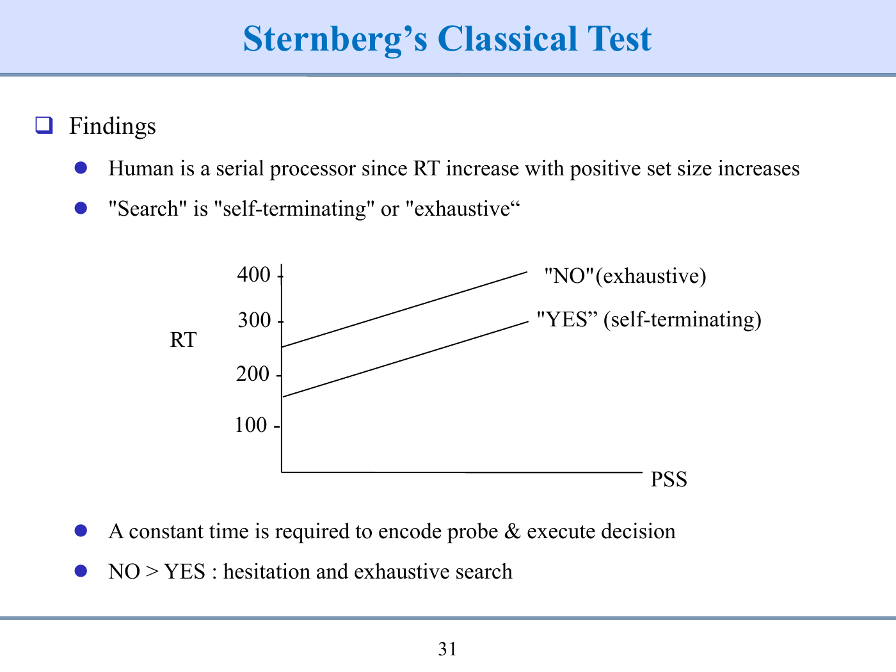

# 인터랙티브심리학 중간고사 · 단답형·서술형·R 코드 작성 문제

작성·검증일: 2026-10-17

총 106문항: 단답형 44 · 서술형 42 · R 코드 20.

1~6주차에 대해 기존 OX001–OX188 개념 목록과 대조한 자체 제작 문제은행이다. 이 전체 분량을 120분 실제 시험 한 회분으로 간주하지 않는다. 기출형 예상시험은 별도 120분·32문항·100점의 5회분으로 제공한다.

**답안 언어:** 교안에 영어로 제시한 용어의 명칭을 요구한 부분만 영문으로 쓴다. 정의·이유·계산·해석을 억지로 영어로 번역하지 않는다. 한글 명칭을 인정하는 문항은 문제에 표시했다. R 문법·함수·객체명은 제시 조건대로 작성한다.

**R 문항:** 실제 R 코드의 번호별 빈칸에 들어갈 코드를 작성한다. 출력·해석을 추가로 요구하는 경우 별도 답안에 작성한다. 빈칸별 해설과 완성 코드는 정답 문서에서 확인한다.

**풀이:** 모범답안은 [04_정답과_해설.md](04_정답과_해설.md)에 분리했다. 웹에서는 답안을 먼저 작성한 뒤 정답·채점 기준을 열고 항목별 부분점수와 이해도를 직접 체크한다.

## SA001 · 단답형 · 개론·역사 · 3점

고객 생애주기(Customer Life Cycle)에 따라 제품을 사용하기 전, 사용하는 도중, 사용한 후의 세 시점을 나타내는 사용자 경험(UX Scope)의 영문 명칭 세 가지를 순서대로 적으시오.

답안 표기: 강의 영문 용어만 영어 표기. 설명은 한글로 작성.

[웹에서 이 문항 풀기](index.html?view=problems&question=SA001)

## SA002 · 단답형 · 개론·역사 · 4점

사용자 경험(UX) 중 브랜드 경험(Brand Experience)을 구성하는 네 가지 하위 요소(인지도·태도·윤리·충성도)의 영문 명칭을 적으시오.

답안 표기: 강의 영문 용어만 영어 표기. 설명은 한글로 작성.

[웹에서 이 문항 풀기](index.html?view=problems&question=SA002)

## SA003 · 단답형 · 개론·역사 · 3점

사용자 경험(UX) 중 제품·서비스 경험(Product/Service Experience)을 구성하는 세 가지 핵심 요소(감성·사용성·사용자 가치)의 영문 명칭을 적으시오.

답안 표기: 강의 영문 용어만 영어 표기. 설명은 한글로 작성.

[웹에서 이 문항 풀기](index.html?view=problems&question=SA003)

## SA004 · 단답형 · 개론·역사 · 4점

Ergonomics를 이루는 두 어원 표기와 각각의 뜻을 적으시오. 뜻은 한글로 써도 된다.

답안 표기: 강의 영문 용어만 영어 표기. 설명은 한글로 작성.

[웹에서 이 문항 풀기](index.html?view=problems&question=SA004)

## SA005 · 단답형 · 개론·역사 · 3점

Frank & Lillian Gilbreth 부부가 시간 및 동작 연구(Time & Motion study)의 미세동작분석에서 고안한 18가지 기본 손동작 단위의 영문 명칭을 쓰고, 무엇을 분석하는 단위인지 한글 한 구절로 적으시오.

답안 표기: 강의 영문 용어만 영어 표기. 설명은 한글로 작성.

[웹에서 이 문항 풀기](index.html?view=problems&question=SA005)

## SA006 · 단답형 · 개론·역사 · 4점

인간공학(HFE)의 세부 영역 중 (가) 인체측정·생리·생체역학적 특성을 다루는 영역과 (나) 지각·기억·추론·운동반응 등 정신 과정을 다루는 영역의 영문 명칭을 각각 적으시오.

답안 표기: 강의 영문 용어만 영어 표기. 설명은 한글로 작성.

[웹에서 이 문항 풀기](index.html?view=problems&question=SA006)

## SA007 · 단답형 · HFE 연구방법론 · 3점

인간공학 연구의 3대 유형 중 (가) 성인의 손 치수·근력 분포를 측정·기술하는 연구, (나) 독립변수(화면 방향 등)를 조작해 종속변수(가독성 등) 효과를 검증하는 연구, (다) 완성된 제품의 효과성·사용성을 평가하는 연구의 영문 명칭을 각각 적으시오.

답안 표기: 강의 영문 용어만 영어 표기. 설명은 한글로 작성.

[웹에서 이 문항 풀기](index.html?view=problems&question=SA007)

## SA008 · 단답형 · HFE 연구방법론 · 4점

연구 환경(Research Settings) 중 (가) 외생변수 통제·반복 측정·정밀 데이터 확보에 유리한 환경과 (나) 실제 사용 맥락·높은 현실 충실도·일반화에 유리한 환경의 영문 명칭을 각각 쓰시오.

답안 표기: 강의 영문 용어만 영어 표기. 설명은 한글로 작성.

[웹에서 이 문항 풀기](index.html?view=problems&question=SA008)

## SA009 · 단답형 · HFE 연구방법론 · 4점

실험 설계에서 (가) 연구자가 의도적으로 조작하는 요인, (나) 그에 따라 측정되는 결과 변수, (다) 기타 외생변수의 조건을 하나로 고정하는 처리, (라) 모집단의 계층(성별·연령 등) 비율에 맞춰 표본을 배정하는 방법의 영문 용어를 각각 쓰시오.

답안 표기: 강의 영문 용어만 영어 표기. 설명은 한글로 작성.

[웹에서 이 문항 풀기](index.html?view=problems&question=SA009)

## SA010 · 단답형 · HFE 연구방법론 · 2점

연구 측정 기준의 6대 실무 요건(Objective, Quantitative 등) 중 “측정 장치나 절차가 작업자의 자연스러운 과업 수행을 방해하지 않아야 한다”는 요건을 뜻하는 영문 한 단어를 쓰시오.

답안 표기: 강의 영문 용어만 영어 표기. 설명은 한글로 작성.

[웹에서 이 문항 풀기](index.html?view=problems&question=SA010)

## SA011 · 단답형 · HFE 연구방법론 · 4점

측정 품질의 지표 중 (가) 반복 측정했을 때 측정값이 일관되고 안정적으로 나오는 정도와 (나) 측정값이 참값(목표 중심)에 가까운 정도를 뜻하는 영문 용어를 각각 쓰시오.

답안 표기: 강의 영문 용어만 영어 표기. 설명은 한글로 작성.

[웹에서 이 문항 풀기](index.html?view=problems&question=SA011)

## SA012 · 단답형 · HFE 연구방법론 · 3점

타당도(Validity)의 세 유형 중 (가) 실험 내 혼동변수(Confounding) 없이 결과를 독립변수 효과로 귀속할 수 있는 정도, (나) 연구 결과를 다른 집단·실제 환경으로 일반화할 수 있는 정도, (다) 측정 도구가 목표 구성개념을 충실히 측정하는 정도의 영문 명칭을 각각 쓰시오.

답안 표기: 강의 영문 용어만 영어 표기. 설명은 한글로 작성.

[웹에서 이 문항 풀기](index.html?view=problems&question=SA012)

## SA013 · 단답형 · HFE 연구방법론 · 4점

구성타당도(Construct Validity) 저하 요인 중 (가) 측정하려는 이론적 구성개념의 일부가 실제 측정에서 누락된 것과 (나) 구성개념과 무관한 외부 요소가 측정치에 섞여 들어간 것을 뜻하는 영문 용어를 각각 쓰시오.

답안 표기: 강의 영문 용어만 영어 표기. 설명은 한글로 작성.

[웹에서 이 문항 풀기](index.html?view=problems&question=SA013)

## SA014 · 단답형 · HFE 연구방법론 · 3점

키 180 cm, 체중 81 kg인 사람의 BMI와, 상위 25%의 경계에 해당하는 백분위수를 각각 구하시오.

답안 표기: 한글·수식·수치·단위로 작성.

[웹에서 이 문항 풀기](index.html?view=problems&question=SA014)

## SA015 · 단답형 · HFE 연구방법론 · 3점

파일럿 5명, 평균 100, \(s = 10\), \(z = 1.96\), \(k = 0.05\)다. \(n=\left(\frac{zs}{k\bar{x}}\right)^2\)로 총 인원과 추가 모집 인원을 구하시오. 파일럿도 최종 표본에 포함한다.

답안 표기: 한글·수식·수치·단위로 작성.

[웹에서 이 문항 풀기](index.html?view=problems&question=SA015)

## SA016 · 단답형 · HFE 연구방법론 · 3점

표본 SD가 12이고 \(n = 36\)이다. 평균의 SE를 구하고 SD와 각각 무엇을 나타내는지 한글로 짧게 적으시오.

답안 표기: 한글·수식·수치·단위로 작성.

[웹에서 이 문항 풀기](index.html?view=problems&question=SA016)

## SA017 · 단답형 · 정보량·중복도 · 3점

감각 입력 이후 지각→결정·반응선택→반응실행의 세 단계 명칭을 정보처리 모형의 영어 표기로 쓰시오.

답안 표기: 강의 영문 용어만 영어 표기. 설명은 한글로 작성.

[웹에서 이 문항 풀기](index.html?view=problems&question=SA017)

## SA018 · 단답형 · 정보량·중복도 · 4점

인간 정보처리 모형(Information Processing Model)에서 (가) 시연이 없을 때 약 20~30초간 정보를 유지·처리하는 기억, (나) 지식과 경험을 장기 저장하는 기억, (다) 지각·결정·실행 등 여러 처리 단계에 배분되는 정신적 자원, (라) 반응 실행의 결과가 다시 감각 입력으로 되돌아가는 연결의 영문 표기를 각각 쓰시오.

답안 표기: 강의 영문 용어만 영어 표기. 설명은 한글로 작성.

[웹에서 이 문항 풀기](index.html?view=problems&question=SA018)

## SA019 · 단답형 · 정보량·중복도 · 3점

등확률 대안 16개의 정보량과, 대안이 32개가 되었을 때 증가한 정보량을 구하시오.

답안 표기: 한글·수식·수치·단위로 작성.

[웹에서 이 문항 풀기](index.html?view=problems&question=SA019)

## SA020 · 단답형 · 정보량·중복도 · 3점

두 사건의 발생 확률이 0.2·0.8이고 \(\log_2 5 = 2.322\), \(\log_2 1.25 = 0.322\)다. Shannon 평균 정보량 \(H\)와 등확률 최대 정보량(\(H_{\max}=\log_2 2=1\) bit) 대비 중복도(% Redundancy)를 구하시오.

답안 표기: 한글·수식·수치·단위로 작성.

[웹에서 이 문항 풀기](index.html?view=problems&question=SA020)

## SA021 · 단답형 · 정보량·중복도 · 3점

중복도 공식 \(\%\text{Redundancy} = (1 - H/H_{\max})\times 100\)을 적용하여 (가) 휜 동전 \(H = 0.468\) bit, \(H_{\max} = 1\) bit (나) 경고등 8종(\(H_{\max} = \log_2 8 = 3\) bits) \(H = 2.3568\) bits일 때 각각의 중복도를 구하시오.

답안 표기: 한글·수식·수치·단위로 작성.

[웹에서 이 문항 풀기](index.html?view=problems&question=SA021)

## SA022 · 단답형 · 정보전달·기억·Hick · 4점

정보전달이론에서 (가) 입력 정보 중 출력으로 전달되지 못하고 손실된 불확실성 \(H\left(X\mid Y\right)\)와 (나) 입력과 무관하게 출력에 끼어든 조건부 불확실성 \(H\left(Y\mid X\right)\)의 영문 명칭을 각각 적고, 전달정보량 \(I(X;Y)\) 공식을 쓰시오.

답안 표기: 강의 영문 용어만 영어 표기. 설명은 한글로 작성.

[웹에서 이 문항 풀기](index.html?view=problems&question=SA022)

## SA023 · 단답형 · 정보전달·기억·Hick · 4점

등확률 이항 입력에서 (가) 모든 반응 라벨을 항상 반대로 답함 (나) 항상 한 반응만 답함의 전달정보량을 구하시오.

답안 표기: 한글·수식·수치·단위로 작성.

[웹에서 이 문항 풀기](index.html?view=problems&question=SA023)

## SA024 · 단답형 · 정보전달·기억·Hick · 3점

작업기억 및 판단 지원 전략 중 (가) 정보를 속으로 되뇌어 기억 유지 시간을 늘리는 것, (나) 기억 속 기준과 단독 비교하는 절대 판단 대신 두 자극을 나란히 직접 비교하게 하는 것, (다) 개별 항목들을 기존 장기기억 지식과 연결해 의미 있는 묶음 단위로 구성하는 것의 영문 용어를 각각 쓰시오.

답안 표기: 강의 영문 용어만 영어 표기. 설명은 한글로 작성.

[웹에서 이 문항 풀기](index.html?view=problems&question=SA024)

## SA025 · 단답형 · 정보전달·기억·Hick · 2점

Sternberg 과제에서 검사 항목과 기억집합 크기를 나타내는 표기 두 가지를 쓰시오.

답안 표기: 강의 영문 용어만 영어 표기. 설명은 한글로 작성.

[웹에서 이 문항 풀기](index.html?view=problems&question=SA025)

## SA026 · 단답형 · 정보전달·기억·Hick · 4점

Sternberg 기억탐색 과제에서 (가) 목표 항목을 찾는 즉시 비교를 멈추는 탐색 방식과 (나) 목표를 찾더라도 기억집합의 끝까지 모두 비교한 뒤 응답하는 탐색 방식의 영문 표현을 순서대로 쓰시오.

답안 표기: 강의 영문 용어만 영어 표기. 설명은 한글로 작성.

[웹에서 이 문항 풀기](index.html?view=problems&question=SA026)

## SA027 · 단답형 · 정보전달·기억·Hick · 4점

Donders \(A = 200\), \(C = 260\), \(B = 350\) ms다. 단계 가정 아래 자극 식별 시간과 반응 선택 시간을 구하시오.

답안 표기: 한글·수식·수치·단위로 작성.

<figure class="visual-box"><figcaption>Donders 과업의 실측 시간 — 인지 단계는 직접 판별</figcaption><div class="table-scroll"><table><thead><tr><th>과업</th><th>제시 자극</th><th>가능 반응</th><th>RT(ms)</th></tr></thead><tbody><tr><td>A</td><td>1종</td><td>1종</td><td>200</td></tr><tr><td>C</td><td>여러 종</td><td>특정 자극에만 1종</td><td>260</td></tr><tr><td>B</td><td>여러 종</td><td>각 자극마다 다른 반응</td><td>350</td></tr></tbody></table></div></figure>

[웹에서 이 문항 풀기](index.html?view=problems&question=SA027)

## SA028 · 단답형 · 정보전달·기억·Hick · 4점

Hick 모형 \(\mathrm{RT} = 200 + 150\,H\)(ms, 단 \(H = \log_2 N\))일 때 등확률 4개·8개 대안의 예측 RT(ms)와 기울기 역수(\(1/b\))의 초당 정보처리율(bits/s)을 구하시오.

답안 표기: 한글·수식·수치·단위로 작성.

[웹에서 이 문항 풀기](index.html?view=problems&question=SA028)

## SA029 · 단답형 · 정보전달·기억·Hick · 3점

Hick의 법칙 \(\mathrm{RT} = a + bH\)에서 절편 \(a\)에 영향을 주는 요인 중 ① 감각 자극 양식(촉각, 청각, 시각)을 반응이 빠른 순서로 배열하고, ② 반응 기관 양식(눈, 손, 발)을 반응이 빠른 순서로 배열하며, ③ 시간적 불확실성이 큰 ‘완전히 예상하지 못한 사건’의 절편 \(a\) 대표 수치(ms)를 적으시오. (한글 답안 인정)

답안 표기: 한글·수식·수치·단위로 작성.

[웹에서 이 문항 풀기](index.html?view=problems&question=SA029)

## SA030 · 단답형 · Fitts·운동·양립성 · 3점

Fitts가 1954년에 제안한 원형 난이도 지수(ID) 공식과 국제표준(ISO 9241-9, Shannon형) 난이도 지수(ID) 공식을 각각 적고, 거리(\(A, D\))와 표적 너비(\(W\))의 단위 조건을 쓰시오.

답안 표기: 한글·수식·수치·단위로 작성.

[웹에서 이 문항 풀기](index.html?view=problems&question=SA030)

## SA031 · 단답형 · Fitts·운동·양립성 · 3점

ISO형 \(\mathrm{MT} = 50 + 150\,\log_2 \left(\frac{D}{W} + 1\right)\) ms에서 \(D = 80\),\(W = 20\) 및 \(D = 100\),\(W = 10\)의 MT를 각각 구하시오. \(\log_2 5 = 2.3219\), \(\log_2 11 = 3.4594\)다.

답안 표기: 한글·수식·수치·단위로 작성.

<figure class="visual-box"><figcaption>같은 시작점에서 두 표적으로 이동 — 거리와 너비의 전체 비교</figcaption><svg role="img" aria-label="같은 시작점에서 두 표적으로 이동 — 거리와 너비의 전체 비교" viewBox="0 0 600 220" xmlns="http://www.w3.org/2000/svg"><circle cx="45" cy="65" r="6" fill="#333"/><circle cx="45" cy="145" r="6" fill="#333"/><path d="M55 65H365M55 145H445" stroke="#7c8fa6" stroke-width="2"/><rect x="325" y="40" width="80" height="50" fill="#c4cfdb"/><rect x="425" y="120" width="40" height="50" fill="#c4cfdb"/><text x="65" y="32">(가) D=80, W=20</text><text x="65" y="112">(나) D=100, W=10</text><text x="65" y="195">공통: a=50 ms, b=150 ms/bit, ISO형</text></svg></figure>

[웹에서 이 문항 풀기](index.html?view=problems&question=SA031)

## SA032 · 단답형 · Fitts·운동·양립성 · 4점

운동 제어(Motor Control)에서 (가) 시각 등 감각 피드백을 실시간으로 받아 목표 근처 오차를 교정하는 운동과 (나) 실행 중 피드백 교정 없이 사전 계획대로 빠르게 실행하는 운동의 영문 명칭 및 제어 회로(Open/Closed loop) 유형을 각각 적으시오.

답안 표기: 강의 영문 용어만 영어 표기. 설명은 한글로 작성.

[웹에서 이 문항 풀기](index.html?view=problems&question=SA032)

## SA033 · 단답형 · Fitts·운동·양립성 · 4점

운동 제어의 범위 효과(Range effect)에서 짧은 이동거리(short distance)와 긴 이동거리(long distance)일 때 나타나는 대표적 도달 오류 경향을 각각 영문 용어로 쓰시오.

답안 표기: 강의 영문 용어만 영어 표기. 설명은 한글로 작성.

[웹에서 이 문항 풀기](index.html?view=problems&question=SA033)

## SA034 · 단답형 · Fitts·운동·양립성 · 4점

제어장치와 표시장치 설계에서 (가) 특정 인구 집단이 공통으로 가지고 있는 조작–표시 기대와 (나) 사물의 형태가 특정 행동을 직관적으로 유도하는 성질을 뜻하는 영문 용어를 각각 쓰시오.

답안 표기: 강의 영문 용어만 영어 표기. 설명은 한글로 작성.

[웹에서 이 문항 풀기](index.html?view=problems&question=SA034)

## SA035 · 단답형 · Fitts·운동·양립성 · 4점

제어–표시 양립성(Compatibility)의 4가지 유형 중 (가) 가스레인지 화구와 조절 노브의 물리적 배열 일치, (나) 다이얼 회전 방향과 눈금 이동 방향의 일치, (다) 온수에 빨간색·냉수에 파란색을 부여하는 의미적 연상 일치, (라) 음성 지시에 음성으로 응답하는 감각-반응 양식 일치의 영문 명칭을 각각 쓰시오.

답안 표기: 강의 영문 용어만 영어 표기. 설명은 한글로 작성.

[웹에서 이 문항 풀기](index.html?view=problems&question=SA035)

## SA036 · 단답형 · 기초통계·T검정 · 3점

한 집단과 기준값 비교, 서로 다른 독립 집단 비교, 같은 대상 전후 비교에 맞는 t-검정 명칭을 쓰시오. 이 문항은 한글 명칭을 인정한다.

답안 표기: 한글·수식·수치·단위로 작성.

[웹에서 이 문항 풀기](index.html?view=problems&question=SA036)

## SA037 · 단답형 · 기초통계·T검정 · 4점

\(a = \left(2, 4, 6\right)\)의 표본평균·중앙값·표본분산·표준편차를 구하시오. 단위는 cm다.

답안 표기: 한글·수식·수치·단위로 작성.

[웹에서 이 문항 풀기](index.html?view=problems&question=SA037)

## SA038 · 단답형 · 회귀·실험실습 · 3점

단순선형회귀에서 표본평균 \(\bar{x} = 2\), \(\bar{y} = 5\)이고 편차제곱합 \(S_{xx} = 2\), 편차교차곱합 \(S_{xy} = 4\)다. 최소제곱(OLS) 기울기 \(b_1 = S_{xy}/S_{xx}\), 절편 \(b_0 = \bar{y} - b_1\bar{x}\)와 \(x = 4\)일 때의 예측값 \(\hat{y}\)를 구하시오.

답안 표기: 한글·수식·수치·단위로 작성.

[웹에서 이 문항 풀기](index.html?view=problems&question=SA038)

## SA039 · 단답형 · 회귀·실험실습 · 5점

절편 포함 단순 OLS에서 \(n = 12\), \(\mathrm{SST} = 100\), \(\mathrm{SSE} = 30\)이다. SSR·잔차 자유도·MSE·F·\(R^2\)를 구하시오.

답안 표기: 한글·수식·수치·단위로 작성.

[웹에서 이 문항 풀기](index.html?view=problems&question=SA039)

## SA040 · 단답형 · 기초통계·T검정 · 3점

RStudio에서 선택 코드를 실행하는 단축키, 스크립트 기본 확장자, 객체 목록을 확인하는 창을 쓰시오. 창 이름만 화면 영어 표기로 적으시오.

답안 표기: 강의 영문 용어만 영어 표기. 설명은 한글로 작성.

[웹에서 이 문항 풀기](index.html?view=problems&question=SA040)

## SA041 · 단답형 · 회귀·실험실습 · 3점

등확률 대안 \(N = 1\)·2·4의 H(bit)를 쓰고, 회귀 \(p = 0.16\)·\(R^{2} = 0.03\)을 \(\alpha = 0.05\)에서 한 문장으로 판독하시오.

답안 표기: 한글·수식·수치·단위로 작성.

<figure class="visual-box analysis-material"><figcaption>SRT·CRT 수업 실습 예시 · 등확률 대안과 회귀 요약</figcaption><div class="table-scroll"><table><thead><tr><th scope="col">항목</th><th scope="col">제시자료</th></tr></thead><tbody><tr><td>등확률 대안 수 N</td><td>1, 2, 4</td></tr><tr><td>반응변수</td><td>Time (ms)</td></tr><tr><td>설명변수</td><td>\(H=\log_2 N\) (bit)</td></tr><tr><td>추정식</td><td>\(\widehat{\mathrm{Time}}=424+78H\)</td></tr><tr><td>모형 p-value</td><td>0.16</td></tr><tr><td>Multiple R-squared</td><td>0.03</td></tr><tr><td>판정 유의수준 α</td><td>0.05</td></tr></tbody></table></div><p class="analysis-note">실습 전사에 주어진 요약값이다. 아래 Sternberg 로그와는 별개의 분석이며, 원자료가 없는 이 회귀를 로그 4행에서 산출한 것으로 간주하지 않는다.</p></figure>

[웹에서 이 문항 풀기](index.html?view=problems&question=SA041)

## SA042 · 단답형 · 회귀·실험실습 · 4점

집합 {2,5,8}, Probe=4, User Input=False, T/F=True, Time=620 ms다. YES/NO 조건·정오·PSS를 적으시오. TimeOut의 Time=5000도 초로 바꾸시오.

답안 표기: 한글·수식·수치·단위로 작성.

<figure class="visual-box"><figcaption>Sternberg 로그 두 시행 — Time 단위 ms</figcaption><div class="table-scroll"><table><thead><tr><th>집합</th><th>Probe</th><th>User Input</th><th>T/F</th><th>Time</th></tr></thead><tbody><tr><td>2,5,8</td><td>4</td><td>False</td><td>True</td><td>620</td></tr><tr><td>2,5,8</td><td>7</td><td>TimeOut</td><td>False</td><td>5000</td></tr></tbody></table></div></figure>

[웹에서 이 문항 풀기](index.html?view=problems&question=SA042)

## SA043 · 단답형 · 개론·역사 · 3점

제시된 Windows 95 보충영상 사례에서 DOS 명령어 입력과 Start 버튼·아이콘 선택을 회상·재인으로 구별하시오. 이어 영상 속 PC의 물리·전원 제약 한 가지와 통신·접속 제약 한 가지를 쓰시오.

답안 표기: 한글·수식·수치·단위로 작성.

<figure class="visual-box analysis-material"><figcaption>보충영상 1 · 자막에서 확인한 사례</figcaption><div class="table-scroll"><table><thead><tr><th>구간</th><th>영상에서 확인한 사례</th></tr></thead><tbody><tr><td>00:49–01:18</td><td>본체와 모니터 전원을 혼동하며 PC를 켠다.</td></tr><tr><td>03:19–04:39</td><td>브라우저 실행 후 연결에 실패하고 전화선 모뎀·AOL 절차를 설명받는다.</td></tr><tr><td>04:41–05:42</td><td>진행자가 Start 버튼과 이전 DOS의 명령어 입력 방식을 대비해 설명한다.</td></tr><tr><td>07:25–08:00</td><td>종료 안내 후 수동으로 전원을 끈다.</td></tr></tbody></table></div></figure>

[웹에서 이 문항 풀기](index.html?view=problems&question=SA043)

## SA044 · 단답형 · 개론·역사 · 3점

제시된 Gen Z Vs Old Technology 사례에서 Nokia에 시도한 현대식 조작 두 가지를 적고, 플로피·VHS·키패드 조작의 어려움을 이전 경험과 행동유도성 또는 집단 기대의 관점에서 설명하시오.

답안 표기: 한글·수식·수치·단위로 작성.

<figure class="visual-box analysis-material"><figcaption>보충영상 2 · 자막에서 확인한 사례</figcaption><div class="table-scroll"><table><thead><tr><th>구간</th><th>영상에서 확인한 사례</th></tr></thead><tbody><tr><td>00:20–03:20</td><td>VHS의 용도와 물리 매체 사용·보관을 낯설어한다.</td></tr><tr><td>03:37–05:42</td><td>Nokia 화면 터치와 음성 호출을 시도하고 숫자 키패드 문자 입력을 어려워한다.</td></tr><tr><td>06:04–07:24</td><td>플로피의 화살표로 삽입 용도는 추측하지만 매체의 정체는 바로 알지 못한다.</td></tr></tbody></table></div></figure>

[웹에서 이 문항 풀기](index.html?view=problems&question=SA044)

## ES001 · 서술형 · 개론·역사 · 6점

쇼핑 앱의 UX를 결제 버튼 조작시간만으로 평가했다. ① 빠진 시간 범위와 맥락 ② 브랜드·제품 경험 지표 ③ UX 심리학의 학문적 접근을 설명하시오.

답안 표기: 한글·수식·수치·단위로 작성.

[웹에서 이 문항 풀기](index.html?view=problems&question=ES001)

## ES002 · 서술형 · 개론·역사 · 5점

패스 횟수를 세던 사람이 시야 중앙의 고릴라를 놓쳤다. ① 이 결과가 보여 주는 주의 특성 ② 관제 화면 설계에 적용할 조치 두 가지 ③ 실험이 입증하지 않는 주장을 쓰시오.

답안 표기: 한글·수식·수치·단위로 작성.

[웹에서 이 문항 풀기](index.html?view=problems&question=ES002)

## ES003 · 서술형 · 개론·역사 · 10점

UX의 역사적 진화 3단계(Dark Ages·Proto UX·UX Gold Rush)와 인간공학(HFE)의 역사 3시기(Old Age·Middle/Modern Age·Information Age)를 구분해 서술하시오. 각 시기의 대표 주제를 붙이고, 전문 학문 탄생기(1945~1960)와 급성장기(1960~1980)를 구별하며, 전문 학문 탄생기에 설립된 대표 기관·학회 예를 두 가지 이상 쓰고 최근의 핵심 연구 주제 하나를 덧붙이시오.

답안 표기: 한글·수식·수치·단위로 작성.

[웹에서 이 문항 풀기](index.html?view=problems&question=ES003)

## ES004 · 서술형 · 개론·역사 · 6점

인간공학의 정의를 목표·대상 특성·설계 적용의 관점에서 설명하시오. 지식 기반을 신체·정신·사회로 나누고, 유럽·미국·미군·미국 심리학계 명칭을 연결하시오.

답안 표기: 한글·수식·수치·단위로 작성.

[웹에서 이 문항 풀기](index.html?view=problems&question=ES004)

## ES005 · 서술형 · 개론·역사 · 6점

(가) 기존 장비에 맞는 사람을 선발·훈련 (나) 그립 홈·당김 손잡이를 추가한 플러그를 비교하시오. 각각의 철학과 관련 HFE 특성을 설명하고, Gilbreth 연구가 어느 역사적 맥락에 놓이는지 쓰시오.

답안 표기: 한글·수식·수치·단위로 작성.

[웹에서 이 문항 풀기](index.html?view=problems&question=ES005)

## ES006 · 서술형 · HFE 연구방법론 · 7점

새 주방 손잡이를 개발한다. 기술·실험·평가 연구가 연결되는 흐름을 제시하시오. 보충 손잡이 논문의 네 단계는 원문 단계명으로 적고, 시제품 평가를 어디에 연결할지도 설명하시오.

답안 표기: 한글·수식·수치·단위로 작성.

[웹에서 이 문항 풀기](index.html?view=problems&question=ES006)

## ES007 · 서술형 · HFE 연구방법론 · 7점

스마트글래스 네 위치의 코 하중 평균은 0.34·0.22·0.20·0.16 N이며 오차막대는 SE다. 청소기 A·B·C 평가의 오차막대는 SD다. 청소기는 A가 가장 높은 사용성 평가를 받았다. 두 연구의 목적·IV/DV·오차막대 의미와 A 모델 장점을 비교하시오.

답안 표기: 한글·수식·수치·단위로 작성.

<figure class="visual-box"><figcaption>무게 위치 4조건과 코 하중 평균 (N) — 오차막대의 의미는 지문에 제시</figcaption><svg role="img" aria-label="무게 위치 4조건과 코 하중 평균 (N) — 오차막대의 의미는 지문에 제시" viewBox="0 0 600 180" xmlns="http://www.w3.org/2000/svg"><path d="M50 20V145H575" fill="none" stroke="#777"/><rect x="80" y="42.999999999999986" width="65" height="102.00000000000001" fill="#c4cfdb"/><text x="112" y="34.999999999999986" text-anchor="middle">0.34</text><text x="112" y="170" text-anchor="middle">Front</text><rect x="205" y="79.0" width="65" height="66.0" fill="#c4cfdb"/><text x="237" y="71.0" text-anchor="middle">0.22</text><text x="237" y="170" text-anchor="middle">Middle</text><rect x="330" y="85.0" width="65" height="60.0" fill="#c4cfdb"/><text x="362" y="77.0" text-anchor="middle">0.20</text><text x="362" y="170" text-anchor="middle">Ear</text><rect x="455" y="97.0" width="65" height="48.0" fill="#c4cfdb"/><text x="487" y="89.0" text-anchor="middle">0.16</text><text x="487" y="170" text-anchor="middle">Rear</text></svg></figure><figure class="visual-box"><figcaption>청소기 비교 조건</figcaption><div class="table-scroll"><table><thead><tr><th>모델</th><th>연장관 무게</th><th>방향 화살표</th><th>완료 청각 피드백</th><th>오차막대</th></tr></thead><tbody><tr><td>A</td><td>290 g</td><td>제공</td><td>제공</td><td>SD</td></tr><tr><td>B</td><td>513 g</td><td>미제시</td><td>미제시</td><td>SD</td></tr><tr><td>C</td><td>545 g</td><td>미제시</td><td>미제시</td><td>SD</td></tr></tbody></table></div></figure>

[웹에서 이 문항 풀기](index.html?view=problems&question=ES007)

## ES008 · 서술형 · HFE 연구방법론 · 6점

실험실에서 개선된 입력 UI를 실제 병원으로 가져갈 계획이다. 실험실·현장 연구의 장단점을 각각 두 가지 이상 제시하고 두 환경의 결과가 다를 때 확인할 사항을 쓰시오.

답안 표기: 한글·수식·수치·단위로 작성.

[웹에서 이 문항 풀기](index.html?view=problems&question=ES008)

## ES009 · 서술형 · HFE 연구방법론 · 6점

왼손잡이 10%인 모집단의 마우스 연구를 설계하시오. IV/DV, 기타 변수 처리, 대표성, 지표 목표 적합성과 포괄성, DV 세 측면을 포함하시오.

답안 표기: 한글·수식·수치·단위로 작성.

[웹에서 이 문항 풀기](index.html?view=problems&question=ES009)

## ES010 · 서술형 · HFE 연구방법론 · 6점

\(n=\left(\frac{zs}{k\bar{x}}\right)^2\)에서 다른 값은 고정한다. α를 낮춤, s를 두 배로 함, k를 절반으로 함의 효과를 각각 설명하시오. 마지막 두 변경을 동시에 하면 n은 몇 배인가?

답안 표기: 한글·수식·수치·단위로 작성.

[웹에서 이 문항 풀기](index.html?view=problems&question=ES010)

## ES011 · 서술형 · HFE 연구방법론 · 6점

센서값이 매번 비슷하지만 참값보다 10 높고, 측정 장치 때문에 작업자가 자세를 바꾼다. 두 문제를 구분해 진단하고 개선안을 제시하시오. 실무 측정 요건도 쓰시오.

답안 표기: 한글·수식·수치·단위로 작성.

[웹에서 이 문항 풀기](index.html?view=problems&question=ES011)

## ES012 · 서술형 · HFE 연구방법론 · 6점

새 UI에는 전문가, 기존 UI에는 초보자만 배정했다. 사용성은 속도만 측정했고 브랜드 호감이 점수에 섞였으며 다른 연령층에도 일반화했다. 각 문제와 대응책을 설명하시오.

답안 표기: 한글·수식·수치·단위로 작성.

[웹에서 이 문항 풀기](index.html?view=problems&question=ES012)

## ES013 · 서술형 · 정보량·중복도 · 6점

경고음을 듣고 의미를 판단해 정지 버튼을 누르는 과정을 정보처리 모형으로 설명하시오. 감각저장·지각·선택·실행, 두 기억, 주의 자원과 피드백을 모두 포함하시오.

답안 표기: 한글·수식·수치·단위로 작성.

[웹에서 이 문항 풀기](index.html?view=problems&question=ES013)

## ES014 · 서술형 · 정보량·중복도 · 6점

등확률 정보량(Hartley)과 비등확률 평균 정보량(Shannon)을 구별하여 공식·단위를 쓰시오. 등확률 대안 수가 두 배일 때의 정보량 변화와 확률 0인 항의 처리 규칙을 설명하고, 두 사건 확률이 0.2·0.8인 예제(단, \(\log_2 5 \approx 2.322, \log_2 1.25 \approx 0.322\))의 평균 정보량과 중복도를 검산하시오.

답안 표기: 한글·수식·수치·단위로 작성.

[웹에서 이 문항 풀기](index.html?view=problems&question=ES014)

## ES015 · 서술형 · 정보량·중복도 · 5점

이항 사건의 앞면 확률 p에 따른 엔트로피 곡선을 스케치하고 \(p = 0\),0.5,1의 값을 표시하시오. 공정한 동전과 휜 동전의 중복도를 비교하시오. 휜 동전 H는 0.468로 주어진다.

답안 표기: 한글·수식·수치·단위로 작성.

[웹에서 이 문항 풀기](index.html?view=problems&question=ES015)

## ES016 · 서술형 · 정보량·중복도 · 5점

경고등 8종(\(H_{\max} = \log_2 8 = 3\) bits)의 발생 확률이 (0.35, 0.35, 0.05, 0.05, 0.05, 0.05, 0.05, 0.05)다. 평균 정보량 \(H = 2.3568\) bits가 주어질 때 중복도 \((1 - H/H_{\max})\times 100\)를 구하고, 확률 분포가 그대로일 때 자주 발생하는 경고를 시각적으로 크게 표시하면 Shannon 엔트로피 \(H\)가 반드시 더 줄어든다는 주장을 평가하시오. 시각적 강조 효과를 평가할 수행 지표를 한 가지 이상 제안하시오.

답안 표기: 한글·수식·수치·단위로 작성.

[웹에서 이 문항 풀기](index.html?view=problems&question=ES016)

## ES017 · 서술형 · 정보량·중복도 · 5점

신호등 설계 비교에서 언제 바뀔지 모르는 기존 신호등(바뀜·안 바뀜 2대안 등확률 가정)과 잔여 시간을 정확히 알려 주어 변경 시점이 확정되는 카운트다운 신호등의 정보량(\(H\)) 및 중복도(% Redundancy)를 각각 계산하고, 실제 교통 환경에 적용할 때 이 단순화 모형의 전제 조건·한계를 쓰시오.

답안 표기: 한글·수식·수치·단위로 작성.

[웹에서 이 문항 풀기](index.html?view=problems&question=ES017)

## ES018 · 서술형 · 정보전달·기억·Hick · 7점

16회 시행에서 \(\left(X, Y\right) = \left(1, 1\right)\),(2,1),(3,3),(4,4)가 각각 4회다. 주변·결합 확률을 구해 \(H\left(X\right)\), \(H\left(Y\right)\), \(H\left(X, Y\right)\), I, Equivocation, Noise를 계산하시오. 결합 엔트로피의 상한도 쓰시오.

답안 표기: 한글·수식·수치·단위로 작성.

<figure class="visual-box"><figcaption>16회 시행 혼동행렬 — 행: 자극 X / 열: 반응 Y</figcaption><div class="table-scroll"><table><thead><tr><th>X \ Y</th><th>1</th><th>2</th><th>3</th><th>4</th></tr></thead><tbody><tr><td>1</td><td>4</td><td>0</td><td>0</td><td>0</td></tr><tr><td>2</td><td>4</td><td>0</td><td>0</td><td>0</td></tr><tr><td>3</td><td>0</td><td>0</td><td>4</td><td>0</td></tr><tr><td>4</td><td>0</td><td>0</td><td>0</td><td>4</td></tr></tbody></table></div></figure>

[웹에서 이 문항 풀기](index.html?view=problems&question=ES018)

## ES019 · 서술형 · 정보전달·기억·Hick · 6점

입력은 두 자극이 등확률이다. 반응 A는 항상 반대 라벨, 반응 B는 어떤 입력에도 같은 라벨이다. 의미상 정답률과 전달정보량을 비교하고, 정확도와 전달량을 함께 봐야 하는 이유를 설명하시오.

답안 표기: 한글·수식·수치·단위로 작성.

<figure class="visual-box"><figcaption>두 반응 방식의 전체 빈도 — 입력 각4회</figcaption><div class="table-scroll"><table><thead><tr><th>입력</th><th>A:Y=1</th><th>A:Y=2</th><th>B:Y=1</th><th>B:Y=2</th></tr></thead><tbody><tr><td>1</td><td>0</td><td>4</td><td>4</td><td>0</td></tr><tr><td>2</td><td>4</td><td>0</td><td>4</td><td>0</td></tr></tbody></table></div></figure>

[웹에서 이 문항 풀기](index.html?view=problems&question=ES019)

## ES020 · 서술형 · 정보전달·기억·Hick · 6점

인간 정보처리 한계를 설명하는 네 가지 지표인 ① 감각-운동 과업의 채널 용량(약 \(2.8\text{ bits/s}\)), ② Miller의 마법의 숫자(\(7 \pm 2\)), ③ 단일 차원 자극별 절대 식별 한계(순음 약 5개, 밝기 3~5개 등), ④ 언어 처리 정보율(말하기 약 \(10\text{ bits/s}\) vs. 글 읽기 약 \(50\text{ bits/s}\))이 각각 어떤 한계와 특성을 뜻하는지 구별하여 서술하시오.

답안 표기: 한글·수식·수치·단위로 작성.

[웹에서 이 문항 풀기](index.html?view=problems&question=ES020)

## ES021 · 서술형 · 정보량·중복도 · 6점

긴 번호·작은 밝기 차이·복잡한 경고를 처리하는 화면을 개선한다. 시연, 상대 판단, 다차원 부호화, 청킹의 원리를 각각 설명하고 적용안을 제시하시오.

답안 표기: 한글·수식·수치·단위로 작성.

[웹에서 이 문항 풀기](index.html?view=problems&question=ES021)

## ES022 · 서술형 · 정보전달·기억·Hick · 6점

Sternberg 기억탐색 과제에서 기억집합 크기(PSS)와 반응시간(RT)의 관계, 검사 숫자(Probe)와 PSS의 정의, 두 가지 탐색 종료 방식(Self-terminating vs. Exhaustive)을 설명하시오. 또한 고전 실험 그래프의 YES/NO 반응시간 패턴과 실제 실험 로그 회귀분석 절차를 연결하되, 모든 탐색 과제의 보편 결론으로 과잉 일반화하지 않도록 구분해 서술하시오.

답안 표기: 한글·수식·수치·단위로 작성.

<figure class="visual-box analysis-material"><figcaption>Sternberg 교안의 YES·NO 설명 도식 · p.31</figcaption><a href="assets/question-data/information-processing-p31.png" target="_blank" rel="noopener"></a><p class="analysis-note">가로축 PSS는 기억집합 크기, 세로축 RT는 반응시간이다. 이 문항은 교안 도식의 설명을 해석한다. 모든 기억탐색 실험에서 같은 종료 방식이 입증된다는 뜻은 아니다.</p></figure><figure class="visual-box analysis-material"><figcaption>Sternberg 실제 로그 발췌 · 열 판독에 필요한 4행</figcaption><div class="table-scroll"><table><thead><tr><th scope="col">Index</th><th scope="col">Number Set</th><th scope="col">Number (Probe)</th><th scope="col">User Input</th><th scope="col">T/F</th><th scope="col">Time (ms)</th></tr></thead><tbody><tr><td>0</td><td>{2, 7, 5}</td><td>2</td><td>TimeOut</td><td>False</td><td>5000</td></tr><tr><td>1</td><td>{2, 6, 1}</td><td>2</td><td>True</td><td>True</td><td>1498</td></tr><tr><td>2</td><td>{1, 3, 4}</td><td>2</td><td>False</td><td>True</td><td>1201</td></tr><tr><td>13</td><td>{5, 3, 9}</td><td>3</td><td>False</td><td>False</td><td>812</td></tr></tbody></table></div><p class="analysis-note">출처: 10-17-12-44-53_num3.txt. Number Set은 기억집합, Number는 검사 숫자, User Input은 포함 여부에 대한 응답, T/F는 응답의 정오다. TimeOut은 제한 내 응답 실패다. 원본 20행의 PSS는 모두 3이므로 PSS 기울기 추정에는 다른 집합크기의 자료가 추가로 필요하다.</p></figure>

[웹에서 이 문항 풀기](index.html?view=problems&question=ES022)

## ES023 · 서술형 · 정보전달·기억·Hick · 6점

Donders A·B·C 과업을 자극 수·반응 수 및 자극 식별·반응 선택 포함 여부로 표로 정리하시오. \(C - A\)와 \(B - C\)의 의미 및 차감법의 전제를 쓰시오.

답안 표기: 한글·수식·수치·단위로 작성.

[웹에서 이 문항 풀기](index.html?view=problems&question=ES023)

## ES024 · 서술형 · 정보전달·기억·Hick · 6점

\(N = 1\)·2·4인 등확률 과제의 평균 RT가 300·430·560 ms다. Hick 회귀식의 a,b와 처리율을 구하고 \(N = 8\)을 예측하시오. 예측의 적용 범위도 쓰시오.

답안 표기: 한글·수식·수치·단위로 작성.

<figure class="visual-box"><figcaption>Hick 추정용 관측값</figcaption><div class="table-scroll"><table><thead><tr><th>N</th><th>1</th><th>2</th><th>4</th></tr></thead><tbody><tr><td>평균RT(ms)</td><td>300</td><td>430</td><td>560</td></tr></tbody></table></div></figure>

[웹에서 이 문항 풀기](index.html?view=problems&question=ES024)

## ES025 · 서술형 · 정보전달·기억·Hick · 6점

Hick의 법칙 \(\mathrm{RT} = a + bH\)에서 절편 \(a\)와 기울기 \(b\)에 영향을 주는 요인을 구분해 서술하시오. 단순반응의 생리적 4단계 소요 시간(감각전달·중앙처리·운동전달·근수축), 자극·반응 양식별 빠른 순서, 기대·사전 경고(약 20% 단축), 그리고 기울기 \(b\)의 3대 요인(양립성·학습·연령)을 포함하여 “기울기 \(b\)가 작다”는 것의 의미를 설명하시오.

답안 표기: 한글·수식·수치·단위로 작성.

[웹에서 이 문항 풀기](index.html?view=problems&question=ES025)

## ES026 · 서술형 · 정보전달·기억·Hick · 6점

메뉴를 단순화하고 자주 쓰는 버튼을 넓혀 화면 모서리에 배치했다. 선택시간과 운동시간에 적용할 법칙을 나누어 설명하고, 어떤 가정에서 모서리의 이점이 생기는지 쓰시오.

답안 표기: 한글·수식·수치·단위로 작성.

[웹에서 이 문항 풀기](index.html?view=problems&question=ES026)

## ES027 · 서술형 · Fitts·운동·양립성 · 6점

Fitts의 속도–정확성 교환을 설명하고 원형·ISO형 ID를 비교하시오. D·W를 동시에 두 배로 할 때와 W만 절반으로 할 때, 같은 ISO형 a,b에서 MT가 어떻게 달라지는지 쓰시오.

답안 표기: 한글·수식·수치·단위로 작성.

[웹에서 이 문항 풀기](index.html?view=problems&question=ES027)

## ES028 · 서술형 · Fitts·운동·양립성 · 5점

신체 부위별 Fitts 법칙(\(\mathrm{MT} = a + b\cdot\mathrm{ID}\))에서 팔뚝(forearm)·손목(wrist)·손가락(finger)의 기울기 \(b\)가 각각 \(105, 43, 26\text{ ms/bit}\)로 측정되었다. 관여하는 관절 수와 감각 정보처리 부담의 관계를 설명하고, 각 부위의 절편 \(a\)를 모르는 상태에서도 기울기 \(b\)만으로 모든 난이도(ID) 구간에서 총 운동시간(MT)의 순서를 무조건 확정할 수 있는지 평가하시오.

답안 표기: 한글·수식·수치·단위로 작성.

[웹에서 이 문항 풀기](index.html?view=problems&question=ES028)

## ES029 · 서술형 · Fitts·운동·양립성 · 5점

포인터가 목표 부근까지 빠르게 이동한 후 천천히 정렬된다. 두 구간을 개회로·폐회로와 연결하고 숙련 효과 및 피드백의 역할을 설명하시오.

답안 표기: 한글·수식·수치·단위로 작성.

[웹에서 이 문항 풀기](index.html?view=problems&question=ES029)

## ES030 · 서술형 · Fitts·운동·양립성 · 5점

표적 이동에서 짧은 거리는 목표를 지나치고(Overshoot) 긴 거리는 못 미치는(Undershoot) 현상의 영문 명칭과 의미를 설명하시오. 또한 가상현실(VR) 손가락 선택 실험에서 시각적으로 두드러진 빨간 버튼을 바로 누르는 과업(Stimulus-based)과 지시문을 읽고 기능 버튼을 찾아 누르는 과업(Goal-based)의 첫 속도 정점과 최대 속도 정점의 시각 차이를 연결해 서술하시오.

답안 표기: 한글·수식·수치·단위로 작성.

<figure class="visual-box analysis-material"><figcaption>두 VR 선택 과업의 속도 정점 · 정보처리 교안 p.56</figcaption><a href="assets/question-data/information-processing-p56.png" target="_blank" rel="noopener"></a><p class="analysis-note">(가) Stimulus-based: 빨간 버튼 선택. (나) Goal-based: 지시문의 기능에 해당하는 버튼 선택. 가로축은 시간(s), 세로축은 정점 속도(m/s)다. 처음 정점과 최대 정점은 서로 다른 지표이며 후반 정점의 시각·크기를 구분해서 읽는다.</p></figure>

[웹에서 이 문항 풀기](index.html?view=problems&question=ES030)

## ES031 · 서술형 · Fitts·운동·양립성 · 8점

양립성을 정의하고 네 유형의 사례를 각각 만들며, 좋은 양립성의 네 이점을 설명하시오. 집단 기대와 행동유도성도 구별하시오.

답안 표기: 한글·수식·수치·단위로 작성.

[웹에서 이 문항 풀기](index.html?view=problems&question=ES031)

## ES032 · 서술형 · Fitts·운동·양립성 · 5점

빨간색에 대해 한국에서는 이름·간판 표기를 기피하지만 중국에서는 행운의 색으로 선호하는 사례와, 한국 내에서도 일반인은 위험으로 인식하지만 주식 투자자는 주가 상승의 색으로 선호하는 사례를 각각 개념 양립성의 차이(문화적 차이 vs. 경험적 차이)로 비교하시오. 아울러 다국적 제품의 색상 코드를 설계할 때 필요한 검증 절차를 쓰시오.

답안 표기: 한글·수식·수치·단위로 작성.

[웹에서 이 문항 풀기](index.html?view=problems&question=ES032)

## ES033 · 서술형 · Fitts·운동·양립성 · 5점

제시된 VR 틸트 지각 과업의 Compatible 조건을 Incompatible와 비교하여 절대오차(AE)·RT·자신감의 평균 방향과 별표의 의미를 쓰시오. AE와 정확성의 관계도 설명하시오. 별개인 3D Fitts 보충논문의 참가자 23명·\(R^2=.645\)가 무엇을 뜻하는지 설명하고 두 연구를 구별하시오.

답안 표기: 한글·수식·수치·단위로 작성.

<figure class="visual-box analysis-material"><figcaption>VR 틸트 연구의 지각 과업(perception task) 결과 · 교안 p.66</figcaption><a href="assets/question-data/information-processing-p66.png" target="_blank" rel="noopener"></a><p class="analysis-note">Compatible/ Incompatible은 몸과 보이는 패널의 기울임 방향의 일치/불일치다. Accuracy(AE)는 절대 각도오차이므로 작은 값이 더 정확하다. 오차막대는 SE, 별표는 해당 비교에서 p&lt;.05다. 이 도표를 레버 수동 조작 과업의 결과로 바꾸어 읽지 않는다.</p></figure><figure class="visual-box analysis-material"><figcaption>별개 연구: 3D VR Fitts 보충논문</figcaption><div class="table-scroll"><table><thead><tr><th scope="col">항목</th><th scope="col">제시값</th></tr></thead><tbody><tr><td>표본</td><td>23명</td></tr><tr><td>반응변수</td><td>운동시간 MT</td></tr><tr><td>확장 모형</td><td>깊이·경사를 반영</td></tr><tr><td>R-squared</td><td>0.645</td></tr></tbody></table></div></figure>

[웹에서 이 문항 풀기](index.html?view=problems&question=ES033)

## ES034 · 서술형 · 기초통계·T검정 · 6점

\(A = \left(50, 50, 50, 50\right)\), \(B = \left(0, 100, 25, 75\right)\)의 평균·표본표준편차를 비교하시오. R 분산의 분모, 산포의 단위, 중앙값·사분위수·상자그림·요약의 역할을 설명하시오. RStudio에서 코드를 작성하는 창과 실행 결과를 확인하는 창도 각각 쓰시오.

답안 표기: 한글·수식·수치·단위로 작성.

[웹에서 이 문항 풀기](index.html?view=problems&question=ES034)

## ES035 · 서술형 · 기초통계·T검정 · 6점

음료 평균과350 mL, 다른 두 지역 학생 평균, 동일 환자 전후를 비교한다. 검정 유형·귀무가설·정규성 점검 대상을 각각 정리하시오.

답안 표기: 한글·수식·수치·단위로 작성.

[웹에서 이 문항 풀기](index.html?view=problems&question=ES035)

## ES036 · 서술형 · 기초통계·T검정 · 6점

독립표본 t-검정 전 정규성 검정(shapiro.test) 결과 \(p = 0.08\), 등분산 검정(levene.test) 결과 \(p = 0.1742\)가 나왔다. 유의수준 \(\alpha = 0.05\)에서 각 검정의 귀무가설 판정과 등분산 가정형(pooled) 독립표본 t-검정의 R 인자 옵션을 쓰고, “표본 크기 \(n \ge 20\)이면 정규성이 수학적으로 100% 증명된다”는 주장과 “Levene 검정이 비기각이면 두 모집단 분산이 완전히 같음이 증명된다”는 주장을 각각 비평하시오.

답안 표기: 한글·수식·수치·단위로 작성.

<figure class="visual-box analysis-material"><figcaption>정규성 검정 결과</figcaption><div class="table-scroll"><table><thead><tr><th scope="col">대상</th><th scope="col">검정</th><th scope="col">n</th><th scope="col">p-value</th><th scope="col">α</th></tr></thead><tbody><tr><td>수치형 측정값</td><td>Shapiro–Wilk</td><td>20</td><td>0.08</td><td>0.05</td></tr></tbody></table></div></figure><figure class="visual-box analysis-material"><figcaption>독립 두 집단 · 분석 조건과 사전 검정</figcaption><div class="table-scroll"><table><thead><tr><th scope="col">항목</th><th scope="col">조건·출력</th></tr></thead><tbody><tr><td>자료 구조</td><td>datat: height(키·cm), group(Deagu/Seoul)</td></tr><tr><td>표본 구조</td><td>서로 독립인 두 집단, 결측값 없음</td></tr><tr><td>정규성 점검</td><td>각 집단에서 Shapiro–Wilk 검정 비기각</td></tr><tr><td>평균 중심 Levene p-value</td><td>0.1742</td></tr><tr><td>α</td><td>0.05</td></tr></tbody></table></div><p class="analysis-note">문항은 교안의 등분산 가정형 절차를 요청한다. 원자료 값 자체의 계산이 아닌 다음 분석 코드와 판정을 묻는다.</p></figure>

[웹에서 이 문항 풀기](index.html?view=problems&question=ES036)

## ES037 · 서술형 · 기초통계·T검정 · 6점

(가) 단일표본 \(\mu_0 = 150\), 평균156.1165,\(p = 0.001169\) (나) d=after-before, 평균-33.65,\(p = 2.97 \times 10^{-7}\)이다. 각 H0·유의성·방향을 쓰고 d를 반대로 정의하면 바뀌는 항목을 설명하시오.

답안 표기: 한글·수식·수치·단위로 작성.

<figure class="visual-box analysis-material"><figcaption>단일표본 양측 t-검정 · 수업 제시 출력</figcaption><div class="table-scroll"><table><thead><tr><th scope="col">항목</th><th scope="col">값</th></tr></thead><tbody><tr><td>자료 구조</td><td>datat: group(집단), height(키·cm)</td></tr><tr><td>분석 대상</td><td>group == &quot;Deagu&quot;인 20명</td></tr><tr><td>기준 모평균 μ₀</td><td>150 cm</td></tr><tr><td>표본평균</td><td>156.1165 cm</td></tr><tr><td>t / df</td><td>3.8148 / 19</td></tr><tr><td>p-value / α</td><td>0.001169 / 0.05</td></tr></tbody></table></div></figure><figure class="visual-box analysis-material"><figcaption>대응 차이의 단일표본 양측 t-검정 · 수업 제시 출력</figcaption><div class="table-scroll"><table><thead><tr><th scope="col">항목</th><th scope="col">값</th></tr></thead><tbody><tr><td>자료 구조</td><td>같은 사람의 before·after가 같은 행, 20쌍</td></tr><tr><td>분석 벡터 d</td><td>after - before (ms)</td></tr><tr><td>차이 정규성</td><td>차이 벡터에 Shapiro–Wilk 적용</td></tr><tr><td>귀무 기준 μd</td><td>0 ms</td></tr><tr><td>표본 평균차</td><td>-33.65 ms</td></tr><tr><td>t / df</td><td>-7.6951 / 19</td></tr><tr><td>p-value / α</td><td>2.97 × 10⁻⁷ / 0.05</td></tr></tbody></table></div></figure>

[웹에서 이 문항 풀기](index.html?view=problems&question=ES037)

## ES038 · 서술형 · 회귀·실험실습 · 6점

상관과 회귀의 목적·방향성을 비교하시오. 공분산과 상관계수의 관계·범위를 쓰고 \(r = 0\)의 한계를 반례로 설명하시오. 회귀 전 산점도를 확인하는 이유도 쓰시오.

답안 표기: 한글·수식·수치·단위로 작성.

[웹에서 이 문항 풀기](index.html?view=problems&question=ES038)

## ES039 · 서술형 · 회귀·실험실습 · 7점

\(x = \left(1, 2, 3\right)\),\(y = \left(2, 3, 7\right)\)이다. OLS 식을 구하고 \(x = 2\)의 잔차, SST·SSR·SSE·\(R^2\)·F를 계산하시오. 절편 포함 모형이며 중간값을 제시하시오.

답안 표기: 한글·수식·수치·단위로 작성.

<figure class="visual-box analysis-material"><figcaption>regression1.xlsx · 실제 R 계수 출력</figcaption><div class="table-scroll"><table><thead><tr><th scope="col">항목</th><th scope="col">Estimate</th><th scope="col">Std. Error</th><th scope="col">t value</th><th scope="col">Pr(&gt;|t|)</th></tr></thead><tbody><tr><td>(Intercept)</td><td>30.9333</td><td>11.5747</td><td>2.672</td><td>0.023392</td></tr><tr><td>x</td><td>0.8705</td><td>0.1876</td><td>4.640</td><td>0.0009223</td></tr></tbody></table></div><p class="analysis-note">x=적성검사 점수, y=업무만족도. 절편 포함 y ~ x, n=12, 계수 검정 자유도=10, α=0.05. 소수점 표시는 반올림했다.</p></figure><figure class="visual-box analysis-material"><figcaption>regression1.xlsx · 실제 R 모형 요약</figcaption><div class="table-scroll"><table><thead><tr><th scope="col">항목</th><th scope="col">출력값</th></tr></thead><tbody><tr><td>관측 수 n</td><td>12</td></tr><tr><td>Multiple R-squared</td><td>0.6828</td></tr><tr><td>Adjusted R-squared</td><td>0.6511</td></tr><tr><td>Residual standard error</td><td>4.806 (df=10)</td></tr><tr><td>F-statistic</td><td>21.53 (df=1, 10)</td></tr><tr><td>모형 p-value</td><td>0.0009223</td></tr><tr><td>α</td><td>0.05</td></tr></tbody></table></div><p class="analysis-note">절편을 포함한 단순선형회귀 y ~ x. x=적성검사 점수, y=업무만족도. 반올림된 출력이며 원자료는 regression1.xlsx의 실제 12행이다.</p></figure>

[웹에서 이 문항 풀기](index.html?view=problems&question=ES039)

## ES040 · 서술형 · 회귀·실험실습 · 7점

summary 출력에서 절편30.9333,기울기0.8705,각 Pr(>|t|),\(R^{2} = 0.6828\),수정\(R^{2} = 0.6511\),\(F = 21.53\),모형\(p = 0.0009223\)을 세 영역으로 나누어 해석하시오. 식·선 그리기·설명변수 추가 포뮬러도 쓰시오.

답안 표기: 한글·수식·수치·단위로 작성.

<figure class="visual-box"><figcaption>summary 발췌</figcaption><div class="table-scroll"><table><thead><tr><th>항목</th><th>값</th></tr></thead><tbody><tr><td>(Intercept) Estimate</td><td>30.9333</td></tr><tr><td>x Estimate</td><td>0.8705</td></tr><tr><td>x Pr(>|t|)</td><td>0.0009223</td></tr><tr><td>Multiple R-squared</td><td>0.6828</td></tr><tr><td>Adjusted R-squared</td><td>0.6511</td></tr><tr><td>F-statistic</td><td>21.53</td></tr><tr><td>모형 p-value</td><td>0.0009223</td></tr></tbody></table></div></figure>

[웹에서 이 문항 풀기](index.html?view=problems&question=ES040)

## ES041 · 서술형 · 회귀·실험실습 · 8점

제시된 SRT·CRT 회귀 요약과 Sternberg 로그를 바탕으로 분석 절차를 설계하시오. bit 변환, 오류·타임아웃, 실제 포함 여부와 정오, 조건별 PSS–RT 회귀에 필요한 추가 자료, 비유의 출력 해석을 포함하시오.

답안 표기: 한글·수식·수치·단위로 작성.

<figure class="visual-box analysis-material"><figcaption>SRT·CRT 수업 실습 예시 · 등확률 대안과 회귀 요약</figcaption><div class="table-scroll"><table><thead><tr><th scope="col">항목</th><th scope="col">제시자료</th></tr></thead><tbody><tr><td>등확률 대안 수 N</td><td>1, 2, 4</td></tr><tr><td>반응변수</td><td>Time (ms)</td></tr><tr><td>설명변수</td><td>\(H=\log_2 N\) (bit)</td></tr><tr><td>추정식</td><td>\(\widehat{\mathrm{Time}}=424+78H\)</td></tr><tr><td>모형 p-value</td><td>0.16</td></tr><tr><td>Multiple R-squared</td><td>0.03</td></tr><tr><td>판정 유의수준 α</td><td>0.05</td></tr></tbody></table></div><p class="analysis-note">실습 전사에 주어진 요약값이다. 아래 Sternberg 로그와는 별개의 분석이며, 원자료가 없는 이 회귀를 로그 4행에서 산출한 것으로 간주하지 않는다.</p></figure><figure class="visual-box analysis-material"><figcaption>Sternberg 실제 로그 발췌 · 열 판독에 필요한 4행</figcaption><div class="table-scroll"><table><thead><tr><th scope="col">Index</th><th scope="col">Number Set</th><th scope="col">Number (Probe)</th><th scope="col">User Input</th><th scope="col">T/F</th><th scope="col">Time (ms)</th></tr></thead><tbody><tr><td>0</td><td>{2, 7, 5}</td><td>2</td><td>TimeOut</td><td>False</td><td>5000</td></tr><tr><td>1</td><td>{2, 6, 1}</td><td>2</td><td>True</td><td>True</td><td>1498</td></tr><tr><td>2</td><td>{1, 3, 4}</td><td>2</td><td>False</td><td>True</td><td>1201</td></tr><tr><td>13</td><td>{5, 3, 9}</td><td>3</td><td>False</td><td>False</td><td>812</td></tr></tbody></table></div><p class="analysis-note">출처: 10-17-12-44-53_num3.txt. Number Set은 기억집합, Number는 검사 숫자, User Input은 포함 여부에 대한 응답, T/F는 응답의 정오다. TimeOut은 제한 내 응답 실패다. 원본 20행의 PSS는 모두 3이므로 PSS 기울기 추정에는 다른 집합크기의 자료가 추가로 필요하다.</p></figure>

[웹에서 이 문항 풀기](index.html?view=problems&question=ES041)

## ES042 · 서술형 · 개론·역사 · 6점

제시한 보충영상 3편의 사례를 바탕으로 ① 명령어 입력과 Start·아이콘 선택을 회상·재인으로 구별 ② 구형 매체·키패드 사용의 어려움을 이전 경험·행동유도성·집단 기대와 연결 ③ 구형 기기의 입력·연결·저장 절차를 현대 통합 UX와 비교하시오. 세 번째 비교에서는 특정 기기의 고장과 설계상 제약을 구분하고, 과업 성공 사례도 고려하시오.

답안 표기: 한글·수식·수치·단위로 작성.

<figure class="visual-box analysis-material"><figcaption>보충영상 1 · 자막에서 확인한 사례</figcaption><div class="table-scroll"><table><thead><tr><th>구간</th><th>영상에서 확인한 사례</th></tr></thead><tbody><tr><td>00:49–01:18</td><td>본체와 모니터 전원을 혼동하며 PC를 켠다.</td></tr><tr><td>03:19–04:39</td><td>브라우저 실행 후 연결에 실패하고 전화선 모뎀·AOL 절차를 설명받는다.</td></tr><tr><td>04:41–05:42</td><td>진행자가 Start 버튼과 이전 DOS의 명령어 입력 방식을 대비해 설명한다.</td></tr><tr><td>07:25–08:00</td><td>종료 안내 후 수동으로 전원을 끈다.</td></tr></tbody></table></div></figure><figure class="visual-box analysis-material"><figcaption>보충영상 2 · 자막에서 확인한 사례</figcaption><div class="table-scroll"><table><thead><tr><th>구간</th><th>영상에서 확인한 사례</th></tr></thead><tbody><tr><td>00:20–03:20</td><td>VHS의 용도와 물리 매체 사용·보관을 낯설어한다.</td></tr><tr><td>03:37–05:42</td><td>Nokia 화면 터치와 음성 호출을 시도하고 숫자 키패드 문자 입력을 어려워한다.</td></tr><tr><td>06:04–07:24</td><td>플로피의 화살표로 삽입 용도는 추측하지만 매체의 정체는 바로 알지 못한다.</td></tr></tbody></table></div></figure><figure class="visual-box analysis-material"><figcaption>보충영상 3 · 자막에서 확인한 사례</figcaption><div class="table-scroll"><table><thead><tr><th>구간</th><th>영상에서 확인한 사례</th></tr></thead><tbody><tr><td>02:57–05:20</td><td>구형 iMac·초기 iPhone에서 검색은 되지만 연결·웹페이지 열기에 어려움을 겪는다.</td></tr><tr><td>05:23–07:27</td><td>PS2 게임 저장에 별도 메모리카드가 필요하며, 준비 후 게임을 즐긴다.</td></tr><tr><td>07:31–09:05</td><td>폴더폰의 문자 입력과 전화·폴더 열기 응답을 시험한다.</td></tr><tr><td>09:11–10:03</td><td>구형 iMac에서 영상 가져오기·편집이 느리지만 문서 작성은 사용한다.</td></tr><tr><td>10:05–11:32</td><td>폴더폰 충전 문제를 겪고 iPod Nano·PSP 등을 사용한다.</td></tr><tr><td>13:31–13:56</td><td>단계별 동영상 대신 최종 사진이 있는 요리책을 따라 조리한다.</td></tr></tbody></table></div></figure>

[웹에서 이 문항 풀기](index.html?view=problems&question=ES042)

## RC001 · R 코드 작성 · 기초통계·T검정 · 5점

주어진 벡터 score <- c(20, 80, 40)을 오름차순으로 정렬한 ascending과 내림차순으로 정렬한 ordered를 만들고, ordered의 첫 원소를 출력하려 한다.
다음 R 코드의 번호가 붙은 빈칸에 들어갈 코드를 적으시오.

답안 표기: 각 빈칸에 실제 R 문법으로 작성. 문자열은 필요한 따옴표까지 포함한다. 추가 답안은 한글·수식·단위를 사용한다.

```r
score <- c(20, 80, 40)

ascending <- ____(1)____(score)
ordered <- sort(
  score,
  decreasing = ____(2)____
)

ordered[____(3)____]
```

추가 답안: 마지막 줄의 출력값을 적으시오.

[웹에서 이 문항 풀기](index.html?view=problems&question=RC001)

## RC002 · R 코드 작성 · 기초통계·T검정 · 4점

주어진 벡터 a <- c(1, 2, 3, 4, 100)의 최솟값·최댓값·평균·중앙값을 차례로 출력하려 한다.
다음 R 코드의 번호가 붙은 빈칸에 들어갈 코드를 적으시오.

답안 표기: 각 빈칸에 실제 R 문법으로 작성. 문자열은 필요한 따옴표까지 포함한다. 추가 답안은 한글·수식·단위를 사용한다.

```r
a <- c(1, 2, 3, 4, 100)

____(1)____(a)
____(2)____(a)
____(3)____(a)
____(4)____(a)
```

추가 답안: 네 함수의 출력값을 실행 순서대로 적으시오.

[웹에서 이 문항 풀기](index.html?view=problems&question=RC002)

## RC003 · R 코드 작성 · 기초통계·T검정 · 4점

단위가 cm인 벡터 a <- c(2, 4, 6)의 표본분산 v와 표준편차 s를 계산하려 한다.
다음 R 코드의 번호가 붙은 빈칸에 들어갈 코드를 적으시오.

답안 표기: 각 빈칸에 실제 R 문법으로 작성. 문자열은 필요한 따옴표까지 포함한다. 추가 답안은 한글·수식·단위를 사용한다.

```r
a <- c(2, 4, 6)

v <- ____(1)____(a)
s <- ____(2)____(a)
```

추가 답안: v와 s의 값·단위를 적고, v를 구할 때 사용한 분모가 무엇인지 설명하시오.

[웹에서 이 문항 풀기](index.html?view=problems&question=RC003)

## RC004 · R 코드 작성 · 기초통계·T검정 · 3점

아래 준비 코드에 결측값이 없는 수치 벡터 a와 데이터프레임 dat를 제시했다. a의 기본 분위수·상자그림, dat의 열별 요약을 차례로 확인하려 한다.
다음 R 코드의 번호가 붙은 빈칸에 들어갈 코드를 적으시오.

답안 표기: 각 빈칸에 실제 R 문법으로 작성. 문자열은 필요한 따옴표까지 포함한다.

### 분석자료 · 준비 코드

분위수를 구할 수치 벡터 a와 열별 요약 대상 dat 전체다. condition은 범주형이다.

```r
a <- c(1, 2, 3, 4, 100)

dat <- data.frame(
  value = a,
  condition = factor(c("A", "A", "B", "B", "B"))
)
```

```r
____(1)____(a)
____(2)____(a)
____(3)____(dat)
```

[웹에서 이 문항 풀기](index.html?view=problems&question=RC004)

## RC005 · R 코드 작성 · 기초통계·T검정 · 5점

아래 준비 코드에 정렬할 score 전체를 제시했다. 잘못 쓴 Sort(score, decreasing=True)[0]을 고쳐 최댓값을 출력하려 한다. 함수명·논리 상수·인덱스 표기를 사용하시오.
다음 R 코드의 번호가 붙은 빈칸에 들어갈 코드를 적으시오.

답안 표기: 각 빈칸에 실제 R 문법으로 작성. 문자열은 필요한 따옴표까지 포함한다. 추가 답안은 한글·수식·단위를 사용한다.

### 분석자료 · 준비 코드

정렬 대상 score의 전체 값이다.

```r
score <- c(20, 80, 40)
```

```r
____(1)____(
  score,
  decreasing = ____(2)____
)[____(3)____]
```

추가 답안: 교안에 제시된 Script의 선택 코드 실행 단축키를 쓰고, R과 RStudio의 역할을 한 문장으로 구별하시오.

[웹에서 이 문항 풀기](index.html?view=problems&question=RC005)

## RC006 · R 코드 작성 · 기초통계·T검정 · 4점

아래 준비 코드로 제시한 수치 벡터 x의 정규성을 함수로 점검하려 한다.
다음 R 코드의 번호가 붙은 빈칸에 들어갈 코드를 적으시오.

답안 표기: 각 빈칸에 실제 R 문법으로 작성. 문자열은 필요한 따옴표까지 포함한다. 추가 답안은 한글·수식·단위를 사용한다.

### 분석자료 · 준비 코드

정규성 검정용 수치 벡터 전체 20개다. 이 문항용 구성자료의 Shapiro–Wilk p값은 소수 둘째 자리로 0.08이다.

```r
x <- c(
  -1.959964, -1.439531, -1.150349, -0.934589, -0.755415, -0.59776, -0.453762, -0.318639,
  -0.189118, -0.062707, 0.062707, 0.189118, 0.318639, 0.453762, 0.59776, 0.755415,
  0.934589, 1.150349, 1.439531, 3.962243
)
```

```r
____(1)____(x)
```

추가 답안: 결과가 \(p = 0.08\)이면 \(\alpha = .05\)에서 어떻게 판단하는지 쓰고, \(n \ge 20\) 경험칙의 한계를 설명하시오.

[웹에서 이 문항 풀기](index.html?view=problems&question=RC006)

## RC007 · R 코드 작성 · 기초통계·T검정 · 4점

datat의 group이 "Deagu"인 행에서 height의 평균이 150 cm인지 단일표본 양측 t-검정으로 확인하려 한다. 제공된 그룹 철자 "Deagu"를 그대로 사용하시오.
다음 R 코드의 번호가 붙은 빈칸에 들어갈 코드를 적으시오.

답안 표기: 각 빈칸에 실제 R 문법으로 작성. 문자열은 필요한 따옴표까지 포함한다.

### 분석자료 · 준비 코드

키 height의 단위는 cm다. Deagu·Seoul 각 20명이며 결측값이 없다. 이 문항용 구성자료 전체를 제시한다.

```r
datat <- data.frame(
  group = rep(c("Deagu", "Seoul"), each = 20),
  height = c(
    141.977269, 145.731682, 147.81785, 149.374348, 150.666916, 151.804243, 152.843048, 153.817827,
    154.752195, 155.664132, 156.568868, 157.480805, 158.415173, 159.389952, 160.428757, 161.566084,
    162.858652, 164.41515, 166.501318, 170.255731, 144.316825, 149.543331, 152.447477, 154.614274,
    156.413653, 157.996922, 159.443038, 160.800026, 162.100755, 163.37026, 164.62974, 165.899245,
    167.199974, 168.556962, 170.003078, 171.586347, 173.385726, 175.552523, 178.456669, 183.683175
  )
)
```

```r
____(1)____(
  datat[____(2)____, ]$____(3)____,
  mu = ____(4)____
)
```

[웹에서 이 문항 풀기](index.html?view=problems&question=RC007)

## RC008 · R 코드 작성 · 기초통계·T검정 · 4점

datat의 독립된 Deagu·Seoul 집단에서 height의 정규성을 집단별로 점검하려 한다. 첫 줄은 Deagu, 둘째 줄은 Seoul을 대상으로 하시오.
다음 R 코드의 번호가 붙은 빈칸에 들어갈 코드를 적으시오.

답안 표기: 각 빈칸에 실제 R 문법으로 작성. 문자열은 필요한 따옴표까지 포함한다.

### 분석자료 · 준비 코드

키 height(cm), 집단 group(Deagu·Seoul 각 20명)의 문항용 구성자료 전체다. 같은 순번을 서로 대응시키는 자료가 아니다.

```r
datat <- data.frame(
  group = rep(c("Deagu", "Seoul"), each = 20),
  height = c(
    141.977269, 145.731682, 147.81785, 149.374348, 150.666916, 151.804243, 152.843048, 153.817827,
    154.752195, 155.664132, 156.568868, 157.480805, 158.415173, 159.389952, 160.428757, 161.566084,
    162.858652, 164.41515, 166.501318, 170.255731, 144.316825, 149.543331, 152.447477, 154.614274,
    156.413653, 157.996922, 159.443038, 160.800026, 162.100755, 163.37026, 164.62974, 165.899245,
    167.199974, 168.556962, 170.003078, 171.586347, 173.385726, 175.552523, 178.456669, 183.683175
  )
)
```

```r
____(1)____(
  datat[____(2)____, ]$height
)

____(3)____(
  datat[____(4)____, ]$height
)
```

[웹에서 이 문항 풀기](index.html?view=problems&question=RC008)

## RC009 · R 코드 작성 · 기초통계·T검정 · 4점

lawstat는 이미 설치되어 있다. 패키지를 불러온 뒤 datat의 height를 group별로 비교하는 평균 중심 Levene 검정을 수행하려 한다.
다음 R 코드의 번호가 붙은 빈칸에 들어갈 코드를 적으시오.

답안 표기: 각 빈칸에 실제 R 문법으로 작성. 문자열은 필요한 따옴표까지 포함한다. 추가 답안은 한글·수식·단위를 사용한다.

### 분석자료 · 준비 코드

집단별 키(cm)의 문항용 구성자료 전체다. lawstat가 설치되어 있다고 가정하며 패키지 불러오기는 아래 빈칸에서 작성한다.

```r
datat <- data.frame(
  group = rep(c("Deagu", "Seoul"), each = 20),
  height = c(
    141.977269, 145.731682, 147.81785, 149.374348, 150.666916, 151.804243, 152.843048, 153.817827,
    154.752195, 155.664132, 156.568868, 157.480805, 158.415173, 159.389952, 160.428757, 161.566084,
    162.858652, 164.41515, 166.501318, 170.255731, 144.316825, 149.543331, 152.447477, 154.614274,
    156.413653, 157.996922, 159.443038, 160.800026, 162.100755, 163.37026, 164.62974, 165.899245,
    167.199974, 168.556962, 170.003078, 171.586347, 173.385726, 175.552523, 178.456669, 183.683175
  )
)
```

```r
library(____(1)____)

levene.test(
  ____(2)____,
  ____(3)____,
  location = ____(4)____
)
```

추가 답안: 이 Levene 검정의 귀무가설을 한글로 쓰시오.

[웹에서 이 문항 풀기](index.html?view=problems&question=RC009)

## RC010 · R 코드 작성 · 기초통계·T검정 · 4점

datat의 두 집단에서 height의 정규성을 점검했고 Levene 검정 \(p = .1742\)였다. \(\alpha = .05\)에서 절차에 따라 등분산형 독립표본 t-검정으로 집단 평균을 비교하려 한다. 빈칸 (2)에는 인자 이름과 값을 함께 쓰시오.
다음 R 코드의 번호가 붙은 빈칸에 들어갈 코드를 적으시오.

답안 표기: 각 빈칸에 실제 R 문법으로 작성. 문자열은 필요한 따옴표까지 포함한다. 추가 답안은 한글·수식·단위를 사용한다.

### 분석자료 · 준비 코드

독립된 두 집단 각 20명의 키(cm) 전체다. 이 문항용 구성자료에서 평균 중심 Levene 검정 \(p=0.1742\)(반올림)이며 집단별 정규성 검정은 비기각이다.

```r
datat <- data.frame(
  group = rep(c("Deagu", "Seoul"), each = 20),
  height = c(
    141.977269, 145.731682, 147.81785, 149.374348, 150.666916, 151.804243, 152.843048, 153.817827,
    154.752195, 155.664132, 156.568868, 157.480805, 158.415173, 159.389952, 160.428757, 161.566084,
    162.858652, 164.41515, 166.501318, 170.255731, 144.316825, 149.543331, 152.447477, 154.614274,
    156.413653, 157.996922, 159.443038, 160.800026, 162.100755, 163.37026, 164.62974, 165.899245,
    167.199974, 168.556962, 170.003078, 171.586347, 173.385726, 175.552523, 178.456669, 183.683175
  )
)
```

```r
t.test(
  ____(1)____,
  ____(2)____,
  var.equal = ____(3)____
)
```

추가 답안: 이 검정 방식을 선택한 이유와 Levene 비기각 해석의 한계를 쓰시오.

[웹에서 이 문항 풀기](index.html?view=problems&question=RC010)

## RC011 · R 코드 작성 · 기초통계·T검정 · 4점

datat2에는 같은 사람의 before와 after 측정값이 같은 행에 저장되어 있다. d=after-before를 만들고 차이의 정규성을 점검한 뒤 평균차가 0인지 양측 검정하려 한다.
다음 R 코드의 번호가 붙은 빈칸에 들어갈 코드를 적으시오.

답안 표기: 각 빈칸에 실제 R 문법으로 작성. 문자열은 필요한 따옴표까지 포함한다.

### 분석자료 · 준비 코드

같은 행의 before·after는 같은 사람의 수행시간(ms)이다. 20쌍의 문항용 구성자료 전체이며 결측값이 없다.

```r
datat2 <- data.frame(
  before = c(
    181, 182, 183, 184, 185, 186, 187, 188,
    189, 190, 191, 192, 193, 194, 195, 196,
    197, 198, 199, 200
  ),
  after = c(
    108.787481, 120.027051, 126.716742, 131.961847, 136.487122, 140.589, 144.422176, 148.080733,
    151.629073, 155.116237, 158.583763, 162.070927, 165.619267, 169.277824, 173.111, 177.212878,
    181.738153, 186.983258, 193.672949, 204.912519
  )
)
```

```r
d <- ____(1)____

____(2)____(d)

t.test(
  d,
  mu = ____(3)____
)
```

[웹에서 이 문항 풀기](index.html?view=problems&question=RC011)

## RC012 · R 코드 작성 · 기초통계·T검정 · 4점

아래 코드는 (가) 평균 중심 Levene 검정, (나) 등분산형 독립표본 t-검정, (다) 대응검정용 차이의 정규성 점검을 수행하려 한다. 모든 객체와 필요한 패키지는 준비되어 있다. 문자열 따옴표·포뮬러 방향·정규성 검정 대상을 올바르게 작성하시오.
다음 R 코드의 번호가 붙은 빈칸에 들어갈 코드를 적으시오.

답안 표기: 각 빈칸에 실제 R 문법으로 작성. 문자열은 필요한 따옴표까지 포함한다.

### 분석자료 · 준비 코드

(가)·(나)는 독립된 두 집단의 키(cm), (다)는 같은 사람의 전후 수행시간(ms)이다. 각 자료는 서로 다른 연구의 문항용 구성자료이며 전체 관측을 제시했다.

```r
library(lawstat)

datat <- data.frame(
  group = rep(c("Deagu", "Seoul"), each = 20),
  height = c(
    141.977269, 145.731682, 147.81785, 149.374348, 150.666916, 151.804243, 152.843048, 153.817827,
    154.752195, 155.664132, 156.568868, 157.480805, 158.415173, 159.389952, 160.428757, 161.566084,
    162.858652, 164.41515, 166.501318, 170.255731, 144.316825, 149.543331, 152.447477, 154.614274,
    156.413653, 157.996922, 159.443038, 160.800026, 162.100755, 163.37026, 164.62974, 165.899245,
    167.199974, 168.556962, 170.003078, 171.586347, 173.385726, 175.552523, 178.456669, 183.683175
  )
)

datat2 <- data.frame(
  before = c(
    181, 182, 183, 184, 185, 186, 187, 188,
    189, 190, 191, 192, 193, 194, 195, 196,
    197, 198, 199, 200
  ),
  after = c(
    108.787481, 120.027051, 126.716742, 131.961847, 136.487122, 140.589, 144.422176, 148.080733,
    151.629073, 155.116237, 158.583763, 162.070927, 165.619267, 169.277824, 173.111, 177.212878,
    181.738153, 186.983258, 193.672949, 204.912519
  )
)
```

```r
# (가) 평균 중심 Levene 검정
levene.test(
  datat$height,
  datat$group,
  location = ____(1)____
)

# (나) 등분산형 독립표본 t-검정
t.test(
  ____(2)____,
  data = datat,
  var.equal = TRUE
)

# (다) 같은 사람의 전후 차이 정규성 점검
d <- ____(3)____
shapiro.test(____(4)____)
```

[웹에서 이 문항 풀기](index.html?view=problems&question=RC012)

## RC013 · R 코드 작성 · 회귀·실험실습 · 4점

같은 사람에게서 얻은 수치 벡터 x는 적성점수, y는 업무만족도다. 산점도를 그리고 y를 x로 예측하는 model을 적합한 뒤 요약을 확인하려 한다. 빈칸 (1)에는 두 인자를 쉼표로 구분하여 쓰시오.
다음 R 코드의 번호가 붙은 빈칸에 들어갈 코드를 적으시오.

답안 표기: 각 빈칸에 실제 R 문법으로 작성. 문자열은 필요한 따옴표까지 포함한다.

### 분석자료 · 준비 코드

regression1.xlsx의 실제 12행을 순서대로 옮겼다. x는 적성검사 점수, y는 업무만족도다.

```r
x <- c(
  65, 50, 55, 65, 55, 70, 65, 70,
  65, 70, 50, 55
)
y <- c(
  85, 74, 76, 90, 85, 87, 94, 98,
  81, 91, 76, 74
)
```

```r
plot(____(1)____)

model <- ____(2)____(
  ____(3)____
)

____(4)____(model)
```

[웹에서 이 문항 풀기](index.html?view=problems&question=RC013)

## RC014 · R 코드 작성 · 회귀·실험실습 · 3점

plot(x,y) 산점도가 열려 있고 model <- lm(y~x)가 적합되어 있다. lty·col 인자로 파란 실선 회귀선을 추가하려 한다. 색은 이름 문자열로 쓰시오.
다음 R 코드의 번호가 붙은 빈칸에 들어갈 코드를 적으시오.

답안 표기: 각 빈칸에 실제 R 문법으로 작성. 문자열은 필요한 따옴표까지 포함한다.

### 분석자료 · 준비 코드

regression1.xlsx의 실제 12행이다. 이 준비 코드를 실행해 model을 적합하고 산점도를 연 상태에서 빈칸 코드를 이어서 실행한다.

```r
x <- c(
  65, 50, 55, 65, 55, 70, 65, 70,
  65, 70, 50, 55
)
y <- c(
  85, 74, 76, 90, 85, 87, 94, 98,
  81, 91, 76, 74
)

model <- lm(y ~ x)
plot(x, y)
```

```r
____(1)____(
  model,
  lty = ____(2)____,
  col = ____(3)____
)
```

[웹에서 이 문항 풀기](index.html?view=problems&question=RC014)

## RC015 · R 코드 작성 · 회귀·실험실습 · 4점

이미 적합한 model의 회귀분석 요약을 result에 저장하고 화면에 출력하려 한다.
다음 R 코드의 번호가 붙은 빈칸에 들어갈 코드를 적으시오.

답안 표기: 각 빈칸에 실제 R 문법으로 작성. 문자열은 필요한 따옴표까지 포함한다. 추가 답안은 한글·수식·단위를 사용한다.

### 분석자료 · 준비 코드

regression1.xlsx의 실제 12행으로 적합한 model이다. x는 적성검사 점수, y는 업무만족도다.

```r
x <- c(
  65, 50, 55, 65, 55, 70, 65, 70,
  65, 70, 50, 55
)
y <- c(
  85, 74, 76, 90, 85, 87, 94, 98,
  81, 91, 76, 74
)

model <- lm(y ~ x)
```

```r
result <- ____(1)____(model)
result
```

추가 답안: 출력의 Estimate·Pr(>|t|), \(R^2\), F와 모형 p값이 각각 무엇을 판단하기 위한 것인지 한글로 설명하시오.

[웹에서 이 문항 풀기](index.html?view=problems&question=RC015)

## RC016 · R 코드 작성 · 회귀·실험실습 · 3점

아래 준비 코드에 수치 벡터 y, x1, x2 전체를 제시했다. y를 두 설명변수 x1·x2의 주효과로 설명하는 다중선형회귀를 적합해 model2에 저장하려 한다. 상호작용은 포함하지 않는다.
다음 R 코드의 번호가 붙은 빈칸에 들어갈 코드를 적으시오.

답안 표기: 각 빈칸에 실제 R 문법으로 작성. 문자열은 필요한 따옴표까지 포함한다.

### 분석자료 · 준비 코드

regression1.xlsx의 실제 12행이다. x1은 적성검사 점수, x2는 결근횟수, y는 업무만족도다.

```r
x1 <- c(
  65, 50, 55, 65, 55, 70, 65, 70,
  65, 70, 50, 55
)
x2 <- c(
  3, 7, 5, 1, 3, 3, 1, 2,
  4, 2, 3, 4
)
y <- c(
  85, 74, 76, 90, 85, 87, 94, 98,
  81, 91, 76, 74
)
```

```r
model2 <- ____(1)____(
  ____(2)____
)
```

[웹에서 이 문항 풀기](index.html?view=problems&question=RC016)

## RC017 · R 코드 작성 · 정보전달·기억·Hick · 4점

등확률 대안 수 N <- c(1, 2, 4)와 반응시간 RT <- c(300, 430, 560)(ms)가 주어져 있다. log2()로 정보량 bit를 만들고 RT를 bit로 예측하는 Hick 회귀모형을 적합한 뒤 요약을 출력하려 한다.
다음 R 코드의 번호가 붙은 빈칸에 들어갈 코드를 적으시오.

답안 표기: 각 빈칸에 실제 R 문법으로 작성. 문자열은 필요한 따옴표까지 포함한다. 추가 답안은 한글·수식·단위를 사용한다.

```r
N <- c(1, 2, 4)
RT <- c(300, 430, 560)

bit <- ____(1)____(N)

model <- lm(
  ____(2)____
)

____(3)____(model)
```

추가 답안: \(\mathrm{RT}=a+b\,\mathrm{bit}\)에서 a와 b의 예상값 및 단위를 적으시오.

[웹에서 이 문항 풀기](index.html?view=problems&question=RC017)

## RC018 · R 코드 작성 · Fitts·운동·양립성 · 4점

같은 길이 단위의 거리 D <- c(80, 100)과 목표 너비 W <- c(20, 10)가 주어져 있다(단, \(\log_2 5 \approx 2.3219\), \(\log_2 11 \approx 3.4594\)). log2()로 ISO형 \(\mathrm{ID} = \log_2(D/W + 1)\)을 계산하고 \(a = 50\), \(b = 150\)인 \(\mathrm{MT} = a + b\cdot\mathrm{ID}\)(ms) 벡터를 구하려 한다. 각 빈칸에는 대입문의 오른쪽 식 전체를 쓰시오.
다음 R 코드의 번호가 붙은 빈칸에 들어갈 코드를 적으시오.

답안 표기: 각 빈칸에 실제 R 문법으로 작성. 문자열은 필요한 따옴표까지 포함한다. 추가 답안은 한글·수식·단위를 사용한다.

```r
D <- c(80, 100)
W <- c(20, 10)

ID <- ____(1)____
MT <- ____(2)____

MT
```

추가 답안: 두 MT 값을 소수 둘째 자리까지 구하고 단위를 적으시오.

[웹에서 이 문항 풀기](index.html?view=problems&question=RC018)

## RC019 · R 코드 작성 · 회귀·실험실습 · 6점

표는 문항용으로 구성한 분석용 dat의 전체 8행이다. PSS는 집합크기, Present는 실제 포함 여부, Correct는 정오, Timeout은 타임아웃, Time은 반응시간(ms)이다. Present·Correct·Timeout은 논리형이다. 정답이며 타임아웃이 아닌 시행만 clean으로 만든 뒤, YES(실제 포함)·NO(실제 미포함)별 PSS–Time 회귀를 적합하려 한다. 원본 dat를 보존하시오.
다음 R 코드의 번호가 붙은 빈칸에 들어갈 코드를 적으시오.

답안 표기: 각 빈칸에 실제 R 문법으로 작성. 문자열은 필요한 따옴표까지 포함한다.

<figure class="visual-box"><figcaption>문항용 구성자료 dat 전체 8행 — 열 정의와 두 조건의 관측을 함께 제시</figcaption><div class="table-scroll"><table><thead><tr><th>PSS</th><th>Present</th><th>Correct</th><th>Timeout</th><th>Time(ms)</th></tr></thead><tbody><tr><td>3</td><td>TRUE</td><td>TRUE</td><td>FALSE</td><td>500</td></tr><tr><td>4</td><td>TRUE</td><td>TRUE</td><td>FALSE</td><td>550</td></tr><tr><td>5</td><td>TRUE</td><td>TRUE</td><td>FALSE</td><td>590</td></tr><tr><td>3</td><td>FALSE</td><td>TRUE</td><td>FALSE</td><td>650</td></tr><tr><td>4</td><td>FALSE</td><td>TRUE</td><td>FALSE</td><td>690</td></tr><tr><td>5</td><td>FALSE</td><td>TRUE</td><td>FALSE</td><td>740</td></tr><tr><td>3</td><td>TRUE</td><td>FALSE</td><td>FALSE</td><td>850</td></tr><tr><td>3</td><td>FALSE</td><td>FALSE</td><td>TRUE</td><td>5000</td></tr></tbody></table></div></figure>

### 분석자료 · 준비 코드

위 표의 전체 8행을 그대로 생성하는 R 코드다. Present·Correct·Timeout은 논리형, PSS·Time은 수치형이다.

```r
dat <- data.frame(
  PSS = c(3, 4, 5, 3, 4, 5, 3, 3),
  Present = c(TRUE, TRUE, TRUE, FALSE, FALSE, FALSE, TRUE, FALSE),
  Correct = c(TRUE, TRUE, TRUE, TRUE, TRUE, TRUE, FALSE, FALSE),
  Timeout = c(FALSE, FALSE, FALSE, FALSE, FALSE, FALSE, FALSE, TRUE),
  Time = c(500, 550, 590, 650, 690, 740, 850, 5000)
)
```

```r
clean <- dat[____(1)____, ]
yes <- clean[____(2)____, ]
no <- clean[____(3)____, ]

model_yes <- lm(
  ____(4)____,
  data = yes
)

model_no <- lm(
  ____(5)____,
  data = no
)
```

[웹에서 이 문항 풀기](index.html?view=problems&question=RC019)

## RC020 · R 코드 작성 · 회귀·실험실습 · 4점

아래 준비 코드에 정보량 bit와 반응시간 Time(ms)을 포함한 dat 전체를 제시했다. Hick 모형에서 잘못된 lm(bit ~ Time, data=dat)의 방향을 고쳐 적합하고 요약을 출력하려 한다. 빈칸 (2)에는 인자 이름과 값을 함께 쓰시오.
다음 R 코드의 번호가 붙은 빈칸에 들어갈 코드를 적으시오.

답안 표기: 각 빈칸에 실제 R 문법으로 작성. 문자열은 필요한 따옴표까지 포함한다. 추가 답안은 한글·수식·단위를 사용한다.

### 분석자료 · 준비 코드

분석 대상 dat 전체 68행을 생성한다. bit는 등확률 대안의 정보량, Time은 ms 단위의 반응시간이다. 이 문항용 구성자료로 원자료가 없는 수업 예시를 대체했으며, 추가 답안에 제시한 p값·R²는 이 자료의 실제 R 출력 반올림값이다.

```r
dat <- data.frame(
  bit = rep(c(0, 1, 2, 3), length.out = 68),
  Time = c(
    738.365438, 530.583421, 381.002946, 511.424853, 484.900259, 333.857896, 422.000592, 701.385062,
    664.253413, 529.086994, 620.21446, 715.141997, 454.896151, 296.93615, 456.871599, 562.746763,
    400.562374, 474.729504, 740.755222, 745.408192, 494.978814, 521.550695, 619.078857, 451.573622,
    257.709667, 452.454909, 623.492985, 538.523197, 512.240755, 735.603176, 718.741835, 478.32042,
    409.718939, 537.910292, 435.525772, 327.608591, 487.469376, 695.166937, 604.509576, 564.450433,
    677.452872, 650.465911, 395.672985, 372.785963, 497.103874, 470.022725, 384.644709, 590.232734,
    745.181226, 628.125222, 512.96088, 633.70128, 567.714723, 334.423514, 325.765412, 559.982701,
    542.525322, 456.366657, 618.356426, 803.826213, 601.251341, 425.499702, 522.069334, 557.840703,
    318.934767, 331.617215, 603.756637, 679.966817
  )
)
```

```r
model <- lm(
  ____(1)____,
  ____(2)____
)

____(3)____(model)
```

추가 답안: 모형 \(p = .16\), \(R^{2} = .03\)이면 \(\alpha = .05\)에서 어떻게 판독하는지 한글로 쓰시오. 이 결과로 Hick 법칙 전체를 부정할 수 있는지도 포함하시오.

[웹에서 이 문항 풀기](index.html?view=problems&question=RC020)

