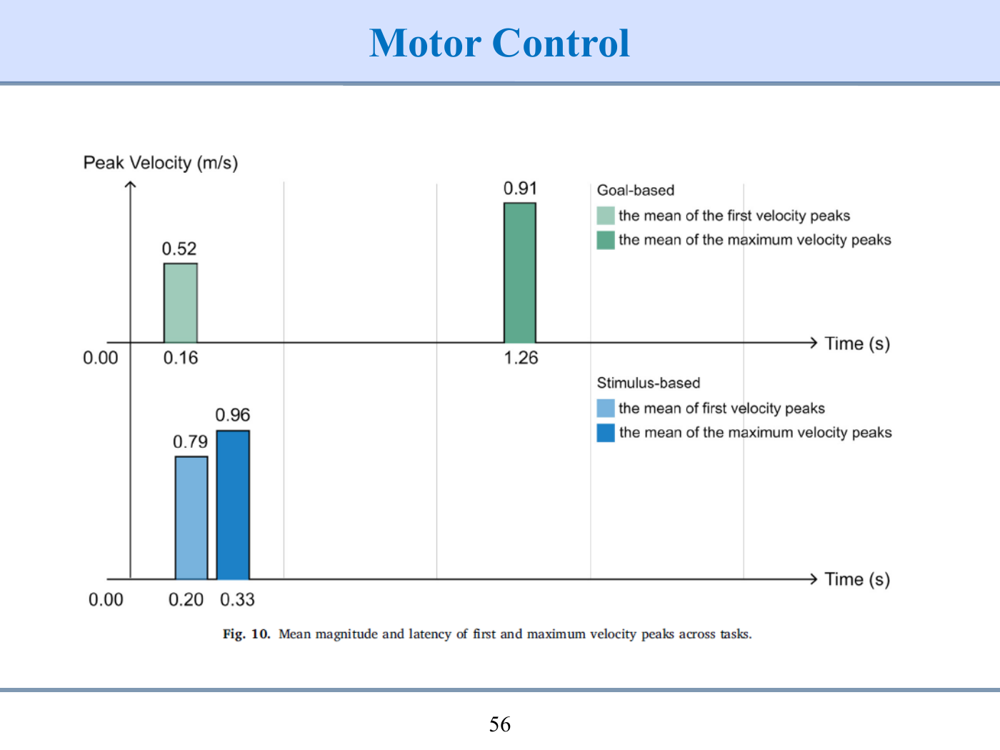
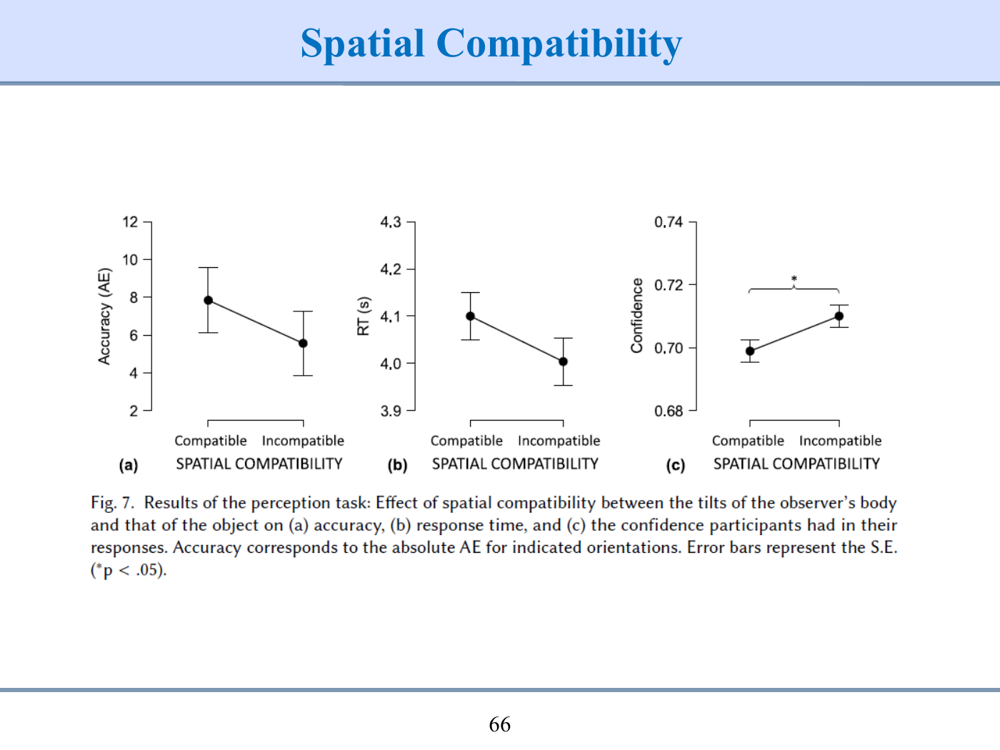

# 인터랙티브심리학 중간고사 · 기출형 예상시험 5회분

제작·검증일: 2026-10-17

**자체 제작 예상문제다.** 실제 기출 원문을 재현한 자료가 아니다. 실제 시험은 2026-10-19(월) 18:00–20:00, 새빛관 102호, 1~6주차 전체 범위다. 공지 유형은 객관식·주관식·서술식·간단한 코드 작성이며 준비물은 연필·지우개다. 실제 문항 수·배점·계산기 허용 여부는 공지에서 확인되지 않았다.

실제 문항 수가 없어 120분 기준으로 회당 32개 대문항·100점을 설계했다. 권장 풀이 110분과 검토 10분이다. 기존 검증 은행에서 시험에 맞게 선별·재구성하고 일부 수치·사례를 변형했다. 5세트 전체에 188개 개념이 모두 대응하며 각 회차에는 7개 단원이 포함된다. 한 회차에 188개 개념 전부를 억지로 넣어 2시간 분량을 초과하지 않는다.

단답에서 교안 영문 명칭을 요구한 부분만 영어로 답한다. 정의·이유·계산·해석은 한글·수식·단위를 사용한다. R은 실제 문법·2칸 들여쓰기·코드 빈칸 형식을 유지한다. 필요한 로그 근삿값은 문제에 제공한다.

[웹 시험](mock-exam/index.html) · [정답·해설](14_기출형예상_정답과해설.md) · [출제 설계·개념 대응](15_기출형예상_출제설계와개념대응.md)

| 유형 | 회당 문항 | 배점 | 권장 시간 |
|---|---:|---:|---:|
| 단일선택 | 12 | 24 | 15분 |
| 복수선택 | 4 | 8 | 8분 |
| O/X 진술 묶음(각 2진술) | 2 | 4 | 2분 |
| 단답형 | 6 | 12 | 12분 |
| 서술·계산형 | 4 | 36 | 48분 |
| R 코드 빈칸 | 4 | 16 | 25분 |
| 검토 | — | — | 10분 |


# 1세트 · 120분 · 100점

## 1번 · 단일선택 · 2점

플러그를 뽑기 어려운 사용자를 위해 그립 홈과 당김 손잡이를 추가했다. 이 접근의 설계 철학은?

1. Fitting the System to the Human — 장치는 유지하고 적응 교육만 강화한다.
2. Fitting the Human to the System — 사용자에게 더 강한 악력을 훈련시킨다.
3. Fitting the Human to the System — 기존 장치에 맞는 사용자를 선발한다.
4. Fitting the System to the Human — 인간 특성에 맞게 시스템을 바꾼다.

[웹에서 풀기](mock-exam/index.html?set=1&mode=practice&question=ME1-Q01)

## 2번 · 단일선택 · 2점

[사례] 병원 새 입력 UI를 평가한다. 야간 신규 간호사에게만 새 UI를, 주간 경력자에게만 기존 UI를 배정했다. 가장 우선할 개선은?

1. 클릭 시간을 소수점까지 기록하여 배정의 혼동 문제를 모두 해결한다.
2. 새 UI 집단을 신규 직원만으로 더 늘려 경력자와의 차이를 극대화한다.
3. 근무 시간·숙련도의 혼동을 줄이는 배정과 통제를 설계하고 사용자 대표성도 점검한다.
4. 현장 연구이므로 내부 교란은 존재하지 않는다고 보고 바로 일반화한다.

[웹에서 풀기](mock-exam/index.html?set=1&mode=practice&question=ME1-Q02)

## 3번 · 단일선택 · 2점

[사례] 남은 시간이 정확한 카운트다운을 추가한 뒤 화면의 경고 색상도 강조했다. 두 변경의 효과를 구별한 설명은?

1. 시간 단서는 변경 시점 불확실성을 줄이고 색 강조는 탐지·주의를 도울 수 있다.
2. 정확한 시간 단서가 있으면 모든 종류의 작업 오류가 사라진다.
3. 시간 단서는 미래 정보이므로 인간 정보처리와 관련이 없다.
4. 색만 진하게 바꾸면 사건 확률과 관계없이 Shannon H가 반드시 0이다.

[웹에서 풀기](mock-exam/index.html?set=1&mode=practice&question=ME1-Q03)

## 4번 · 단일선택 · 2점

G. A. Miller의 마법의 숫자(\(7 \pm 2\), 즉 5~9개)와 단일 차원 자극(순음·음량·크기·밝기 등)의 절대 식별 한계를 해석한 것으로 가장 적절한 것은?

1. \(7 \pm 2\)는 대표적 경험적 한계이며 밝기 3~5개 등 자극 차원에 따라 식별 수가 다르다.
2. 밝기·음량·크기 모두 최소 15개를 정확히 구별한다.
3. \(7 \pm 2\)의 단위는 bits/s이며 Channel capacity와 같은 수치다.
4. 모든 자극 차원에서 정확히 7개를 구별하고 개인차가 없다.

[웹에서 풀기](mock-exam/index.html?set=1&mode=practice&question=ME1-Q04)

## 5번 · 단일선택 · 2점

신체 부위별 Fitts 법칙(\(\mathrm{MT} = a + b\cdot\mathrm{ID}\))의 기울기 \(b\)가 팔뚝(forearm) 105, 손목(wrist) 43, 손가락(finger) 26 ms/bit이다. 동일한 절편 \(a\)와 난이도 지수 \(\mathrm{ID}\)를 가정할 때 올바른 해석은?

<figure class="visual-box"><figcaption>신체 부위별 기울기 — 동일 a와 ID 조건</figcaption><div class="table-scroll"><table><thead><tr><th>부위</th><th>forearm</th><th>wrist</th><th>finger</th></tr></thead><tbody><tr><td>b (ms/bit)</td><td>105</td><td>43</td><td>26</td></tr></tbody></table></div></figure>

1. finger의 추가 시간이 가장 작고 forearm이 가장 크다.
2. forearm의 추가 시간이 가장 작고 finger가 가장 크다.
3. 105 ms/bit는 105 bits/ms의 처리속도를 뜻한다.
4. 세 부위는 기울기가 달라도 동일한 MT가 반드시 나온다.

[웹에서 풀기](mock-exam/index.html?set=1&mode=practice&question=ME1-Q05)

## 6번 · 단일선택 · 2점

[사례] ISO형 Fitts 모형 \(\mathrm{MT} = a + b\,\log_2\left(\frac{D}{W}+1\right)\)에서 메뉴 수는 고정하고 버튼 거리와 폭 \((D, W)\)을 (120 mm, 20 mm)에서 (240 mm, 40 mm)로 바꿨다. 같은 계수 \(a, b\)에서 Fitts 예측은?

1. 메뉴 수가 고정되었으므로 Fitts는 어떤 거리·폭 변화에도 불변이다.
2. \(\frac{D}{W} = 6\)이 유지되어 \(\mathrm{ID} = \log_2 7\)과 MT가 같다.
3. 너비가 두 배이므로 ID는 반드시 절반이다.
4. 거리가 두 배이므로 MT도 반드시 두 배다.

[웹에서 풀기](mock-exam/index.html?set=1&mode=practice&question=ME1-Q06)

## 7번 · 단일선택 · 2점

[사례] 관제사가 수치를 세는 동안 눈앞 경보를 놓친다. 작업자를 바꾸기 전에 적용할 HFE 대책의 근거로 가장 적절한 것은?

1. 한 번 놓쳤으므로 모든 작업자는 어떤 표시 설계에서도 같은 오류를 낸다.
2. 제한된 주의와 과업 요구를 분석하여 경보·표시장치를 인간 특성에 맞춘다.
3. 시스템 출력을 높이기 위해 오류와 사용자 안녕은 평가에서 제외한다.
4. 시야에 있었으므로 주의 실패 가능성을 제외하고 신체 근력만 훈련한다.

[웹에서 풀기](mock-exam/index.html?set=1&mode=practice&question=ME1-Q07)

## 8번 · 단일선택 · 2점

[사례] \(x = \left(1, 2, 3\right)\), \(y = \left(2, 3, 7\right)\)이다. \(\bar{x} = 2\), \(\bar{y} = 4\), \(S_{xx} = 2\), \(S_{xy} = 5\)다. 회귀식과 \(x = 2\)에서의 잔차는?

<figure class="visual-box"><figcaption>세 관측값과 OLS 계산용 요약값</figcaption><div class="table-scroll"><table><thead><tr><th>i</th><th>x</th><th>y</th></tr></thead><tbody><tr><td>1</td><td>1</td><td>2</td></tr><tr><td>2</td><td>2</td><td>3</td></tr><tr><td>3</td><td>3</td><td>7</td></tr><tr><td>요약</td><td>평균 x=2, Sxx=2</td><td>평균 y=4, Sxy=5</td></tr></tbody></table></div></figure>

1. \(\hat{y} = 3.2 + 0.4\,x\) / 잔차 -1
2. \(\hat{y} = 4 + 2.5\,x\) / 잔차 -6
3. \(\hat{y} = -1 + 2.5\,x\) / 잔차 -1
4. \(\hat{y} = -1 + 2.5\,x\) / 잔차 1

[웹에서 풀기](mock-exam/index.html?set=1&mode=practice&question=ME1-Q08)

## 9번 · 단일선택 · 2점

실제 작업을 관찰할 때 측정 장치가 작업을 방해하여 수행시간이 바뀌었다. 가장 직접적으로 위반한 실무 요건은?

1. Quantitative
2. Cost as little as possible
3. Easy to collect
4. Unobtrusive

[웹에서 풀기](mock-exam/index.html?set=1&mode=practice&question=ME1-Q09)

## 10번 · 단일선택 · 2점

[사례] 4개 경보(\(H_{\max} = \log_2 4 = 2\) bits)의 발생 확률이 \(\left(\frac{1}{2}, \frac{1}{4}, \frac{1}{8}, \frac{1}{8}\right)\)이다. Shannon 평균 정보량 \(H\)와 중복도 \((1 - H/H_{\max})\times 100\)를 순서대로 고르면?

1. 1.75 bits / 56.25%
2. 1.75 bits / 87.5%
3. 1.75 bits / 12.5%
4. 2 bits / 0%

[웹에서 풀기](mock-exam/index.html?set=1&mode=practice&question=ME1-Q10)

## 11번 · 단일선택 · 2점

단위가 cm인 a=c(2,4,6)에 대해 R의 var(a), sd(a)와 두 지표의 단위를 고르면?

1. \(\frac{8}{3}\) \(\mathrm{cm}^2\) / \(\sqrt{\left(\frac{8}{3}\right)}\) cm
2. 4 cm / 2 \(\mathrm{cm}^2\)
3. 2 \(\mathrm{cm}^2\) / 4 cm
4. 4 \(\mathrm{cm}^2\) / 2 cm

[웹에서 풀기](mock-exam/index.html?set=1&mode=practice&question=ME1-Q11)

## 12번 · 단일선택 · 2점

인간의 언어 처리 방식별 초당 정보 처리량(말하기 spoken language vs. 글 읽기 written language)과, 시각 단순반응시간(약 150~180 ms) 중 가장 긴 시간이 걸리는 생리적 단계를 올바르게 짝지은 것은?

1. 말하기 약 50 bits/s > 읽기 약 10 bits/s / 신경전달만 총 750 ms
2. 읽기 약 50 bits/s > 말하기 약 10 bits/s / 중앙처리 약 90 ms
3. 읽기 약 50 bits/s > 말하기 약 10 bits/s / 근수축 약 90 ms
4. 말하기 약 50 bits/s > 읽기 약 10 bits/s / 중앙처리 약 90 ms

[웹에서 풀기](mock-exam/index.html?set=1&mode=practice&question=ME1-Q12)

## 13번 · 복수선택 · 2점

\(n=\left(\frac{zs}{k\bar{x}}\right)^2\)와 \(\mathrm{SE} = \frac{s}{\sqrt{n}}\)에 관해 옳은 것을 모두 고르시오. 명시하지 않은 값은 고정한다.

1. s를 두 배로 하면 필요한 n은 네 배다.
2. n을 네 배로 하면 같은 s에서 평균의 SE는 절반이다.
3. n의 계산값이 15.37이면 최소 필요 인원을 15명으로 내린다.
4. k를 절반으로 하면 필요한 n은 절반이다.

[웹에서 풀기](mock-exam/index.html?set=1&mode=practice&question=ME1-Q13)

## 14번 · 복수선택 · 2점

UX와 UX 심리학에 관한 설명 중 옳은 것을 모두 고르시오.

1. UX는 사용 전·사용 중·사용 후의 경험을 포괄한다.
2. UX 연구 기반에는 인간공학·공학·심리학·사회학이 포함된다.
3. Brand Ethics는 Product/Service Experience의 세 요소 중 하나다.
4. UX 심리학은 심리학 지식과 방법을 사용자 경험에 적용한다.

[웹에서 풀기](mock-exam/index.html?set=1&mode=practice&question=ME1-Q14)

## 15번 · 복수선택 · 2점

양립성에 관해 옳은 것을 모두 고르시오.

1. 빨간색과 온수의 의미 연상은 Modality compatibility다.
2. 음성 지시–음성 응답은 Modality compatibility의 예다.
3. 화구와 노브의 배열 대응은 Spatial compatibility다.
4. 다이얼 이동과 바늘 이동 방향의 대응은 Movement compatibility다.

[웹에서 풀기](mock-exam/index.html?set=1&mode=practice&question=ME1-Q15)

## 16번 · 복수선택 · 2점

정보전달량과 조건부 엔트로피에 관해 옳은 것을 모두 고르시오.

1. 출력이 한 값으로 고정되면 \(I\left(X; Y\right) = 0\)이다.
2. 반응 라벨을 일대일로 뒤집어도 전달정보량은 최대일 수 있다.
3. \(I\left(X; Y\right) = H\left(X\right) + H\left(Y\right) - H\left(X, Y\right)\)다.
4. \(H\left(X\mid Y\right)\)는 Noise이고 \(H\left(Y\mid X\right)\)는 Equivocation이다.

[웹에서 풀기](mock-exam/index.html?set=1&mode=practice&question=ME1-Q16)

## 17번 · O/X 진술 묶음 · 2점

다음 각 진술의 옳고 그름을 O/X로 판별하시오. 각 진술 1점이다.

(가) 공정한 동전의 \(H_{\max} = 1\) bit, 휜 동전의 \(H = 0.468\) bit이면 휜 동전의 중복도는 53.2%다. — O / X
(나) 표준을 기억해 한 화면을 평가하는 절대 판단은 두 화면을 나란히 비교하는 상대 판단보다 항상 정확하다. — O / X

[웹에서 풀기](mock-exam/index.html?set=1&mode=practice&question=ME1-Q17)

## 18번 · O/X 진술 묶음 · 2점

다음 각 진술의 옳고 그름을 O/X로 판별하시오. 각 진술 1점이다.

(가) 같은 동작을 충분히 연습할수록 운동제어는 개회로에서 폐회로 쪽으로 옮겨 간다. — O / X
(나) 독립표본 t-검정의 포뮬러 height ~ group은 왼쪽에 수치형 결과변수, 오른쪽에 집단 변수를 둔다. — O / X

[웹에서 풀기](mock-exam/index.html?set=1&mode=practice&question=ME1-Q18)

## 19번 · 단답형 · 2점

고객 생애주기에 따른 UX Scope의 세 가지 시간 범위를 강의의 영문 명칭으로 쓰시오. 경험이 형성되는 시간 순서대로 배열하시오.

답안 표기: 강의 영문 용어만 영어 표기. 설명은 한글로 작성.

[웹에서 풀기](mock-exam/index.html?set=1&mode=practice&question=ME1-Q19)

## 20번 · 단답형 · 2점

구성타당도(Construct Validity) 저하 요인 중 (가) 측정하려는 이론적 구성개념의 일부가 실제 측정에서 누락된 것과 (나) 구성개념과 무관한 외부 요소가 측정치에 섞여 들어간 것을 뜻하는 영문 용어를 각각 쓰시오.

답안 표기: 강의 영문 용어만 영어 표기. 설명은 한글로 작성.

[웹에서 풀기](mock-exam/index.html?set=1&mode=practice&question=ME1-Q20)

## 21번 · 단답형 · 2점

등확률 대안이 8개인 과제의 정보량을 구하고, 대안이 32개가 되면 정보량이 몇 bit 증가하는지 쓰시오.

답안 표기: 한글·수식·수치·단위로 작성.

[웹에서 풀기](mock-exam/index.html?set=1&mode=practice&question=ME1-Q21)

## 22번 · 단답형 · 2점

Donders 과업에서 \(A = 180\), \(C = 250\), \(B = 340\) ms다. 단계 차감법의 전제 아래 자극 식별 시간과 반응 선택 시간을 구하시오.

답안 표기: 한글·수식·수치·단위로 작성.

<figure class="visual-box"><figcaption>동일 조건에서 측정한 Donders 과업의 평균 RT</figcaption><div class="table-scroll"><table><thead><tr><th>과업</th><th>A</th><th>C</th><th>B</th></tr></thead><tbody><tr><td>평균 RT(ms)</td><td>180</td><td>250</td><td>340</td></tr></tbody></table></div></figure>

[웹에서 풀기](mock-exam/index.html?set=1&mode=practice&question=ME1-Q22)

## 23번 · 단답형 · 2점

운동 제어의 범위 효과(Range effect)에서 짧은 이동거리(short distance)와 긴 이동거리(long distance)일 때 나타나는 대표적 도달 오류 경향을 각각 영문 용어로 쓰시오.

답안 표기: 강의 영문 용어만 영어 표기. 설명은 한글로 작성.

[웹에서 풀기](mock-exam/index.html?set=1&mode=practice&question=ME1-Q23)

## 24번 · 단답형 · 2점

한 집단과 기준값 비교, 서로 다른 독립 집단 비교, 같은 대상 전후 비교에 맞는 t-검정 명칭을 쓰시오. 이 문항은 한글 명칭을 인정한다.

답안 표기: 한글·수식·수치·단위로 작성.

[웹에서 풀기](mock-exam/index.html?set=1&mode=practice&question=ME1-Q24)

## 25번 · 서술·계산형 · 9점

새 주방 손잡이를 개발한다. 인체 특성을 조사하는 시점부터 완성 제품의 사용성을 확인하는 시점까지 필요한 연구를 세 유형으로 구분하고, 유형별 명칭·목적과 연결 순서를 설명하시오. 보충 손잡이 논문의 네 단계는 원문 단계명으로 쓰고, 시제품 평가는 어느 단계의 결과를 확인하는지 설명하시오.

답안 표기: 한글·수식·수치·단위로 작성.

[웹에서 풀기](mock-exam/index.html?set=1&mode=practice&question=ME1-Q25)

## 26번 · 서술·계산형 · 9점

32회 시행에서 \(\left(X, Y\right) = \left(1, 1\right)\),(2,2),(3,2),(4,4)가 각각 8회이고 나머지는 0회다. 주변·결합 확률을 구해 \(H\left(X\right)\), \(H\left(Y\right)\), \(H\left(X, Y\right)\), 전달정보량 I, Equivocation, Noise를 계산하시오. 결합 엔트로피의 상한과 등호 조건도 쓰시오.

답안 표기: 한글·수식·수치·단위로 작성.

<figure class="visual-box"><figcaption>32회 시행 전체 혼동행렬 — 행 X, 열 Y</figcaption><div class="table-scroll"><table><thead><tr><th>X \ Y</th><th>1</th><th>2</th><th>3</th><th>4</th></tr></thead><tbody><tr><td>1</td><td>8</td><td>0</td><td>0</td><td>0</td></tr><tr><td>2</td><td>0</td><td>8</td><td>0</td><td>0</td></tr><tr><td>3</td><td>0</td><td>8</td><td>0</td><td>0</td></tr><tr><td>4</td><td>0</td><td>0</td><td>0</td><td>8</td></tr></tbody></table></div></figure>

[웹에서 풀기](mock-exam/index.html?set=1&mode=practice&question=ME1-Q26)

## 27번 · 서술·계산형 · 9점

Fitts의 속도–정확성 교환을 설명하고 원형·ISO형 ID를 비교하시오. D·W를 동시에 두 배로 할 때와 W만 절반으로 할 때, 같은 ISO형 a,b에서 MT가 어떻게 달라지는지 쓰시오.

답안 표기: 한글·수식·수치·단위로 작성.

[웹에서 풀기](mock-exam/index.html?set=1&mode=practice&question=ME1-Q27)

## 28번 · 서술·계산형 · 9점

제시된 회귀 출력에서 ① 추정 회귀식과 각 계수 Pr(>|t|)의 검정 대상 ② \(R^2\)·수정 \(R^2\)의 의미 ③ F와 모형 p값의 판정 ④ 이 결과만으로 보장할 수 없는 결론을 설명하시오. \(\alpha = .05\)다. 코드 작성은 요구하지 않는다.

답안 표기: 한글·수식·수치·단위로 작성.

<figure class="visual-box"><figcaption>summary 발췌</figcaption><div class="table-scroll"><table><thead><tr><th>항목</th><th>값</th></tr></thead><tbody><tr><td>(Intercept) Estimate</td><td>30.9333</td></tr><tr><td>x Estimate</td><td>0.8705</td></tr><tr><td>x Pr(>|t|)</td><td>0.0009223</td></tr><tr><td>Multiple R-squared</td><td>0.6828</td></tr><tr><td>Adjusted R-squared</td><td>0.6511</td></tr><tr><td>F-statistic</td><td>21.53</td></tr><tr><td>모형 p-value</td><td>0.0009223</td></tr></tbody></table></div></figure>

[웹에서 풀기](mock-exam/index.html?set=1&mode=practice&question=ME1-Q28)

## 29번 · R 코드 빈칸 · 4점

주어진 벡터 score <- c(35, 90, 60)을 오름차순으로 정렬한 ascending과 내림차순으로 정렬한 ordered를 만들고, ordered의 첫 원소를 출력하려 한다.
다음 R 코드의 번호가 붙은 빈칸에 들어갈 코드를 적으시오.

답안 표기: 각 빈칸에 실제 R 문법으로 작성. 문자열은 필요한 따옴표까지 포함한다. 추가 답안은 한글·수식·단위를 사용한다.

```r
score <- c(35, 90, 60)

ascending <- ____(1)____(score)
ordered <- sort(
  score,
  decreasing = ____(2)____
)

ordered[____(3)____]
```

추가 답안: 마지막 줄의 출력값을 적으시오.

[웹에서 풀기](mock-exam/index.html?set=1&mode=practice&question=ME1-Q29)

## 30번 · R 코드 빈칸 · 4점

datat의 group이 "Deagu"인 행에서 height의 평균이 160 cm인지 단일표본 양측 t-검정으로 확인하려 한다. 제공된 그룹 철자 "Deagu"를 그대로 사용하시오.
다음 R 코드의 번호가 붙은 빈칸에 들어갈 코드를 적으시오.

답안 표기: 각 빈칸에 실제 R 문법으로 작성. 문자열은 필요한 따옴표까지 포함한다.

### 분석자료 · 준비 코드

키 height의 단위는 cm다. Deagu·Seoul 각 20명이며 결측값이 없다. 이 문항용 구성자료 전체를 제시한다.

```r
datat <- data.frame(
  group = rep(c("Deagu", "Seoul"), each = 20),
  height = c(
    141.977269, 145.731682, 147.81785, 149.374348, 150.666916, 151.804243, 152.843048, 153.817827,
    154.752195, 155.664132, 156.568868, 157.480805, 158.415173, 159.389952, 160.428757, 161.566084,
    162.858652, 164.41515, 166.501318, 170.255731, 144.316825, 149.543331, 152.447477, 154.614274,
    156.413653, 157.996922, 159.443038, 160.800026, 162.100755, 163.37026, 164.62974, 165.899245,
    167.199974, 168.556962, 170.003078, 171.586347, 173.385726, 175.552523, 178.456669, 183.683175
  )
)
```

```r
____(1)____(
  datat[____(2)____, ]$____(3)____,
  mu = ____(4)____
)
```

[웹에서 풀기](mock-exam/index.html?set=1&mode=practice&question=ME1-Q30)

## 31번 · R 코드 빈칸 · 4점

같은 사람에게서 얻은 수치 벡터 x는 적성점수, y는 업무만족도다. 산점도를 그리고 y를 x로 예측하는 model을 적합한 뒤 요약을 확인하려 한다. 빈칸 (1)에는 두 인자를 쉼표로 구분하여 쓰시오.
다음 R 코드의 번호가 붙은 빈칸에 들어갈 코드를 적으시오.

답안 표기: 각 빈칸에 실제 R 문법으로 작성. 문자열은 필요한 따옴표까지 포함한다.

### 분석자료 · 준비 코드

regression1.xlsx의 실제 12행을 순서대로 옮겼다. x는 적성검사 점수, y는 업무만족도다.

```r
x <- c(
  65, 50, 55, 65, 55, 70, 65, 70,
  65, 70, 50, 55
)
y <- c(
  85, 74, 76, 90, 85, 87, 94, 98,
  81, 91, 76, 74
)
```

```r
plot(____(1)____)

model <- ____(2)____(
  ____(3)____
)

____(4)____(model)
```

[웹에서 풀기](mock-exam/index.html?set=1&mode=practice&question=ME1-Q31)

## 32번 · R 코드 빈칸 · 4점

등확률 대안 수 N <- c(1, 2, 4)와 반응시간 RT <- c(280, 400, 520)(ms)가 주어져 있다. 정보량 bit를 산출하고 RT를 bit로 예측하는 Hick 회귀모형을 적합한 뒤 요약을 출력하려 한다.
다음 R 코드의 번호가 붙은 빈칸에 들어갈 코드를 적으시오.

답안 표기: 각 빈칸에 실제 R 문법으로 작성. 문자열은 필요한 따옴표까지 포함한다. 추가 답안은 한글·수식·단위를 사용한다.

```r
N <- c(1, 2, 4)
RT <- c(280, 400, 520)

bit <- ____(1)____(N)

model <- lm(
  ____(2)____
)

____(3)____(model)
```

추가 답안: \(\mathrm{RT}=a+b\,\mathrm{bit}\)에서 a와 b의 예상값 및 단위를 적으시오.

[웹에서 풀기](mock-exam/index.html?set=1&mode=practice&question=ME1-Q32)


# 2세트 · 120분 · 100점

## 1번 · 단일선택 · 2점

[사례] 기억집합 {2,5,8}, Probe=4, User Input=False, T/F=True, Time=620 ms다. 별도 행에 TimeOut·5000 ms가 있다. 타당한 분석은?

<figure class="visual-box"><figcaption>Sternberg 로그 두 시행 — Time 단위 ms</figcaption><div class="table-scroll"><table><thead><tr><th>집합</th><th>Probe</th><th>User Input</th><th>T/F</th><th>Time</th></tr></thead><tbody><tr><td>2,5,8</td><td>4</td><td>False</td><td>True</td><td>620</td></tr><tr><td>2,5,8</td><td>7</td><td>TimeOut</td><td>False</td><td>5000</td></tr></tbody></table></div></figure>

1. 5000 ms를 가장 정확한 NO 반응으로 간주하여 정상 반응과 무조건 합친다.
2. 620 ms를 정답 NO 시행으로 분류하고 TimeOut을 구별하여 YES·NO별 PSS–RT 회귀를 비교한다.
3. T/F=True이므로 620 ms는 YES 정답이며 PSS는 4다.
4. User Input=False이므로 620 ms는 오답이며 제거한다.

[웹에서 풀기](mock-exam/index.html?set=2&mode=practice&question=ME2-Q01)

## 2번 · 단일선택 · 2점

이항 사건에서 p가 0→0.5→1로 변한다. 평균 엔트로피와 중복도의 변화로 옳은 것은?

<figure class="visual-box"><figcaption>이항 사건의 세 확률 조건 — 세 패널은 같은 두 결과를 비교</figcaption><svg role="img" aria-label="이항 사건의 세 확률 조건 — 세 패널은 같은 두 결과를 비교" viewBox="0 0 600 180" xmlns="http://www.w3.org/2000/svg"><rect x="20" y="15" width="180" height="140" rx="6" fill="#f7f7f5"/><text x="110" y="40" text-anchor="middle">(가) p = 0</text><rect x="55" y="125" width="35" height="0" fill="#8294aa"/><rect x="125" y="60" width="35" height="65" fill="#bdc7d4"/><text x="72" y="145" text-anchor="middle">앞</text><text x="142" y="145" text-anchor="middle">뒤</text><rect x="215" y="15" width="180" height="140" rx="6" fill="#f7f7f5"/><text x="305" y="40" text-anchor="middle">(나) p = 0.5</text><rect x="250" y="92.5" width="35" height="32.5" fill="#8294aa"/><rect x="320" y="92.5" width="35" height="32.5" fill="#bdc7d4"/><text x="267" y="145" text-anchor="middle">앞</text><text x="337" y="145" text-anchor="middle">뒤</text><rect x="410" y="15" width="180" height="140" rx="6" fill="#f7f7f5"/><text x="500" y="40" text-anchor="middle">(다) p = 1</text><rect x="445" y="60" width="35" height="65" fill="#8294aa"/><rect x="515" y="125" width="35" height="0" fill="#bdc7d4"/><text x="462" y="145" text-anchor="middle">앞</text><text x="532" y="145" text-anchor="middle">뒤</text></svg></figure>

1. H는 1→0→1 bit이며 중복도는 0→100→0%다.
2. H는 0→1→0 bit이며 중복도도 0→100→0%다.
3. H는 0→1→0 bit이며 중복도는 100→0→100%다.
4. H는 0→0.5→1 bit이며 중복도는 선형 감소한다.

[웹에서 풀기](mock-exam/index.html?set=2&mode=practice&question=ME2-Q02)

## 3번 · 단일선택 · 2점

인간 정보처리 모형을 가장 정확하게 설명한 것은?

1. 감각저장→지각→결정→실행 순서이며 반응은 입력과 단절된다.
2. 감각저장→실행→지각→결정 순서이며 주의는 실행에만 필요하다.
3. 감각저장→지각→결정→실행 순서이며 장기기억은 실행과만 연결된다.
4. 감각저장→지각→결정·반응선택→실행의 흐름에 주의·기억·피드백이 관여한다.

[웹에서 풀기](mock-exam/index.html?set=2&mode=practice&question=ME2-Q03)

## 4번 · 단일선택 · 2점

입력 정보율을 늘려도 전달 정보율이 약 2.8 bits/s에서 포화되었다. 이 값에 대한 해석은?

1. 해당 과업 조건의 Channel capacity를 나타내는 점근적 전달 정보율이다.
2. 입력 정보율을 두 배로 늘리면 반드시 전달률도 두 배가 된다.
3. 정보량이 2.8 bits 이상인 사건은 존재할 수 없다는 뜻이다.
4. 작업기억에 정확히 2.8개 항목이 저장된다는 뜻이다.

[웹에서 풀기](mock-exam/index.html?set=2&mode=practice&question=ME2-Q04)

## 5번 · 단일선택 · 2점

Frank & Lillian Gilbreth가 고안한 therbligs를 올바르게 설명한 것은?

1. 시간·동작 연구에서 수작업을 분석하는 기본 미세동작 단위다.
2. 회귀분석에서 잔차의 크기를 표준화하는 통계 단위다.
3. 선택반응시간에서 등확률 대안을 세는 정보량 단위다.
4. 정보화 시대 터치스크린의 해상도를 나타내는 단위다.

[웹에서 풀기](mock-exam/index.html?set=2&mode=practice&question=ME2-Q05)

## 6번 · 단일선택 · 2점

[사례] 사용성 점수가 반복 측정에서 안정적이다. 그러나 만족도를 빠뜨렸고 브랜드 선호가 점수에 섞였다. 옳은 진단은?

1. 만족도 누락은 오염, 브랜드 선호 혼입은 결핍이다.
2. 안정적인 점수이므로 결핍과 오염이 동시에 존재할 수 없다.
3. 신뢰도는 높을 수 있으나 Deficiency와 Contamination 때문에 구성타당도가 낮을 수 있다.
4. 점수에 수치를 사용했으므로 모든 측정 측면이 포괄되었다.

[웹에서 풀기](mock-exam/index.html?set=2&mode=practice&question=ME2-Q06)

## 7번 · 단일선택 · 2점

(가) 성인 손 치수의 분포 조사 (나) 화면 방향을 조작해 읽기시간 비교 (다) 완성된 청소기 3종의 사용성 평가. 연구 유형을 순서대로 고르면?

1. Evaluation / Experimental / Descriptive
2. Descriptive / Evaluation / Experimental
3. Experimental / Descriptive / Evaluation
4. Descriptive / Experimental / Evaluation

[웹에서 풀기](mock-exam/index.html?set=2&mode=practice&question=ME2-Q07)

## 8번 · 단일선택 · 2점

[사례] score=c(10,20,30)으로 최대값, 평균, 표본분산, 표준편차를 출력했다. 올바른 결과는?

1. 10 / 20 / 100 / 10
2. 30 / 20 / 100 / 10
3. 30 / 20 / \(\frac{200}{3}\) / \(\sqrt{\left(\frac{200}{3}\right)}\)
4. 30 / 20 / 10 / 100

[웹에서 풀기](mock-exam/index.html?set=2&mode=practice&question=ME2-Q08)

## 9번 · 단일선택 · 2점

[사례] 쇼핑 앱의 재구매 감소를 진단한다. 결제 버튼 조작시간만 측정한 보고서의 보완으로 가장 적절한 것은?

1. 버튼 조작시간을 같은 날 한 번 더 재서 전후 경험 조사를 대신한다.
2. 재구매는 미래 행동이므로 UX와 관련 없는 변수로 제외한다.
3. 브랜드 윤리를 결제시간과 같은 제품 사용성 지표로만 간주한다.
4. 구매 전 브랜드 기대와 사용 후 경험·사회적 맥락을 추가해 시간 범위를 확장한다.

[웹에서 풀기](mock-exam/index.html?set=2&mode=practice&question=ME2-Q09)

## 10번 · 단일선택 · 2점

가상현실(VR) 손가락 선택 실험에서 (가) 시각적으로 두드러진 빨간 버튼을 곧바로 누르는 과업(Stimulus-based)과 (나) 지시문을 읽고 해당 기능 버튼을 찾아 누르는 과업(Goal-based)의 제시한 첫 속도 정점·최대 속도 정점의 시각을 비교한 해석으로 옳은 것은?

<figure class="visual-box analysis-material"><figcaption>두 VR 선택 과업의 속도 정점 · 정보처리 교안 p.56</figcaption><a href="assets/question-data/information-processing-p56.png" target="_blank" rel="noopener"></a><p class="analysis-note">(가) Stimulus-based: 빨간 버튼 선택. (나) Goal-based: 지시문의 기능에 해당하는 버튼 선택. 가로축은 시간(s), 세로축은 정점 속도(m/s)다. 처음 정점과 최대 정점은 서로 다른 지표이며 후반 정점의 시각·크기를 구분해서 읽는다.</p></figure>

1. 최대 속도 정점은 정보량의 단위이므로 운동 조정과 무관하다.
2. (나)는 Goal-based로, 최대 속도 정점이 더 늦으며 처음 정점과의 시각 차이가 더 크다.
3. (나)는 Stimulus-based로, 목표 의미를 해석할 필요가 없다.
4. (가)는 Goal-based로, (나)보다 최대 속도 정점이 늦다.

[웹에서 풀기](mock-exam/index.html?set=2&mode=practice&question=ME2-Q10)

## 11번 · 단일선택 · 2점

Hick 모형 \(\mathrm{RT} = a + b\,H\) (\(H = \log_2 N\))에서 같은 절편 \(a\)와 기울기 \(b = 150\) ms/bit일 때, 등확률 메뉴를 8개에서 2개로 줄이면 예측 선택시간(RT) 변화는?

1. 300 ms 증가
2. 150 ms 단축
3. 300 ms 단축
4. 900 ms 단축

[웹에서 풀기](mock-exam/index.html?set=2&mode=practice&question=ME2-Q11)

## 12번 · 단일선택 · 2점

[사례] 다국적 VR 앱에 화구와 같은 노브 배열, 표시 방향과 같은 레버 이동, 국가별 상승·하락 색 코드를 적용한다. 검토 원칙은?

1. 배열은 Spatial, 방향은 Movement, 색의 의미는 Conceptual이며 문화·경험을 조사한다.
2. 배열은 Conceptual, 색의 의미는 Spatial이며 경험 차이는 없다.
3. 세 변경 모두 Modality이며 문화와 경험은 무시해도 된다.
4. 색의 의미가 집단마다 다르므로 레버 방향의 일치도 평가할 수 없다.

[웹에서 풀기](mock-exam/index.html?set=2&mode=practice&question=ME2-Q12)

## 13번 · 복수선택 · 2점

정보량 계산에 관해 옳은 것을 모두 고르시오.

1. 등확률 16개 대안의 정보량은 4 bits다.
2. 확률 0인 사건의 엔트로피 기여는 극한으로 0이다.
3. 비등확률 대안에서도 평균 정보량은 대안 수의 log₂만으로 결정된다.
4. Shannon 식은 개별 자기정보량 \(\log_2 \left(\frac{1}{p_i}\right)\)의 확률 가중평균이다.

[웹에서 풀기](mock-exam/index.html?set=2&mode=practice&question=ME2-Q13)

## 14번 · 복수선택 · 2점

개회로(Open loop)·폐회로(Closed loop) 운동제어와 범위 효과(Range effect)에 관한 설명 중 옳은 것을 모두 고르시오.

1. 숙련되면 상대적으로 Open loop 수행 비중이 커질 수 있다.
2. Range effect는 짧은 거리 Overshoot, 긴 거리 Undershoot다.
3. Positioning movement는 피드백을 이용하는 Closed loop다.
4. Ballistic movement는 매 순간 시각 피드백으로 정밀 조정한다.

[웹에서 풀기](mock-exam/index.html?set=2&mode=practice&question=ME2-Q14)

## 15번 · 복수선택 · 2점

t-검정 자료 구조와 R 포뮬러에 관해 옳은 것을 모두 고르시오.

1. after-before 평균이 음수면 after가 더 크다.
2. t.test(x,mu=150)는 한 집단 평균과 기준값 150을 비교한다.
3. t.test(height ~ group,data=d)는 결과 height를 왼쪽에 둔다.
4. 대응표본 검정에서는 짝별 차이의 분포를 점검한다.

[웹에서 풀기](mock-exam/index.html?set=2&mode=practice&question=ME2-Q15)

## 16번 · 복수선택 · 2점

인간공학의 정의·영역·설계 철학에 관한 설명 중 옳은 것을 모두 고르시오.

1. 인간공학은 시스템 성능을 개선하기 위해 인간의 안녕을 목표에서 제외한다.
2. 인지 인간공학은 지각·기억·추론 같은 정신 과정을 다룬다.
3. 기존 장치에 맞는 작업자를 선발하는 것은 시스템을 인간에게 맞추는 접근이다.
4. 근력·인체측정·생체역학은 Physical Ergonomics와 관련된다.

[웹에서 풀기](mock-exam/index.html?set=2&mode=practice&question=ME2-Q16)

## 17번 · O/X 진술 묶음 · 2점

다음 각 진술의 옳고 그름을 O/X로 판별하시오. 각 진술 1점이다.

(가) \(n=\left(\frac{zs}{k\bar{x}}\right)^2\)에서 다른 조건을 고정하고 α를 .05에서 .01로 낮추면 필요한 표본 수는 증가한다. — O / X
(나) 등확률 이항 입력을 항상 반대 라벨로 답하더라도 일대일 대응이 유지되면 정답률 0%와 전달정보량 1 bit가 동시에 가능하다. — O / X

[웹에서 풀기](mock-exam/index.html?set=2&mode=practice&question=ME2-Q17)

## 18번 · O/X 진술 묶음 · 2점

다음 각 진술의 옳고 그름을 O/X로 판별하시오. 각 진술 1점이다.

(가) Donders 단계 차감법(A 단순반응, B 선택반응, C 변별반응) 가정 아래 \(B - C\)는 자극 식별 시간이며 \(C - A\)는 반응 선택 시간이다. — O / X
(나) UX 심리학은 시각적 감각만을 적용하는 분야이므로 과학적 심리학 방법론은 정의에서 제외된다. — O / X

[웹에서 풀기](mock-exam/index.html?set=2&mode=practice&question=ME2-Q18)

## 19번 · 단답형 · 2점

사용자 경험(UX)에서 브랜드 경험(Brand Experience)을 구성하는 네 가지 하위 요소를 강의의 영문 명칭으로 모두 적으시오.

답안 표기: 강의 영문 용어만 영어 표기. 설명은 한글로 작성.

[웹에서 풀기](mock-exam/index.html?set=2&mode=practice&question=ME2-Q19)

## 20번 · 단답형 · 2점

실험 설계에서 (가) 연구자가 의도적으로 조작하는 요인, (나) 그에 따라 측정되는 결과 변수, (다) 기타 외생변수의 조건을 하나로 고정하는 처리, (라) 모집단의 계층(성별·연령 등) 비율에 맞춰 표본을 배정하는 방법의 영문 용어를 각각 쓰시오.

답안 표기: 강의 영문 용어만 영어 표기. 설명은 한글로 작성.

[웹에서 풀기](mock-exam/index.html?set=2&mode=practice&question=ME2-Q20)

## 21번 · 단답형 · 2점

두 사건의 발생 확률이 0.25·0.75다. \(\log_2 4 = 2\), \(\log_2 \left(\frac{4}{3}\right) = 0.4150\)을 이용해 Shannon 평균 정보량 \(H\)와 최대 정보량(\(H_{\max}=\log_2 2=1\) bit) 대비 중복도 \((1 - H/H_{\max})\times 100\)를 구하시오.

답안 표기: 한글·수식·수치·단위로 작성.

[웹에서 풀기](mock-exam/index.html?set=2&mode=practice&question=ME2-Q21)

## 22번 · 단답형 · 2점

작업기억 및 판단 지원 전략 중 (가) 정보를 속으로 되뇌어 기억 유지 시간을 늘리는 것, (나) 기억 속 기준과 단독 비교하는 절대 판단 대신 두 자극을 나란히 직접 비교하게 하는 것, (다) 개별 항목들을 기존 장기기억 지식과 연결해 의미 있는 묶음 단위로 구성하는 것의 영문 용어를 각각 쓰시오.

답안 표기: 강의 영문 용어만 영어 표기. 설명은 한글로 작성.

[웹에서 풀기](mock-exam/index.html?set=2&mode=practice&question=ME2-Q22)

## 23번 · 단답형 · 2점

Fitts가 1954년에 제안한 원형 난이도 지수(ID) 공식과 국제표준(ISO 9241-9, Shannon형) 난이도 지수(ID) 공식을 각각 적고, 거리(\(A, D\))와 표적 너비(\(W\))의 단위 조건을 쓰시오.

답안 표기: 한글·수식·수치·단위로 작성.

[웹에서 풀기](mock-exam/index.html?set=2&mode=practice&question=ME2-Q23)

## 24번 · 단답형 · 2점

절편을 포함한 단순선형회귀에서 \(\bar{x}=2\), \(\bar{y}=5\), \(S_{xx}=2\), \(S_{xy}=4\)다. 최소제곱법으로 기울기와 절편을 구하고, \(x=4\)일 때의 예측값을 계산하시오.

답안 표기: 한글·수식·수치·단위로 작성.

[웹에서 풀기](mock-exam/index.html?set=2&mode=practice&question=ME2-Q24)

## 25번 · 서술·계산형 · 9점

새 UI에는 전문가, 기존 UI에는 초보자만 배정했다. 사용성은 속도만 측정했고 브랜드 호감이 점수에 섞였으며 다른 연령층에도 일반화했다. 각 문제와 대응책을 설명하시오.

답안 표기: 한글·수식·수치·단위로 작성.

[웹에서 풀기](mock-exam/index.html?set=2&mode=practice&question=ME2-Q25)

## 26번 · 서술·계산형 · 9점

확률이 (0.5,0.25,0.25)인 세 경고의 평균 정보량을 구하시오. 등확률·비등확률에 사용하는 공식과 단위를 구분하고, 등확률 대안 수가 두 배가 되는 경우와 확률 0인 항의 처리도 설명하시오. 정보량을 정량화하는 설계 목적을 덧붙이시오.

답안 표기: 한글·수식·수치·단위로 작성.

<figure class="visual-box"><figcaption>전체 경고 분포 — 개별 정보량은 \(-\log_2 p\)로 계산</figcaption><div class="table-scroll"><table><thead><tr><th>경고</th><th>A</th><th>B</th><th>C</th></tr></thead><tbody><tr><td>발생확률</td><td>0.5</td><td>0.25</td><td>0.25</td></tr></tbody></table></div></figure>

[웹에서 풀기](mock-exam/index.html?set=2&mode=practice&question=ME2-Q26)

## 27번 · 서술·계산형 · 9점

Hick 모형 \(\mathrm{RT}=a+bH\)의 절편 \(a\)와 기울기 \(b\)에 영향을 주는 요인을 구분하시오. 단순반응의 생리적 처리 네 단계와 단계별 대표 시간, 자극·반응 양식별 빠른 순서, 완전 불시 사건과 사전 경고의 교안상 수치 예시를 설명하시오. 기울기에 영향을 주는 세 요인을 들고 작은 \(b\)의 의미를 쓰시오.

답안 표기: 한글·수식·수치·단위로 작성.

[웹에서 풀기](mock-exam/index.html?set=2&mode=practice&question=ME2-Q27)

## 28번 · 서술·계산형 · 9점

상관과 회귀의 목적·방향성을 비교하시오. 공분산과 상관계수의 관계·범위를 쓰고 \(r = 0\)의 한계를 반례로 설명하시오. 회귀 전 산점도를 확인하는 이유도 쓰시오.

답안 표기: 한글·수식·수치·단위로 작성.

[웹에서 풀기](mock-exam/index.html?set=2&mode=practice&question=ME2-Q28)

## 29번 · R 코드 빈칸 · 4점

단위가 cm인 벡터 a <- c(2, 4, 6)의 표본분산 v와 표준편차 s를 계산하려 한다.
다음 R 코드의 번호가 붙은 빈칸에 들어갈 코드를 적으시오.

답안 표기: 각 빈칸에 실제 R 문법으로 작성. 문자열은 필요한 따옴표까지 포함한다. 추가 답안은 한글·수식·단위를 사용한다.

```r
a <- c(2, 4, 6)

v <- ____(1)____(a)
s <- ____(2)____(a)
```

추가 답안: v와 s의 값·단위를 적고, v를 구할 때 사용한 분모가 무엇인지 설명하시오.

[웹에서 풀기](mock-exam/index.html?set=2&mode=practice&question=ME2-Q29)

## 30번 · R 코드 빈칸 · 4점

datat의 독립된 Deagu·Seoul 집단에서 height의 정규성을 집단별로 점검하려 한다. 첫 줄은 Deagu, 둘째 줄은 Seoul을 대상으로 하시오.
다음 R 코드의 번호가 붙은 빈칸에 들어갈 코드를 적으시오.

답안 표기: 각 빈칸에 실제 R 문법으로 작성. 문자열은 필요한 따옴표까지 포함한다.

### 분석자료 · 준비 코드

키 height(cm), 집단 group(Deagu·Seoul 각 20명)의 문항용 구성자료 전체다. 같은 순번을 서로 대응시키는 자료가 아니다.

```r
datat <- data.frame(
  group = rep(c("Deagu", "Seoul"), each = 20),
  height = c(
    141.977269, 145.731682, 147.81785, 149.374348, 150.666916, 151.804243, 152.843048, 153.817827,
    154.752195, 155.664132, 156.568868, 157.480805, 158.415173, 159.389952, 160.428757, 161.566084,
    162.858652, 164.41515, 166.501318, 170.255731, 144.316825, 149.543331, 152.447477, 154.614274,
    156.413653, 157.996922, 159.443038, 160.800026, 162.100755, 163.37026, 164.62974, 165.899245,
    167.199974, 168.556962, 170.003078, 171.586347, 173.385726, 175.552523, 178.456669, 183.683175
  )
)
```

```r
____(1)____(
  datat[____(2)____, ]$height
)

____(3)____(
  datat[____(4)____, ]$height
)
```

[웹에서 풀기](mock-exam/index.html?set=2&mode=practice&question=ME2-Q30)

## 31번 · R 코드 빈칸 · 4점

plot(x,y) 산점도가 열려 있고 model <- lm(y~x)가 적합되어 있다. lty·col 인자로 파란 실선 회귀선을 추가하려 한다. 색은 이름 문자열로 쓰시오.
다음 R 코드의 번호가 붙은 빈칸에 들어갈 코드를 적으시오.

답안 표기: 각 빈칸에 실제 R 문법으로 작성. 문자열은 필요한 따옴표까지 포함한다.

### 분석자료 · 준비 코드

regression1.xlsx의 실제 12행이다. 이 준비 코드를 실행해 model을 적합하고 산점도를 연 상태에서 빈칸 코드를 이어서 실행한다.

```r
x <- c(
  65, 50, 55, 65, 55, 70, 65, 70,
  65, 70, 50, 55
)
y <- c(
  85, 74, 76, 90, 85, 87, 94, 98,
  81, 91, 76, 74
)

model <- lm(y ~ x)
plot(x, y)
```

```r
____(1)____(
  model,
  lty = ____(2)____,
  col = ____(3)____
)
```

[웹에서 풀기](mock-exam/index.html?set=2&mode=practice&question=ME2-Q31)

## 32번 · R 코드 빈칸 · 4점

같은 길이 단위의 거리 D <- c(100, 200)과 목표 너비 W <- c(20, 20)가 주어져 있다. ISO형 Fitts 난이도 ID와, 절편 \(a=40\) ms·기울기 \(b=120\) ms/bit인 모형의 운동시간 MT 벡터를 구하려 한다. 각 빈칸에는 대입문의 오른쪽 식 전체를 쓰시오. 손계산에는 \(\log_2 6\approx2.5850\), \(\log_2 11\approx3.4594\)를 사용할 수 있다.
다음 R 코드의 번호가 붙은 빈칸에 들어갈 코드를 적으시오.

답안 표기: 각 빈칸에 실제 R 문법으로 작성. 문자열은 필요한 따옴표까지 포함한다. 추가 답안은 한글·수식·단위를 사용한다.

```r
D <- c(100, 200)
W <- c(20, 20)

ID <- ____(1)____
MT <- ____(2)____

MT
```

추가 답안: 두 MT 값을 소수 둘째 자리까지 구하고 단위를 적으시오. \(\log_2 6 = 2.5850\), \(\log_2 11 = 3.4594\)를 사용해도 된다.

[웹에서 풀기](mock-exam/index.html?set=2&mode=practice&question=ME2-Q32)


# 3세트 · 120분 · 100점

## 1번 · 단일선택 · 2점

인간 특성 조사부터 손잡이 제품 평가까지의 흐름으로 가장 적절한 것은?

1. 형태 확정 → 판매 → 인간 특성 파악 → 평가 생략
2. 평가 점수 수집 → 신체 자료 제외 → 설계 고정 → 개선 종료
3. 인간 특성·설계변수 파악 → 자료 수집·분석 → 설계에 반영 → 사용성 평가·개선
4. 인간 특성 파악 → 설계 확정 → 자료 분석 생략 → 사용성 추측

[웹에서 풀기](mock-exam/index.html?set=3&mode=practice&question=ME3-Q01)

## 2번 · 단일선택 · 2점

Hick 모형의 절편 \(a\)와 관련하여 ① 자극 양식 세 가지(시각·촉각/진동·청각)의 빠른 순서, ② 반응 기관 세 가지(발·눈·손)의 빠른 순서, ③ 완전히 예상하지 못한 사건의 교안상 절편 예시를 바르게 묶은 것은?

1. 자극: 시각→청각→촉각 / 반응: 눈→손→발 / 완전 불시 사건 \(a \approx 750\) ms
2. 자극: 촉각·진동→청각→시각 / 반응: 눈→손→발 / 완전 불시 사건 \(a \approx 750\) ms
3. 자극: 촉각→청각→시각 / 반응: 눈→손→발 / 완전 불시 사건 \(a = 0\) ms
4. 자극: 촉각→청각→시각 / 반응: 발→손→눈 / 완전 불시 사건 \(a \approx 750\) ms

[웹에서 풀기](mock-exam/index.html?set=3&mode=practice&question=ME3-Q02)

## 3번 · 단일선택 · 2점

[사례] 4개 등확률 자극을 장치 A는 4개 반응으로 일대일 전달하고, 장치 B는 모두 같은 반응으로 보낸다. 장치별 전달량은?

1. A: 4 bits / B: 1 bit
2. A: 2 bits / B: 2 bits
3. A: 0 bit / B: 2 bits
4. A: 2 bits / B: 0 bit

[웹에서 풀기](mock-exam/index.html?set=3&mode=practice&question=ME3-Q03)

## 4번 · 단일선택 · 2점

아래 VR 틸트 연구의 지각 과업(perception task) 그래프를 읽으시오. Incompatible에서 Compatible로 바뀔 때의 평균값 방향과 유의성 표시를 올바르게 설명한 것은? Accuracy(AE)는 절대 각도오차다.

<figure class="visual-box analysis-material"><figcaption>VR 틸트 연구의 지각 과업(perception task) 결과 · 교안 p.66</figcaption><a href="assets/question-data/information-processing-p66.png" target="_blank" rel="noopener"></a><p class="analysis-note">Compatible/ Incompatible은 몸과 보이는 패널의 기울임 방향의 일치/불일치다. Accuracy(AE)는 절대 각도오차이므로 작은 값이 더 정확하다. 오차막대는 SE, 별표는 해당 비교에서 p&lt;.05다. 이 도표를 레버 수동 조작 과업의 결과로 바꾸어 읽지 않는다.</p></figure>

1. 절대오차↑, RT↑, 자신감↓이며, 별표는 자신감 비교에 표시되어 있다.
2. Accuracy 축이 높으므로 Compatible에서 더 정확하며, RT와 자신감도 모두 개선된다.
3. 절대오차↑, RT↓, 자신감↑이며, 세 평균차가 모두 통계적으로 유의하다.
4. Compatible와 Incompatible의 오차막대가 일부 겹치므로 세 평균은 정확히 같다.

[웹에서 풀기](mock-exam/index.html?set=3&mode=practice&question=ME3-Q04)

## 5번 · 단일선택 · 2점

적성점수 x로 업무만족도 y를 예측하려 한다. 상관·회귀의 구분과 시작 절차로 적절한 것은?

1. 상관은 Y를 예측하는 방향을 고정하고 회귀는 X와 Y를 구분하지 않는다.
2. 변수가 두 종류이므로 반드시 다중회귀이며 산점도는 불필요하다.
3. 회귀에서 업무만족도가 X이고 적성점수가 Y다.
4. 상관은 대칭적 선형 연관, 회귀는 X→Y 설명·예측이며 먼저 산점도를 살핀다.

[웹에서 풀기](mock-exam/index.html?set=3&mode=practice&question=ME3-Q05)

## 6번 · 단일선택 · 2점

인간공학(Ergonomics)을 부르는 지역·집단별 대표 영문 명칭(유럽, 미국, 미군, 미국 심리학계)을 올바르게 연결한 것은?

1. 유럽: Ergonomics / 미국: Human Factors / 미군: Human Engineering / 심리학계: Engineering Psychology
2. 유럽: Engineering Psychology / 미국: Human Engineering / 미군: Ergonomics / 심리학계: Human Factors
3. 유럽: Ergonomics / 미국: Engineering Psychology / 미군: Human Factors / 심리학계: Human Engineering
4. 유럽: Human Engineering / 미국: Ergonomics / 미군: Engineering Psychology / 심리학계: Human Factors

[웹에서 풀기](mock-exam/index.html?set=3&mode=practice&question=ME3-Q06)

## 7번 · 단일선택 · 2점

인간공학의 목표와 지식 기반을 가장 정확하게 설명한 것은?

1. 심리학과 사회학을 활용하므로 인체측정 자료는 설계에서 제외한다.
2. 해부학과 생체역학을 활용하여 시스템 출력 속도만을 최대화한다.
3. 신체·정신·사회 특성 지식을 활용하여 인간의 안녕과 시스템 성능을 함께 개선한다.
4. 인간의 안녕만 고려하므로 시스템 성능은 평가에서 제외한다.

[웹에서 풀기](mock-exam/index.html?set=3&mode=practice&question=ME3-Q07)

## 8번 · 단일선택 · 2점

스마트글래스 무게 위치를 바꾸어 코 하중을 측정했다. Front 0.34, Middle 0.22, Ear 0.20, Rear 0.16 N이며 오차막대는 SE다. 올바른 해석은?

<figure class="visual-box"><figcaption>무게 위치 4조건과 코 하중 평균 (N) — 오차막대의 의미는 지문에 제시</figcaption><svg role="img" aria-label="무게 위치 4조건과 코 하중 평균 (N) — 오차막대의 의미는 지문에 제시" viewBox="0 0 600 180" xmlns="http://www.w3.org/2000/svg"><path d="M50 20V145H575" fill="none" stroke="#777"/><rect x="80" y="42.999999999999986" width="65" height="102.00000000000001" fill="#c4cfdb"/><text x="112" y="34.999999999999986" text-anchor="middle">0.34</text><text x="112" y="170" text-anchor="middle">Front</text><rect x="205" y="79.0" width="65" height="66.0" fill="#c4cfdb"/><text x="237" y="71.0" text-anchor="middle">0.22</text><text x="237" y="170" text-anchor="middle">Middle</text><rect x="330" y="85.0" width="65" height="60.0" fill="#c4cfdb"/><text x="362" y="77.0" text-anchor="middle">0.20</text><text x="362" y="170" text-anchor="middle">Ear</text><rect x="455" y="97.0" width="65" height="48.0" fill="#c4cfdb"/><text x="487" y="89.0" text-anchor="middle">0.16</text><text x="487" y="170" text-anchor="middle">Rear</text></svg></figure>

1. 무게 위치는 IV, 코 하중은 DV이며 오차막대만으로 모든 쌍의 유의차가 확정된다.
2. 무게 위치는 IV, 코 하중은 DV이며 SE는 개별 관측치의 SD다.
3. 코 하중은 IV, 무게 위치는 DV이며 Rear 평균이 가장 낮다.
4. 무게 위치는 IV, 코 하중은 DV이며 Rear 평균이 가장 낮고 SE는 평균 추정의 불확실성이다.

[웹에서 풀기](mock-exam/index.html?set=3&mode=practice&question=ME3-Q08)

## 9번 · 단일선택 · 2점

등확률 대안 수가 8개에서 16개로 늘었다. 정보량의 변화와 1 bit의 뜻을 올바르게 설명한 것은?

1. 3→6 bits로 2배 증가하며, 1 bit는 등확률 두 대안의 선택 정보량이다.
2. 3→4 bits로 1 bit 증가하며, 1 bit는 등확률 두 대안의 선택 정보량이다.
3. 8→16 bits로 증가하며, 1 bit는 대안 하나를 뜻한다.
4. 3→4 bits로 증가하며, 4 bits는 대안 8개에 대응한다.

[웹에서 풀기](mock-exam/index.html?set=3&mode=practice&question=ME3-Q09)

## 10번 · 단일선택 · 2점

3D VR Fitts 보충논문에서 참가자 23명, 확장 모형 \(R^{2} = 0.645\)였다. 이 결과의 적절한 해석은?

1. \(R^2\)가 1보다 작으므로 이 모형은 아무 변동도 설명하지 못한다.
2. 해당 자료에서 모형이 MT 변동의 약 64.5%를 설명했으며 23명은 연구 표본 수다.
3. 새 참가자에게 항상 64.5%의 정답률을 보장한다.
4. 23명은 참가자 수가 아니라 반응시간의 단위다.

[웹에서 풀기](mock-exam/index.html?set=3&mode=practice&question=ME3-Q10)

## 11번 · 단일선택 · 2점

정보이론을 인터페이스 설계에 적용하는 목적을 가장 잘 설명한 것은?

1. 정보량을 구하면 사용자의 모든 오류 원인이 자동으로 밝혀진다.
2. 화면의 글자 수만으로 정보량을 정하므로 대안의 확률은 무시한다.
3. 과업의 불확실성을 정보량으로 정량화하여 처리 부담을 비교한다.
4. 불확실성이 높을수록 처리 정보량이 줄어드는 원리를 이용한다.

[웹에서 풀기](mock-exam/index.html?set=3&mode=practice&question=ME3-Q11)

## 12번 · 단일선택 · 2점

[사례] 같은 12명의 훈련 전후 수행시간을 분석한다. 개인별 차이 d=after-before가 정규적이며 평균 -20 ms다. 적절한 분석은?

1. 짝을 유지한 t.test(d,mu=0)로 차이를 검정하고 음수는 시간 단축으로 읽는다.
2. 평균 차이가 음수이므로 p값 없이 유의한 개선으로 확정한다.
3. 전후 자료의 사람 순서를 따로 섞은 뒤 대응표본 검정을 한다.
4. 같은 사람이어도 측정일이 다르면 반드시 독립표본 검정을 한다.

[웹에서 풀기](mock-exam/index.html?set=3&mode=practice&question=ME3-Q12)

## 13번 · 복수선택 · 2점

중복도 \(R = \left(1 - \frac{H}{H_{\max}}\right) \times 100\)에 관해 옳은 것을 모두 고르시오.

1. 8개 대안의 Hmax는 3 bits다.
2. H가 Hmax와 같으면 중복도는 100%다.
3. 같은 대안 수에서 확률이 치우칠수록 일반적으로 중복도는 증가한다.
4. 변경 시점이 완전히 확정되면 해당 불확실성의 H는 0이다.

[웹에서 풀기](mock-exam/index.html?set=3&mode=practice&question=ME3-Q13)

## 14번 · 복수선택 · 2점

Donders와 Hick 모형에 관해 옳은 것을 모두 고르시오.

1. Donders 차감법에서 \(C - A\)는 자극 식별, \(B - C\)는 반응 선택 시간이다.
2. Donders C는 자극 식별과 여러 반응 사이의 선택을 모두 포함한다.
3. Hick의 b 단위는 ms/bit이며 작을수록 추가 선택 부담이 작다.
4. 양립성·학습·연령을 Hick 기울기 요인으로 제시한다.

[웹에서 풀기](mock-exam/index.html?set=3&mode=practice&question=ME3-Q14)

## 15번 · 복수선택 · 2점

상관과 OLS에 관해 옳은 것을 모두 고르시오.

1. OLS는 잔차 제곱합을 최소화하는 계수를 구한다.
2. 기울기는 \(\frac{S_{xx}}{S_{xy}}\)이며 절편은 평균 y다.
3. 절편 포함 OLS의 동일 학습 자료에서는 \(\mathrm{SST} = \mathrm{SSR} + \mathrm{SSE}\)다.
4. \(r = 0\)이어도 비선형 함수 관계가 있을 수 있다.

[웹에서 풀기](mock-exam/index.html?set=3&mode=practice&question=ME3-Q15)

## 16번 · 복수선택 · 2점

HFE 연구 유형과 변수에 관한 설명 중 옳은 것을 모두 고르시오.

1. 완성된 제품들의 사용성·효과성을 평가하는 것은 Evaluation research다.
2. 인간의 손 치수 분포를 측정·기술하는 연구는 Descriptive research다.
3. 변수 조작의 수행도 효과를 검증하는 것은 Experimental research다.
4. 스마트글래스 무게 위치를 조작하고 코 하중을 비교하면 위치가 DV다.

[웹에서 풀기](mock-exam/index.html?set=3&mode=practice&question=ME3-Q16)

## 17번 · O/X 진술 묶음 · 2점

다음 각 진술의 옳고 그름을 O/X로 판별하시오. 각 진술 1점이다.

(가) ISO형 Fitts 난이도 지수는 \(\mathrm{ID} = \log_2 \left(\frac{W}{D} + 1\right)\)이므로 거리가 멀어지면 ID가 감소한다. — O / X
(나) 결측값이 없는 벡터 score에서 sort(score, decreasing=TRUE)[1]은 최솟값을 선택한다. — O / X

[웹에서 풀기](mock-exam/index.html?set=3&mode=practice&question=ME3-Q17)

## 18번 · O/X 진술 묶음 · 2점

다음 각 진술의 옳고 그름을 O/X로 판별하시오. 각 진술 1점이다.

(가) 1주차 보충영상(Windows 95)과 Old computer 사례에서 MS-DOS 명령줄 인터페이스(CLI)는 시각적 아이콘을 보고 고르는 재인(Recognition) 방식이어서 Windows 95 GUI보다 기억 회상 부하가 낮았다. — O / X
(나) Gen Z Vs Old Technology 영상에서 3.5인치 플로피 디스크·VHS·Nokia 멀티탭 문자 입력에 어려움을 겪는 현상은 행동유도성과 집단 고정관념이 세대별 사전 경험(Previous Experience)에 영향받음을 보여준다. — O / X

[웹에서 풀기](mock-exam/index.html?set=3&mode=practice&question=ME3-Q18)

## 19번 · 단답형 · 2점

사용자 경험(UX)에서 제품·서비스 경험(Product/Service Experience)을 구성하는 세 가지 핵심 요소를 강의의 영문 명칭으로 모두 적으시오.

답안 표기: 강의 영문 용어만 영어 표기. 설명은 한글로 작성.

[웹에서 풀기](mock-exam/index.html?set=3&mode=practice&question=ME3-Q19)

## 20번 · 단답형 · 2점

측정 품질의 지표 중 (가) 반복 측정했을 때 측정값이 일관되고 안정적으로 나오는 정도와 (나) 측정값이 참값(목표 중심)에 가까운 정도를 뜻하는 영문 용어를 각각 쓰시오.

답안 표기: 강의 영문 용어만 영어 표기. 설명은 한글로 작성.

[웹에서 풀기](mock-exam/index.html?set=3&mode=practice&question=ME3-Q20)

## 21번 · 단답형 · 2점

중복도 공식 \(\%\text{Redundancy} = (1 - H/H_{\max})\times 100\)을 적용하여 (가) 동전의 \(H = 0.7219\) bit, \(H_{\max} = 1\) bit (나) 경고등 8종(\(H_{\max} = \log_2 8 = 3\) bits)의 \(H = 2.25\) bits일 때 각 중복도를 구하시오.

답안 표기: 한글·수식·수치·단위로 작성.

[웹에서 풀기](mock-exam/index.html?set=3&mode=practice&question=ME3-Q21)

## 22번 · 단답형 · 2점

Sternberg 기억탐색 과제에서 (가) 목표 항목을 찾는 즉시 비교를 멈추는 탐색 방식과 (나) 목표를 찾더라도 기억집합의 끝까지 모두 비교한 뒤 응답하는 탐색 방식의 영문 표현을 순서대로 쓰시오.

답안 표기: 강의 영문 용어만 영어 표기. 설명은 한글로 작성.

[웹에서 풀기](mock-exam/index.html?set=3&mode=practice&question=ME3-Q22)

## 23번 · 단답형 · 2점

제어장치와 표시장치 설계에서 (가) 특정 인구 집단이 공통으로 가지고 있는 조작–표시 기대와 (나) 사물의 형태가 특정 행동을 직관적으로 유도하는 성질을 뜻하는 영문 용어를 각각 쓰시오.

답안 표기: 강의 영문 용어만 영어 표기. 설명은 한글로 작성.

[웹에서 풀기](mock-exam/index.html?set=3&mode=practice&question=ME3-Q23)

## 24번 · 단답형 · 2점

절편 포함 단순 OLS에서 \(n = 10\), \(\mathrm{SST} = 80\), \(\mathrm{SSE} = 20\)이다. SSR·잔차 자유도·\(R^2\)를 구하시오.

답안 표기: 한글·수식·수치·단위로 작성.

[웹에서 풀기](mock-exam/index.html?set=3&mode=practice&question=ME3-Q24)

## 25번 · 서술·계산형 · 9점

왼손잡이 10%인 모집단의 마우스 연구를 설계하시오. IV/DV, 기타 변수 처리, 대표성, 지표 목표 적합성과 포괄성, DV 세 측면을 포함하시오.

답안 표기: 한글·수식·수치·단위로 작성.

[웹에서 풀기](mock-exam/index.html?set=3&mode=practice&question=ME3-Q25)

## 26번 · 서술·계산형 · 9점

입력은 두 자극이 등확률이다. 반응 A는 항상 반대 라벨, 반응 B는 어떤 입력에도 같은 라벨이다. 의미상 정답률과 전달정보량을 비교하고, 정확도와 전달량을 함께 봐야 하는 이유를 설명하시오.

답안 표기: 한글·수식·수치·단위로 작성.

<figure class="visual-box"><figcaption>두 반응 방식의 전체 빈도 — 입력 각4회</figcaption><div class="table-scroll"><table><thead><tr><th>입력</th><th>A:Y=1</th><th>A:Y=2</th><th>B:Y=1</th><th>B:Y=2</th></tr></thead><tbody><tr><td>1</td><td>0</td><td>4</td><td>4</td><td>0</td></tr><tr><td>2</td><td>4</td><td>0</td><td>4</td><td>0</td></tr></tbody></table></div></figure>

[웹에서 풀기](mock-exam/index.html?set=3&mode=practice&question=ME3-Q26)

## 27번 · 서술·계산형 · 9점

양립성을 정의하고 네 유형의 사례를 각각 만들며, 좋은 양립성의 네 이점을 설명하시오. 집단 기대와 행동유도성도 구별하시오.

답안 표기: 한글·수식·수치·단위로 작성.

[웹에서 풀기](mock-exam/index.html?set=3&mode=practice&question=ME3-Q27)

## 28번 · 서술·계산형 · 9점

(가) 단일표본 \(\mu_0 = 150\), 평균156.1165,\(p = 0.001169\) (나) d=after-before, 평균-33.65,\(p = 2.97 \times 10^{-7}\)이다. 각 H0·유의성·방향을 쓰고 d를 반대로 정의하면 바뀌는 항목을 설명하시오.

답안 표기: 한글·수식·수치·단위로 작성.

<figure class="visual-box analysis-material"><figcaption>단일표본 양측 t-검정 · 수업 제시 출력</figcaption><div class="table-scroll"><table><thead><tr><th scope="col">항목</th><th scope="col">값</th></tr></thead><tbody><tr><td>자료 구조</td><td>datat: group(집단), height(키·cm)</td></tr><tr><td>분석 대상</td><td>group == &quot;Deagu&quot;인 20명</td></tr><tr><td>기준 모평균 μ₀</td><td>150 cm</td></tr><tr><td>표본평균</td><td>156.1165 cm</td></tr><tr><td>t / df</td><td>3.8148 / 19</td></tr><tr><td>p-value / α</td><td>0.001169 / 0.05</td></tr></tbody></table></div></figure><figure class="visual-box analysis-material"><figcaption>대응 차이의 단일표본 양측 t-검정 · 수업 제시 출력</figcaption><div class="table-scroll"><table><thead><tr><th scope="col">항목</th><th scope="col">값</th></tr></thead><tbody><tr><td>자료 구조</td><td>같은 사람의 before·after가 같은 행, 20쌍</td></tr><tr><td>분석 벡터 d</td><td>after - before (ms)</td></tr><tr><td>차이 정규성</td><td>차이 벡터에 Shapiro–Wilk 적용</td></tr><tr><td>귀무 기준 μd</td><td>0 ms</td></tr><tr><td>표본 평균차</td><td>-33.65 ms</td></tr><tr><td>t / df</td><td>-7.6951 / 19</td></tr><tr><td>p-value / α</td><td>2.97 × 10⁻⁷ / 0.05</td></tr></tbody></table></div></figure>

[웹에서 풀기](mock-exam/index.html?set=3&mode=practice&question=ME3-Q28)

## 29번 · R 코드 빈칸 · 4점

아래 준비 코드에 결측값이 없는 수치 벡터 a와 데이터프레임 dat를 제시했다. a의 기본 분위수·상자그림, dat의 열별 요약을 차례로 확인하려 한다.
다음 R 코드의 번호가 붙은 빈칸에 들어갈 코드를 적으시오.

답안 표기: 각 빈칸에 실제 R 문법으로 작성. 문자열은 필요한 따옴표까지 포함한다.

### 분석자료 · 준비 코드

분위수를 구할 수치 벡터 a와 열별 요약 대상 dat 전체다. condition은 범주형이다.

```r
a <- c(1, 2, 3, 4, 100)

dat <- data.frame(
  value = a,
  condition = factor(c("A", "A", "B", "B", "B"))
)
```

```r
____(1)____(a)
____(2)____(a)
____(3)____(dat)
```

[웹에서 풀기](mock-exam/index.html?set=3&mode=practice&question=ME3-Q29)

## 30번 · R 코드 빈칸 · 4점

lawstat는 이미 설치되어 있다. 패키지를 불러온 뒤 datat의 height를 group별로 비교하는 평균 중심 Levene 검정을 수행하려 한다.
다음 R 코드의 번호가 붙은 빈칸에 들어갈 코드를 적으시오.

답안 표기: 각 빈칸에 실제 R 문법으로 작성. 문자열은 필요한 따옴표까지 포함한다. 추가 답안은 한글·수식·단위를 사용한다.

### 분석자료 · 준비 코드

집단별 키(cm)의 문항용 구성자료 전체다. lawstat가 설치되어 있다고 가정하며 패키지 불러오기는 아래 빈칸에서 작성한다.

```r
datat <- data.frame(
  group = rep(c("Deagu", "Seoul"), each = 20),
  height = c(
    141.977269, 145.731682, 147.81785, 149.374348, 150.666916, 151.804243, 152.843048, 153.817827,
    154.752195, 155.664132, 156.568868, 157.480805, 158.415173, 159.389952, 160.428757, 161.566084,
    162.858652, 164.41515, 166.501318, 170.255731, 144.316825, 149.543331, 152.447477, 154.614274,
    156.413653, 157.996922, 159.443038, 160.800026, 162.100755, 163.37026, 164.62974, 165.899245,
    167.199974, 168.556962, 170.003078, 171.586347, 173.385726, 175.552523, 178.456669, 183.683175
  )
)
```

```r
library(____(1)____)

levene.test(
  ____(2)____,
  ____(3)____,
  location = ____(4)____
)
```

추가 답안: 이 Levene 검정의 귀무가설을 한글로 쓰시오.

[웹에서 풀기](mock-exam/index.html?set=3&mode=practice&question=ME3-Q30)

## 31번 · R 코드 빈칸 · 4점

datat2에는 같은 사람의 before와 after 측정값이 같은 행에 저장되어 있다. d=after-before를 만들고 차이의 정규성을 점검한 뒤 평균차가 0인지 양측 검정하려 한다.
다음 R 코드의 번호가 붙은 빈칸에 들어갈 코드를 적으시오.

답안 표기: 각 빈칸에 실제 R 문법으로 작성. 문자열은 필요한 따옴표까지 포함한다.

### 분석자료 · 준비 코드

같은 행의 before·after는 같은 사람의 수행시간(ms)이다. 20쌍의 문항용 구성자료 전체이며 결측값이 없다.

```r
datat2 <- data.frame(
  before = c(
    181, 182, 183, 184, 185, 186, 187, 188,
    189, 190, 191, 192, 193, 194, 195, 196,
    197, 198, 199, 200
  ),
  after = c(
    108.787481, 120.027051, 126.716742, 131.961847, 136.487122, 140.589, 144.422176, 148.080733,
    151.629073, 155.116237, 158.583763, 162.070927, 165.619267, 169.277824, 173.111, 177.212878,
    181.738153, 186.983258, 193.672949, 204.912519
  )
)
```

```r
d <- ____(1)____

____(2)____(d)

t.test(
  d,
  mu = ____(3)____
)
```

[웹에서 풀기](mock-exam/index.html?set=3&mode=practice&question=ME3-Q31)

## 32번 · R 코드 빈칸 · 4점

이미 적합한 model의 회귀분석 요약을 result에 저장하고 화면에 출력하려 한다.
다음 R 코드의 번호가 붙은 빈칸에 들어갈 코드를 적으시오.

답안 표기: 각 빈칸에 실제 R 문법으로 작성. 문자열은 필요한 따옴표까지 포함한다. 추가 답안은 한글·수식·단위를 사용한다.

### 분석자료 · 준비 코드

regression1.xlsx의 실제 12행으로 적합한 model이다. x는 적성검사 점수, y는 업무만족도다.

```r
x <- c(
  65, 50, 55, 65, 55, 70, 65, 70,
  65, 70, 50, 55
)
y <- c(
  85, 74, 76, 90, 85, 87, 94, 98,
  81, 91, 76, 74
)

model <- lm(y ~ x)
```

```r
result <- ____(1)____(model)
result
```

추가 답안: 출력의 Estimate·Pr(>|t|), \(R^2\), F와 모형 p값이 각각 무엇을 판단하기 위한 것인지 한글로 설명하시오.

[웹에서 풀기](mock-exam/index.html?set=3&mode=practice&question=ME3-Q32)


# 4세트 · 120분 · 100점

## 1번 · 단일선택 · 2점

\(H\left(X\right) = 2\), \(H\left(Y\right) = 1.5\), \(H\left(X, Y\right) = 2\) bits일 때 전달정보량, Equivocation, Noise의 순서로 옳은 것은?

1. 1.5, 0, 0.5 bits
2. 3.5, 0.5, 0 bits
3. 1.5, 0.5, 0 bits
4. 0.5, 1.5, 2 bits

[웹에서 풀기](mock-exam/index.html?set=4&mode=practice&question=ME4-Q01)

## 2번 · 단일선택 · 2점

메뉴에서 항목을 고르는 데 오래 걸리고, 고른 뒤 작은 표적까지 포인터를 옮기는 데도 오래 걸린다. 두 시간을 다루는 법칙을 순서대로 고르면?

1. Hick / Hick
2. Hick / Fitts
3. Fitts / Hick
4. Fitts / Fitts

[웹에서 풀기](mock-exam/index.html?set=4&mode=practice&question=ME4-Q02)

## 3번 · 단일선택 · 2점

Donders \(A = 200\) ms, \(C = 260\) ms, \(B = 350\) ms다. 차감법의 단계 가정 아래 자극 식별과 반응 선택 시간은?

<figure class="visual-box"><figcaption>Donders 과업의 실측 시간 — 인지 단계는 직접 판별</figcaption><div class="table-scroll"><table><thead><tr><th>과업</th><th>제시 자극</th><th>가능 반응</th><th>RT(ms)</th></tr></thead><tbody><tr><td>A</td><td>1종</td><td>1종</td><td>200</td></tr><tr><td>C</td><td>여러 종</td><td>특정 자극에만 1종</td><td>260</td></tr><tr><td>B</td><td>여러 종</td><td>각 자극마다 다른 반응</td><td>350</td></tr></tbody></table></div></figure>

1. 식별 150 ms / 선택 90 ms
2. 식별 90 ms / 선택 60 ms
3. 식별 60 ms / 선택 150 ms
4. 식별 60 ms / 선택 90 ms

[웹에서 풀기](mock-exam/index.html?set=4&mode=practice&question=ME4-Q03)

## 4번 · 단일선택 · 2점

보충영상 TEENS REACT TO WINDOWS 95에서 진행자는 Start 버튼·아이콘 탐색과 이전 DOS의 명령어 입력 방식을 대비해 설명한다. 아래 사례를 기억 인출과 UX 관점에서 해석한 것으로 가장 적절한 것은?

<figure class="visual-box analysis-material"><figcaption>보충영상 1 · 자막에서 확인한 사례</figcaption><div class="table-scroll"><table><thead><tr><th>구간</th><th>영상에서 확인한 사례</th></tr></thead><tbody><tr><td>00:49–01:18</td><td>본체와 모니터 전원을 혼동하며 PC를 켠다.</td></tr><tr><td>03:19–04:39</td><td>브라우저 실행 후 연결에 실패하고 전화선 모뎀·AOL 절차를 설명받는다.</td></tr><tr><td>04:41–05:42</td><td>진행자가 Start 버튼과 이전 DOS의 명령어 입력 방식을 대비해 설명한다.</td></tr><tr><td>07:25–08:00</td><td>종료 안내 후 수동으로 전원을 끈다.</td></tr></tbody></table></div></figure>

1. Windows 95는 본체와 모니터 전원이 하나로 통합되고 시스템 종료 즉시 전원이 완전 자동 차단되어 하드웨어 조작 절차가 사라졌다.
2. Windows 95는 초고속 무선 Wi-Fi와 클라우드 자동 동기화를 기본 내장하여 전화선 모뎀이나 플로피 디스크 없이 모든 설치를 자동화했다.
3. 명령어를 암기해 떠올려야 하는 회상(Recall) 중심 CLI에서 시각적 단서를 보고 선택하는 재인(Recognition) 중심 GUI로 전환되어 작업기억 부하가 줄어들었다.
4. MS-DOS의 명령줄 인터페이스는 시각적 메타포가 과도하여 선택적 주의 분산 때문에만 느려진 것이며 기억 인출 부담과는 무관하다.

[웹에서 풀기](mock-exam/index.html?set=4&mode=practice&question=ME4-Q04)

## 5번 · 단일선택 · 2점

외생변수 통제와 반복 측정을 우선한 연구 A, 실제 사용 맥락과 일반화 가능성을 우선한 연구 B의 비교로 적절한 것은?

1. A는 Laboratory, B는 Field이며 A가 현실 충실도에서 항상 우세하다.
2. A는 Laboratory, B는 Field이며 B는 외생변수 통제가 더 쉽다.
3. A는 Field, B는 Laboratory이며 B가 항상 일반화에 유리하다.
4. A는 Laboratory, B는 Field이며 B는 통제·비용·안전의 부담이 커질 수 있다.

[웹에서 풀기](mock-exam/index.html?set=4&mode=practice&question=ME4-Q05)

## 6번 · 단일선택 · 2점

RStudio의 Script에서 선택한 코드를 실행하고 스크립트 파일을 보존하려 한다. 올바른 조합은?

1. Ctrl+Enter로 실행, .R로 저장 / 결과는 Console, 객체는 Environment에서 확인
2. Ctrl+Enter로 실행, .R로 저장 / Console은 데이터 객체 목록만 표시
3. Ctrl+S로 실행, .R로 저장 / 결과는 Script에만 표시
4. Ctrl+Enter로 실행, .pdf로 저장 / 객체는 Help에서 확인

[웹에서 풀기](mock-exam/index.html?set=4&mode=practice&question=ME4-Q06)

## 7번 · 단일선택 · 2점

다음 중 사용자 경험(UX)을 이루는 브랜드 경험(Brand Experience)의 4요소와 제품·서비스 경험(Product/Service Experience)의 3요소를 올바르게 묶은 것은?

1. Brand: Awareness·Attitude·Ethics·Loyalty / Product·Service: Affect·Usability·User Value
2. Brand: Awareness·Usability·Ethics·Loyalty / Product·Service: Affect·Attitude·User Value
3. Brand: Affect·Usability·User Value / Product·Service: Awareness·Attitude·Ethics·Loyalty
4. Brand: Awareness·Attitude·Affect·Loyalty / Product·Service: Ethics·Usability·User Value

[웹에서 풀기](mock-exam/index.html?set=4&mode=practice&question=ME4-Q07)

## 8번 · 단일선택 · 2점

8개 경고등 확률이 (0.35,0.35,0.05,0.05,0.05,0.05,0.05,0.05)이며 \(H \approx 2.3568\) bits다. Hmax와 중복도의 올바른 조합은?

1. 8 bits / 70.54%
2. 2.3568 bits / 0%
3. 3 bits / 78.56%
4. 3 bits / 21.44%

[웹에서 풀기](mock-exam/index.html?set=4&mode=practice&question=ME4-Q08)

## 9번 · 단일선택 · 2점

(가) 화구와 노브 배열 일치 (나) 다이얼·바늘 이동 방향 일치 (다) 온수에 빨강 (라) 음성 지시에 같은 음성으로 응답. 양립성 유형을 순서대로 고르면?

1. Conceptual / Spatial / Movement / Modality
2. Movement / Spatial / Conceptual / Modality
3. Spatial / Movement / Conceptual / Modality
4. Spatial / Conceptual / Modality / Movement

[웹에서 풀기](mock-exam/index.html?set=4&mode=practice&question=ME4-Q09)

## 10번 · 단일선택 · 2점

왼손잡이 10%, 오른손잡이 90%인 모집단을 연구한다. 조명은 일정하게 두고 손잡이 비율은 모집단에 맞추어 표집했다. 이를 설명하면?

1. 조명은 Control이며 오른손잡이만 뽑아도 대표성은 동일하다.
2. 조명은 Control, 손잡이 비율 배정은 Stratification이며 대표성 확보를 돕는다.
3. 손잡이 비율을 맞추면 조명 같은 외생변수는 통제할 필요가 없다.
4. 조명은 Stratification, 손잡이 비율 배정은 Control이다.

[웹에서 풀기](mock-exam/index.html?set=4&mode=practice&question=ME4-Q10)

## 11번 · 단일선택 · 2점

summary(model)의 \(R^{2} = 0.6828\), Adjusted \(R^{2} = 0.6511\), \(F = 21.53\), 모형 \(p = 0.0009223\)을 올바르게 해석한 것은?

<figure class="visual-box analysis-material"><figcaption>regression1.xlsx · 실제 R 모형 요약</figcaption><div class="table-scroll"><table><thead><tr><th scope="col">항목</th><th scope="col">출력값</th></tr></thead><tbody><tr><td>관측 수 n</td><td>12</td></tr><tr><td>Multiple R-squared</td><td>0.6828</td></tr><tr><td>Adjusted R-squared</td><td>0.6511</td></tr><tr><td>Residual standard error</td><td>4.806 (df=10)</td></tr><tr><td>F-statistic</td><td>21.53 (df=1, 10)</td></tr><tr><td>모형 p-value</td><td>0.0009223</td></tr><tr><td>α</td><td>0.05</td></tr></tbody></table></div><p class="analysis-note">절편을 포함한 단순선형회귀 y ~ x. x=적성검사 점수, y=업무만족도. 반올림된 출력이며 원자료는 regression1.xlsx의 실제 12행이다.</p></figure>

1. 표본 내 Y 변동 약 68.3%를 설명하며 회귀모형은 \(\alpha = 0.05\)에서 유의하다.
2. \(F = 21.53\)은 설명력 21.53%를 뜻하고 모형 p는 기울기의 크기다.
3. 모든 미래 관측값을 정확히 맞힐 확률이 68.3%다.
4. \(R^2\)와 수정 \(R^2\)는 항상 같아야 하므로 출력은 무효다.

[웹에서 풀기](mock-exam/index.html?set=4&mode=practice&question=ME4-Q11)

## 12번 · 단일선택 · 2점

두 사건의 확률이 0.2, 0.8이고 \(\log_2 5 = 2.322\), \(\log_2 1.25 = 0.322\)이다. 평균 정보량은?

1. 1.000 bit
2. 0.722 bit
3. 1.322 bits
4. 2.644 bits

[웹에서 풀기](mock-exam/index.html?set=4&mode=practice&question=ME4-Q12)

## 13번 · 복수선택 · 2점

Fitts ID 계산에 관해 옳은 것을 모두 고르시오.

1. 원형 공식은 \(\log_2 \left(\frac{2\,A}{W}\right)\)다.
2. D가 cm이고 W가 mm여도 숫자만 바로 나누면 비율이 같다.
3. 같은 모형에서 D와 W를 모두 두 배로 하면 ID는 같다.
4. ISO 표준형(Shannon형) 공식은 \(\log_2 \left(\frac{D}{W} + 1\right)\)이다.

[웹에서 풀기](mock-exam/index.html?set=4&mode=practice&question=ME4-Q13)

## 14번 · 복수선택 · 2점

인간 정보처리 모형에 관해 옳은 것을 모두 고르시오.

1. 장기기억은 지각과 무관하고 근육 실행에만 관여한다.
2. 반응의 결과는 피드백으로 다시 감각 입력에 영향을 준다.
3. 주의 자원은 지각뿐 아니라 작업기억·결정·실행에도 관여한다.
4. 시연 없는 작업기억 지속시간은 대략 20~30초다.

[웹에서 풀기](mock-exam/index.html?set=4&mode=practice&question=ME4-Q14)

## 15번 · 복수선택 · 2점

측정 품질에 관해 옳은 것을 모두 고르시오.

1. 구성개념의 일부가 측정에서 빠지는 것은 Contamination이다.
2. 숙련도가 조건별로 달라지면 UI 효과 추정의 내적 타당도를 해칠 수 있다.
3. 결과를 다른 사용환경으로 일반화하는 정도는 External validity다.
4. 반복값이 촘촘하더라도 참값에서 벗어나면 정확도는 낮을 수 있다.

[웹에서 풀기](mock-exam/index.html?set=4&mode=practice&question=ME4-Q15)

## 16번 · 복수선택 · 2점

아래 SRT·CRT 회귀 요약과 Sternberg 로그 발췌를 분석할 때 옳은 것을 모두 고르시오. 두 자료는 서로 다른 분석이다. 유의수준은 \(\alpha = .05\)다.

<figure class="visual-box analysis-material"><figcaption>SRT·CRT 수업 실습 예시 · 등확률 대안과 회귀 요약</figcaption><div class="table-scroll"><table><thead><tr><th scope="col">항목</th><th scope="col">제시자료</th></tr></thead><tbody><tr><td>등확률 대안 수 N</td><td>1, 2, 4</td></tr><tr><td>반응변수</td><td>Time (ms)</td></tr><tr><td>설명변수</td><td>H (bit)</td></tr><tr><td>추정식</td><td>\(\widehat{\mathrm{Time}}=424+78H\)</td></tr><tr><td>모형 p-value</td><td>0.16</td></tr><tr><td>Multiple R-squared</td><td>0.03</td></tr><tr><td>판정 유의수준 α</td><td>0.05</td></tr></tbody></table></div><p class="analysis-note">실습 전사에 주어진 요약값이다. 아래 Sternberg 로그와는 별개의 분석이며, 원자료가 없는 이 회귀를 로그 4행에서 산출한 것으로 간주하지 않는다.</p></figure><figure class="visual-box analysis-material"><figcaption>Sternberg 실제 로그 발췌 · 열 판독에 필요한 4행</figcaption><div class="table-scroll"><table><thead><tr><th scope="col">Index</th><th scope="col">Number Set</th><th scope="col">Number (Probe)</th><th scope="col">User Input</th><th scope="col">T/F</th><th scope="col">Time (ms)</th></tr></thead><tbody><tr><td>0</td><td>{2, 7, 5}</td><td>2</td><td>TimeOut</td><td>False</td><td>5000</td></tr><tr><td>1</td><td>{2, 6, 1}</td><td>2</td><td>True</td><td>True</td><td>1498</td></tr><tr><td>2</td><td>{1, 3, 4}</td><td>2</td><td>False</td><td>True</td><td>1201</td></tr><tr><td>13</td><td>{5, 3, 9}</td><td>3</td><td>False</td><td>False</td><td>812</td></tr></tbody></table></div><p class="analysis-note">출처: 10-17-12-44-53_num3.txt. Number Set은 기억집합, Number는 검사 숫자, User Input은 포함 여부에 대한 응답, T/F는 응답의 정오다. TimeOut은 제한 내 응답 실패다. 원본 로그는 20행이며 모두 같은 기억집합 길이로 수집했다.</p></figure>

1. T/F=True인 행만 모아 한 회귀선을 적합하면 YES·NO 조건의 PSS–RT 기울기를 비교할 수 있다.
2. 대안 수 1·2·4는 등확률이면 0·1·2 bits로 변환한다.
3. TimeOut 5000은 응답 실패 표식이므로 정상 RT와 구별한다.
4. \(p = 0.16\)과 \(R^{2} = 0.03\)은 유의하지 않고 표본 설명력도 낮은 사례다.

[웹에서 풀기](mock-exam/index.html?set=4&mode=practice&question=ME4-Q16)

## 17번 · O/X 진술 묶음 · 2점

다음 각 진술의 옳고 그름을 O/X로 판별하시오. 각 진술 1점이다.

(가) UX 연구 영역은 인간공학·공학·심리학·사회학의 교차 영역으로 제시된다. — O / X
(나) 특정 과업에 주의를 집중해도 시야 중앙을 지나는 예상 밖 자극은 항상 인식할 수 있다. — O / X

[웹에서 풀기](mock-exam/index.html?set=4&mode=practice&question=ME4-Q17)

## 18번 · O/X 진술 묶음 · 2점

다음 각 진술의 옳고 그름을 O/X로 판별하시오. 각 진술 1점이다.

(가) UX 발전 순서는 1960~1980년대 The Dark Ages, 1990년대 The UX Gold Rush, 2010년대 Proto UX다. — O / X
(나) 1990년대 Proto UX에는 인지인간공학·정보 설계·인터페이스 디자인이 주요 영역으로 등장했다. — O / X

[웹에서 풀기](mock-exam/index.html?set=4&mode=practice&question=ME4-Q18)

## 19번 · 단답형 · 2점

Ergonomics를 이루는 두 어원 표기와 각각의 뜻을 적으시오. 뜻은 한글로 써도 된다.

답안 표기: 강의 영문 용어만 영어 표기. 설명은 한글로 작성.

[웹에서 풀기](mock-exam/index.html?set=4&mode=practice&question=ME4-Q19)

## 20번 · 단답형 · 2점

키 160 cm, 체중 64 kg인 사람의 BMI와 상위 25%의 경계에 해당하는 백분위수를 각각 구하시오.

답안 표기: 한글·수식·수치·단위로 작성.

[웹에서 풀기](mock-exam/index.html?set=4&mode=practice&question=ME4-Q20)

## 21번 · 단답형 · 2점

강의의 인간 정보처리 모형에서 감각저장 이후 외현적 반응이 완성되기까지의 세 처리 단계를 순서대로 쓰시오. 각 단계는 강의의 영문 명칭으로 적으시오.

답안 표기: 강의 영문 용어만 영어 표기. 설명은 한글로 작성.

[웹에서 풀기](mock-exam/index.html?set=4&mode=practice&question=ME4-Q21)

## 22번 · 단답형 · 2점

Hick 모형 \(\mathrm{RT} = 180 + 120\,H\)(ms, 단 \(H = \log_2 N\))일 때 등확률 4개·8개 대안의 예측 RT(ms)와 기울기 역수(\(1/b\))의 초당 처리율(bits/s)을 구하시오.

답안 표기: 한글·수식·수치·단위로 작성.

[웹에서 풀기](mock-exam/index.html?set=4&mode=practice&question=ME4-Q22)

## 23번 · 단답형 · 2점

운동 제어(Motor Control)에서 (가) 시각 등 감각 피드백을 실시간으로 받아 목표 근처 오차를 교정하는 운동과 (나) 실행 중 피드백 교정 없이 사전 계획대로 빠르게 실행하는 운동의 영문 명칭 및 제어 회로(Open/Closed loop) 유형을 각각 적으시오.

답안 표기: 강의 영문 용어만 영어 표기. 설명은 한글로 작성.

[웹에서 풀기](mock-exam/index.html?set=4&mode=practice&question=ME4-Q23)

## 24번 · 단답형 · 2점

등확률 대안 \(N = 1\)·2·4의 H(bit)를 쓰고, 회귀 \(p = 0.16\)·\(R^{2} = 0.03\)을 \(\alpha = 0.05\)에서 한 문장으로 판독하시오.

답안 표기: 한글·수식·수치·단위로 작성.

<figure class="visual-box analysis-material"><figcaption>SRT·CRT 수업 실습 예시 · 등확률 대안과 회귀 요약</figcaption><div class="table-scroll"><table><thead><tr><th scope="col">항목</th><th scope="col">제시자료</th></tr></thead><tbody><tr><td>등확률 대안 수 N</td><td>1, 2, 4</td></tr><tr><td>반응변수</td><td>Time (ms)</td></tr><tr><td>설명변수</td><td>H (bit)</td></tr><tr><td>추정식</td><td>\(\widehat{\mathrm{Time}}=424+78H\)</td></tr><tr><td>모형 p-value</td><td>0.16</td></tr><tr><td>Multiple R-squared</td><td>0.03</td></tr><tr><td>판정 유의수준 α</td><td>0.05</td></tr></tbody></table></div><p class="analysis-note">실습 전사에 주어진 요약값이다. 아래 Sternberg 로그와는 별개의 분석이며, 원자료가 없는 이 회귀를 로그 4행에서 산출한 것으로 간주하지 않는다.</p></figure>

[웹에서 풀기](mock-exam/index.html?set=4&mode=practice&question=ME4-Q24)

## 25번 · 서술·계산형 · 9점

스마트글래스 네 위치의 코 하중 평균은 0.34·0.22·0.20·0.16 N이며 오차막대는 SE다. 청소기 A·B·C 평가의 오차막대는 SD다. 청소기는 A가 가장 높은 사용성 평가를 받았다. 두 연구의 목적·IV/DV·오차막대 의미와 A 모델 장점을 비교하시오.

답안 표기: 한글·수식·수치·단위로 작성.

<figure class="visual-box"><figcaption>무게 위치 4조건과 코 하중 평균 (N) — 오차막대의 의미는 지문에 제시</figcaption><svg role="img" aria-label="무게 위치 4조건과 코 하중 평균 (N) — 오차막대의 의미는 지문에 제시" viewBox="0 0 600 180" xmlns="http://www.w3.org/2000/svg"><path d="M50 20V145H575" fill="none" stroke="#777"/><rect x="80" y="42.999999999999986" width="65" height="102.00000000000001" fill="#c4cfdb"/><text x="112" y="34.999999999999986" text-anchor="middle">0.34</text><text x="112" y="170" text-anchor="middle">Front</text><rect x="205" y="79.0" width="65" height="66.0" fill="#c4cfdb"/><text x="237" y="71.0" text-anchor="middle">0.22</text><text x="237" y="170" text-anchor="middle">Middle</text><rect x="330" y="85.0" width="65" height="60.0" fill="#c4cfdb"/><text x="362" y="77.0" text-anchor="middle">0.20</text><text x="362" y="170" text-anchor="middle">Ear</text><rect x="455" y="97.0" width="65" height="48.0" fill="#c4cfdb"/><text x="487" y="89.0" text-anchor="middle">0.16</text><text x="487" y="170" text-anchor="middle">Rear</text></svg></figure><figure class="visual-box"><figcaption>청소기 비교 조건</figcaption><div class="table-scroll"><table><thead><tr><th>모델</th><th>연장관 무게</th><th>방향 화살표</th><th>완료 청각 피드백</th><th>오차막대</th></tr></thead><tbody><tr><td>A</td><td>290 g</td><td>제공</td><td>제공</td><td>SD</td></tr><tr><td>B</td><td>513 g</td><td>미제시</td><td>미제시</td><td>SD</td></tr><tr><td>C</td><td>545 g</td><td>미제시</td><td>미제시</td><td>SD</td></tr></tbody></table></div></figure>

[웹에서 풀기](mock-exam/index.html?set=4&mode=practice&question=ME4-Q25)

## 26번 · 서술·계산형 · 9점

이항 사건의 앞면 확률 p에 따른 엔트로피 곡선을 스케치하고 \(p = 0\),0.5,1의 값을 표시하시오. 공정한 동전과 휜 동전의 중복도를 비교하시오. 휜 동전 H는 0.468로 주어진다.

답안 표기: 한글·수식·수치·단위로 작성.

[웹에서 풀기](mock-exam/index.html?set=4&mode=practice&question=ME4-Q26)

## 27번 · 서술·계산형 · 9점

Sternberg 기억탐색 과제의 Probe와 PSS가 각각 무엇을 뜻하는지 쓰고, 제시한 도식의 두 조건을 비교하시오. PSS–RT 관계를 해석하고, 교안에서 다룬 두 탐색 종료 방식의 영문 명칭과 작동 차이를 설명하시오. 실제 로그로 조건별 회귀를 하려면 어떤 자료·전처리가 필요한지 쓰고, 이 도식만으로 확정할 수 없는 결론도 구분하시오.

답안 표기: 한글·수식·수치·단위로 작성.

<figure class="visual-box analysis-material"><figcaption>Sternberg 과제의 두 조건 · 교안 p.31 관계도 재구성</figcaption><svg viewBox="0 0 720 290" role="img" aria-label="PSS에 따른 YES와 NO 조건의 RT 관계도"><line x1="85" y1="235" x2="610" y2="235" stroke="currentColor"/><line x1="85" y1="235" x2="85" y2="35" stroke="currentColor"/><text x="620" y="241">PSS</text><text x="30" y="35">RT</text><path d="M85 180 L505 75" fill="none" stroke="#37352f" stroke-width="3"/><path d="M85 225 L505 120" fill="none" stroke="#6b6b67" stroke-width="3"/><text x="520" y="80">NO</text><text x="520" y="125">YES</text></svg><p class="analysis-note">교안의 두 조건 관계를 다시 그린 개념 도식이다. 실제 관측값이나 계수 추정용 수치 자료가 아니다.</p></figure><figure class="visual-box analysis-material"><figcaption>Sternberg 실제 로그 발췌 · 열 판독에 필요한 4행</figcaption><div class="table-scroll"><table><thead><tr><th scope="col">Index</th><th scope="col">Number Set</th><th scope="col">Number</th><th scope="col">User Input</th><th scope="col">T/F</th><th scope="col">Time (ms)</th></tr></thead><tbody><tr><td>0</td><td>{2, 7, 5}</td><td>2</td><td>TimeOut</td><td>False</td><td>5000</td></tr><tr><td>1</td><td>{2, 6, 1}</td><td>2</td><td>True</td><td>True</td><td>1498</td></tr><tr><td>2</td><td>{1, 3, 4}</td><td>2</td><td>False</td><td>True</td><td>1201</td></tr><tr><td>13</td><td>{5, 3, 9}</td><td>3</td><td>False</td><td>False</td><td>812</td></tr></tbody></table></div><p class="analysis-note">출처: 10-17-12-44-53_num3.txt. 열 이름과 값은 원문 로그의 표기를 따랐다. 원본 로그는 20행이며 모두 같은 기억집합 길이로 수집했다.</p></figure>

[웹에서 풀기](mock-exam/index.html?set=4&mode=practice&question=ME4-Q27)

## 28번 · 서술·계산형 · 9점

전체 관측값 \(x = \left(1, 2, 3\right)\), \(y = \left(1, 3, 8\right)\)이다. 절편 포함 OLS 회귀식, \(x = 2\)의 잔차, SST·SSR·SSE·\(R^2\)·F를 구하시오. 최소제곱의 목적과 중간값·자유도를 제시하시오.

답안 표기: 한글·수식·수치·단위로 작성.

<figure class="visual-box analysis-material"><figcaption>OLS 계산용 전체 관측값 · 3쌍</figcaption><div class="table-scroll"><table><thead><tr><th>관측</th><th>x</th><th>y</th></tr></thead><tbody><tr><td>1</td><td>1</td><td>1</td></tr><tr><td>2</td><td>2</td><td>3</td></tr><tr><td>3</td><td>3</td><td>8</td></tr></tbody></table></div></figure>

[웹에서 풀기](mock-exam/index.html?set=4&mode=practice&question=ME4-Q28)

## 29번 · R 코드 빈칸 · 4점

주어진 벡터 a <- c(1, 2, 3, 4, 100)의 최솟값·최댓값·평균·중앙값을 차례로 출력하려 한다.
다음 R 코드의 번호가 붙은 빈칸에 들어갈 코드를 적으시오.

답안 표기: 각 빈칸에 실제 R 문법으로 작성. 문자열은 필요한 따옴표까지 포함한다. 추가 답안은 한글·수식·단위를 사용한다.

```r
a <- c(1, 2, 3, 4, 100)

____(1)____(a)
____(2)____(a)
____(3)____(a)
____(4)____(a)
```

추가 답안: 네 함수의 출력값을 실행 순서대로 적으시오.

[웹에서 풀기](mock-exam/index.html?set=4&mode=practice&question=ME4-Q29)

## 30번 · R 코드 빈칸 · 4점

datat의 두 집단에서 height의 정규성을 점검했고 Levene 검정 \(p = .1742\)였다. \(\alpha = .05\)에서 절차에 따라 등분산형 독립표본 t-검정으로 집단 평균을 비교하려 한다. 빈칸 (2)에는 인자 이름과 값을 함께 쓰시오.
다음 R 코드의 번호가 붙은 빈칸에 들어갈 코드를 적으시오.

답안 표기: 각 빈칸에 실제 R 문법으로 작성. 문자열은 필요한 따옴표까지 포함한다. 추가 답안은 한글·수식·단위를 사용한다.

### 분석자료 · 준비 코드

독립된 두 집단 각 20명의 키(cm) 전체다. 이 문항용 구성자료에서 평균 중심 Levene 검정 \(p=0.1742\)(반올림)이며 집단별 정규성 검정은 비기각이다.

```r
datat <- data.frame(
  group = rep(c("Deagu", "Seoul"), each = 20),
  height = c(
    141.977269, 145.731682, 147.81785, 149.374348, 150.666916, 151.804243, 152.843048, 153.817827,
    154.752195, 155.664132, 156.568868, 157.480805, 158.415173, 159.389952, 160.428757, 161.566084,
    162.858652, 164.41515, 166.501318, 170.255731, 144.316825, 149.543331, 152.447477, 154.614274,
    156.413653, 157.996922, 159.443038, 160.800026, 162.100755, 163.37026, 164.62974, 165.899245,
    167.199974, 168.556962, 170.003078, 171.586347, 173.385726, 175.552523, 178.456669, 183.683175
  )
)
```

```r
t.test(
  ____(1)____,
  ____(2)____,
  var.equal = ____(3)____
)
```

추가 답안: 이 검정 방식을 선택한 이유와 Levene 비기각 해석의 한계를 쓰시오.

[웹에서 풀기](mock-exam/index.html?set=4&mode=practice&question=ME4-Q30)

## 31번 · R 코드 빈칸 · 4점

아래 준비 코드에 수치 벡터 y, x1, x2 전체를 제시했다. y를 두 설명변수 x1·x2의 주효과로 설명하는 다중선형회귀를 적합해 model2에 저장하려 한다. 상호작용은 포함하지 않는다.
다음 R 코드의 번호가 붙은 빈칸에 들어갈 코드를 적으시오.

답안 표기: 각 빈칸에 실제 R 문법으로 작성. 문자열은 필요한 따옴표까지 포함한다.

### 분석자료 · 준비 코드

regression1.xlsx의 실제 12행이다. x1은 적성검사 점수, x2는 결근횟수, y는 업무만족도다.

```r
x1 <- c(
  65, 50, 55, 65, 55, 70, 65, 70,
  65, 70, 50, 55
)
x2 <- c(
  3, 7, 5, 1, 3, 3, 1, 2,
  4, 2, 3, 4
)
y <- c(
  85, 74, 76, 90, 85, 87, 94, 98,
  81, 91, 76, 74
)
```

```r
model2 <- ____(1)____(
  ____(2)____
)
```

[웹에서 풀기](mock-exam/index.html?set=4&mode=practice&question=ME4-Q31)

## 32번 · R 코드 빈칸 · 4점

아래 준비 코드에 정보량 bit와 반응시간 Time(ms)을 포함한 dat 전체를 제시했다. Hick 모형에서 잘못된 lm(bit ~ Time, data=dat)의 방향을 고쳐 적합하고 요약을 출력하려 한다. 빈칸 (2)에는 인자 이름과 값을 함께 쓰시오.
다음 R 코드의 번호가 붙은 빈칸에 들어갈 코드를 적으시오.

답안 표기: 각 빈칸에 실제 R 문법으로 작성. 문자열은 필요한 따옴표까지 포함한다. 추가 답안은 한글·수식·단위를 사용한다.

### 분석자료 · 준비 코드

분석 대상 dat 전체 40행을 생성한다. bit는 등확률 대안의 정보량, Time은 ms 단위의 반응시간이다. 이 문항용 구성자료로 원자료가 없는 수업 예시를 대체했으며, 추가 답안에 제시한 p값·R²는 이 자료의 실제 R 출력 반올림값이다.

```r
dat <- data.frame(
  bit = rep(c(0, 1, 2, 3), length.out = 40),
  Time = c(
    715.836117, 531.153871, 397.453063, 509.019372, 493.814172, 358.832828, 433.364809, 675.414359,
    650.917946, 529.843081, 606.98956, 687.464699, 467.532177, 326.491353, 463.909947, 553.974622,
    419.938694, 482.228826, 712.576823, 713.976268, 502.642447, 523.241686, 605.994833, 456.592894,
    294.807359, 462.717471, 609.861373, 532.756072, 517.762985, 710.740215, 693.294273, 480.021659,
    427.959355, 537.571818, 445.212143, 348.006154, 496.064581, 675.320231, 593.232921, 555.466945
  )
)
```

```r
model <- lm(
  ____(1)____,
  ____(2)____
)

____(3)____(model)
```

추가 답안: 모형 \(p = .22\), \(R^{2} = .04\)이면 \(\alpha = .05\)에서 어떻게 판독하는지 한글로 쓰시오. 이 결과로 Hick 법칙 전체를 부정할 수 있는지도 포함하시오.

[웹에서 풀기](mock-exam/index.html?set=4&mode=practice&question=ME4-Q32)


# 5세트 · 120분 · 100점

## 1번 · 단일선택 · 2점

사용성을 시간·오류율, 근전도, 리커트 만족도 척도로 평가한다. 지표 구성 원칙을 올바르게 설명한 것은?

1. 각각 Subjective·Physical·Performance이며 시간은 주관적 지표다.
2. 각각 Performance·Physical·Subjective이며 목표 적합성과 포괄성을 함께 확인한다.
3. 모든 지표가 수치이므로 같은 측면을 중복 측정한 것이다.
4. 지표가 하나라도 있으면 목표 적합성과 포괄성을 따질 필요가 없다.

[웹에서 풀기](mock-exam/index.html?set=5&mode=practice&question=ME5-Q01)

## 2번 · 단일선택 · 2점

(가) 한 지역 평균 키와 150 cm 비교 (나) 서로 다른 지역 독립 표본의 평균 비교 (다) 같은 환자의 약 전후 비교. 적절한 t-검정 순서는?

1. Paired samples / Independent samples / One-sample
2. Independent samples / One-sample / Paired samples
3. One-sample / Paired samples / Independent samples
4. One-sample / Independent samples / Paired samples

[웹에서 풀기](mock-exam/index.html?set=5&mode=practice&question=ME5-Q02)

## 3번 · 단일선택 · 2점

[사례] Hick 모형 \(\mathrm{RT} = a + b\,H\) (\(H = \log_2 N\))에서 등확률 대안이 2·4·8개일 때 RT가 300·400·500 ms였다. 같은 모형에서 \(N = 16\)의 RT와 \(a, b\)는?

1. 600 ms / \(a = 200\) ms, \(b = 100\) ms/bit
2. 800 ms / \(a = 200\) ms, \(b = 150\) ms/bit
3. 600 ms / \(a = 300\) ms, \(b = 100\) ms/bit
4. 900 ms / \(a = 100\) ms, \(b = 50\) ms/bit

[웹에서 풀기](mock-exam/index.html?set=5&mode=practice&question=ME5-Q03)

## 4번 · 단일선택 · 2점

신호등 설계 비교에서 언제 바뀔지 모르는 기존 신호등(바뀜·안 바뀜 2대안 등확률 가정)을 잔여 시간을 표시해 변경 시점이 100% 확정되는 카운트다운 신호등으로 바꾸었다. 기존 정보량, 확정 후 정보량, 중복도(% Redundancy)는?

1. 기존 1 bit, 확정 후 0 bit, 중복도 100%
2. 기존 0 bit, 확정 후 1 bit, 중복도 100%
3. 기존 1 bit, 확정 후 0 bit, 중복도 0%
4. 기존 1 bit, 확정 후 1 bit, 중복도 0%

[웹에서 풀기](mock-exam/index.html?set=5&mode=practice&question=ME5-Q04)

## 5번 · 단일선택 · 2점

16회 시행의 빈도표에서 \(\left(X, Y\right) = \left(1, 1\right)\),(2,1),(3,3),(4,4)가 각각 4회이고 나머지는 0이다. \(H\left(X\right)\), \(H\left(Y\right)\), \(H\left(X, Y\right)\)의 조합은?

<figure class="visual-box"><figcaption>16회 시행 혼동행렬 — 행: 자극 X / 열: 반응 Y</figcaption><div class="table-scroll"><table><thead><tr><th>X \ Y</th><th>1</th><th>2</th><th>3</th><th>4</th></tr></thead><tbody><tr><td>1</td><td>4</td><td>0</td><td>0</td><td>0</td></tr><tr><td>2</td><td>4</td><td>0</td><td>0</td><td>0</td></tr><tr><td>3</td><td>0</td><td>0</td><td>4</td><td>0</td></tr><tr><td>4</td><td>0</td><td>0</td><td>0</td><td>4</td></tr></tbody></table></div></figure>

1. 2, 0, 2 bits
2. 2, 1.5, 2 bits
3. 1.5, 2, 2 bits
4. 2, 2, 4 bits

[웹에서 풀기](mock-exam/index.html?set=5&mode=practice&question=ME5-Q05)

## 6번 · 단일선택 · 2점

처음 보는 장치의 손잡이가 당기기를 유도하고, 조작 결과도 사용자의 공통 기대와 맞는다. 관련 개념을 올바르게 설명한 것은?

1. Affordance는 집단의 공통 기대, Population stereotype은 물리적 행동 유도 성질이다.
2. Affordance는 행동 유도 성질, Population stereotype은 집단의 공통 기대다.
3. Population stereotype은 개인·문화·경험과 무관한 물리 상수다.
4. Compatibility가 높으면 학습은 느려지고 오류는 늘어난다.

[웹에서 풀기](mock-exam/index.html?set=5&mode=practice&question=ME5-Q06)

## 7번 · 단일선택 · 2점

\(X = \left(-1, 0, 1\right)\), \(Y = \left(1, 0, 1\right)\)일 때 선형 상관계수는 0이지만 \(Y = X^{2}\)다. 이 예가 보여 주는 것은?

1. \(r = 0\)이면 두 변수의 표준편차가 모두 0이다.
2. r의 범위는 자료 단위에 따라 -100부터 100까지 바뀐다.
3. \(r = 0\)이면 X와 Y 사이에 어떤 함수 관계도 없다.
4. \(r = 0\)은 선형 연관의 부재이며 비선형 관계의 부재까지 뜻하지 않는다.

[웹에서 풀기](mock-exam/index.html?set=5&mode=practice&question=ME5-Q07)

## 8번 · 단일선택 · 2점

UX 심리학의 정의와 학문적 기반을 함께 설명한 것으로 가장 적절한 것은?

1. 심리학 지식·방법을 UX에 적용하며 인간공학·공학·심리학·사회학을 연결한다.
2. 디자인 감각으로 UX를 평가하므로 관찰·측정과 심리학 실험은 제외한다.
3. 심리학 지식·방법을 UX에 적용하므로 디자인 실무는 학문적 범위에서 제외한다.
4. 인체 치수와 근력만으로 UX를 평가하므로 사회적 경험 연구는 제외한다.

[웹에서 풀기](mock-exam/index.html?set=5&mode=practice&question=ME5-Q08)

## 9번 · 단일선택 · 2점

중복도 공식 \(\%\text{Redundancy} = \left(1 - \frac{H}{H_{\max}}\right)\times 100\)에서 공정한 동전의 \(H_{\max} = 1\) bit, 휜 동전의 \(H = 0.468\) bit일 때 중복도는?

1. 113.7%
2. 0.532%
3. 53.2%
4. 46.8%

[웹에서 풀기](mock-exam/index.html?set=5&mode=practice&question=ME5-Q09)

## 10번 · 단일선택 · 2점

패스 횟수 세기에 집중한 참가자가 화면 중앙의 고릴라를 놓쳤다. 이 결과의 핵심 함의는?

1. 시야 중앙에 있던 자극은 감각기관에 도달하지 않았다.
2. 집중하면 과업에 필요한 정보도 전혀 처리할 수 없다.
3. 주의 자원이 제한되어 과업과 무관한 자극을 놓칠 수 있다.
4. 이 실험은 시각 과업에서 주의 용량이 무제한임을 보인다.

[웹에서 풀기](mock-exam/index.html?set=5&mode=practice&question=ME5-Q10)

## 11번 · 단일선택 · 2점

같은 조건에서 반복 측정한 값이 서로 매우 가깝지만 참값보다 일관되게 10만큼 높다. 측정의 상태는?

<figure class="visual-box"><figcaption>반복 측정 분포와 참값 — 각 점은 동일 조건의 측정</figcaption><svg role="img" aria-label="반복 측정 분포와 참값 — 각 점은 동일 조건의 측정" viewBox="0 0 600 180" xmlns="http://www.w3.org/2000/svg"><path d="M40 120H560" stroke="#777"/><path d="M160 35V130" stroke="#333" stroke-dasharray="5 5"/><text x="160" y="155" text-anchor="middle">참값</text><text x="405" y="155" text-anchor="middle">참값 + 10</text><circle cx="394" cy="105" r="5" fill="#5f738b"/><circle cx="402" cy="95" r="5" fill="#5f738b"/><circle cx="410" cy="105" r="5" fill="#5f738b"/><circle cx="399" cy="83" r="5" fill="#5f738b"/><circle cx="411" cy="88" r="5" fill="#5f738b"/><circle cx="406" cy="73" r="5" fill="#5f738b"/></svg></figure>

1. Reliability는 낮고 Accuracy는 높다.
2. Reliability와 Accuracy가 모두 낮다.
3. Reliability와 Accuracy가 모두 높다.
4. Reliability는 높고 Accuracy는 낮다.

[웹에서 풀기](mock-exam/index.html?set=5&mode=practice&question=ME5-Q11)

## 12번 · 단일선택 · 2점

ISO형 \(\mathrm{MT} = 50 + 150\,\log_2 \left(\frac{D}{W} + 1\right)\) ms에서 (가) \(D = 80\),\(W = 20\) (나) \(D = 100\),\(W = 10\)이다. \(\log_2 5 = 2.3219\), \(\log_2 11 = 3.4594\)일 때 두 MT는?

<figure class="visual-box"><figcaption>같은 시작점에서 두 표적으로 이동 — 거리와 너비의 전체 비교</figcaption><svg role="img" aria-label="같은 시작점에서 두 표적으로 이동 — 거리와 너비의 전체 비교" viewBox="0 0 600 220" xmlns="http://www.w3.org/2000/svg"><circle cx="45" cy="65" r="6" fill="#333"/><circle cx="45" cy="145" r="6" fill="#333"/><path d="M55 65H365M55 145H445" stroke="#7c8fa6" stroke-width="2"/><rect x="325" y="40" width="80" height="50" fill="#c4cfdb"/><rect x="425" y="120" width="40" height="50" fill="#c4cfdb"/><text x="65" y="32">(가) D=80, W=20</text><text x="65" y="112">(나) D=100, W=10</text><text x="65" y="195">공통: a=50 ms, b=150 ms/bit, ISO형</text></svg></figure>

1. 약 650 ms / 약 1550 ms
2. 약 348.29 ms / 약 518.91 ms
3. 약 398.29 ms / 약 568.91 ms
4. 약 568.91 ms / 약 398.29 ms

[웹에서 풀기](mock-exam/index.html?set=5&mode=practice&question=ME5-Q12)

## 13번 · 복수선택 · 2점

기억·판단 전략에 관해 옳은 것을 모두 고르시오.

1. Relative judgment는 두 자극을 직접 비교하게 하는 전략이다.
2. Location+Color는 자극 차원을 증가시키는 전략이다.
3. Chunking은 기존 지식과 연결해 의미 있는 단위를 구성한다.
4. Self-terminating은 목표를 찾더라도 반드시 끝까지 비교한다.

[웹에서 풀기](mock-exam/index.html?set=5&mode=practice&question=ME5-Q13)

## 14번 · 복수선택 · 2점

UX의 발전 단계(Dark Ages·Proto UX·UX Gold Rush)와 인간공학의 시대별 역사(Old Age·Middle/Modern Age·Information Age)에 관한 설명 중 옳은 것을 모두 고르시오.

1. Old Age는 사람을 직무·장비에 맞추는 관점이 중심이었다.
2. Information Age의 초기 HCI 연구는 UI와 Usability를 다루었다.
3. Proto UX는 1990년대 인지인간공학·정보설계·인터페이스 디자인과 연결된다.
4. therbligs는 스마트폰 시대의 픽셀 밀도를 재는 단위로 만들어졌다.

[웹에서 풀기](mock-exam/index.html?set=5&mode=practice&question=ME5-Q14)

## 15번 · 복수선택 · 2점

R 기초통계 코드에 관해 옳은 것을 모두 고르시오.

1. quantile(a)의 50% 값은 항상 mean(a)다.
2. boxplot(a)는 회귀계수의 유의성을 검정한다.
3. sort(a,decreasing=TRUE)[1]은 결측값 없는 비어 있지 않은 수치 벡터의 최댓값이다.
4. var(a)는 표본분산이며 분모는 \(n - 1\)이다.

[웹에서 풀기](mock-exam/index.html?set=5&mode=practice&question=ME5-Q15)

## 16번 · 복수선택 · 2점

아래 단순선형회귀의 R 출력에 대한 해석으로 옳은 것을 모두 고르시오.

<figure class="visual-box analysis-material"><figcaption>regression1.xlsx · 실제 R 계수 출력</figcaption><div class="table-scroll"><table><thead><tr><th scope="col">항목</th><th scope="col">Estimate</th><th scope="col">Std. Error</th><th scope="col">t value</th><th scope="col">Pr(&gt;|t|)</th></tr></thead><tbody><tr><td>(Intercept)</td><td>30.9333</td><td>11.5747</td><td>2.672</td><td>0.023392</td></tr><tr><td>x</td><td>0.8705</td><td>0.1876</td><td>4.640</td><td>0.0009223</td></tr></tbody></table></div><p class="analysis-note">x=적성검사 점수, y=업무만족도. 절편 포함 y ~ x, n=12, 계수 검정 자유도=10, α=0.05. 소수점 표시는 반올림했다.</p></figure><figure class="visual-box analysis-material"><figcaption>regression1.xlsx · 실제 R 모형 요약</figcaption><div class="table-scroll"><table><thead><tr><th scope="col">항목</th><th scope="col">출력값</th></tr></thead><tbody><tr><td>관측 수 n</td><td>12</td></tr><tr><td>Multiple R-squared</td><td>0.6828</td></tr><tr><td>Adjusted R-squared</td><td>0.6511</td></tr><tr><td>Residual standard error</td><td>4.806 (df=10)</td></tr><tr><td>F-statistic</td><td>21.53 (df=1, 10)</td></tr><tr><td>모형 p-value</td><td>0.0009223</td></tr><tr><td>α</td><td>0.05</td></tr></tbody></table></div><p class="analysis-note">절편을 포함한 단순선형회귀 y ~ x. x=적성검사 점수, y=업무만족도. 반올림된 출력이며 원자료는 regression1.xlsx의 실제 12행이다.</p></figure>

1. F-statistic과 해당 p값은 회귀모형 전체의 유의성을 평가한다.
2. \(R^{2} = 0.68\)은 새 자료를 정확히 맞힐 확률이 68%임을 보장한다.
3. 절편 포함 모형의 잔차 자유도는 \(n - 2\)다.
4. Pr(>|t|)는 각 회귀계수 0에 대한 검정 p값이다.

[웹에서 풀기](mock-exam/index.html?set=5&mode=practice&question=ME5-Q16)

## 17번 · O/X 진술 묶음 · 2점

다음 각 진술의 옳고 그름을 O/X로 판별하시오. 각 진술 1점이다.

(가) 오늘날 소프트웨어의 ‘저장(Save)’ 아이콘은 3.5인치 플로피 디스크에서 유래한 시각적 메타포이지만, 실물 디스크 사용 경험이 없는 세대는 실제 디스크의 물리적 조작법을 직관적으로 알기 어렵다. — O / X
(나) 2000년대 기기를 사용한 영상에는 별도 PS2 메모리카드 준비와 구형 iMac 영상 편집 지연이 나타나므로, 실제 과업의 절차와 완료 가능성을 UX 평가에 포함해야 한다. — O / X

[웹에서 풀기](mock-exam/index.html?set=5&mode=practice&question=ME5-Q17)

## 18번 · O/X 진술 묶음 · 2점

다음 각 진술의 옳고 그름을 O/X로 판별하시오. 각 진술 1점이다.

(가) Ergonomics의 어원 Ergon은 일·노동, Nomos는 법칙을 뜻한다. — O / X
(나) 명칭 구분에서 Human Engineering은 유럽, Ergonomics는 미군의 대표 표기다. — O / X

[웹에서 풀기](mock-exam/index.html?set=5&mode=practice&question=ME5-Q18)

## 19번 · 단답형 · 2점

인간공학(HFE)의 세부 영역 중 (가) 인체측정·생리·생체역학적 특성을 다루는 영역과 (나) 지각·기억·추론·운동반응 등 정신 과정을 다루는 영역의 영문 명칭을 각각 적으시오.

답안 표기: 강의 영문 용어만 영어 표기. 설명은 한글로 작성.

[웹에서 풀기](mock-exam/index.html?set=5&mode=practice&question=ME5-Q19)

## 20번 · 단답형 · 2점

파일럿 4명, 평균 80, \(s = 8\), \(z = 1.96\), \(k = 0.04\)다. \(n=\left(\frac{zs}{k\bar{x}}\right)^2\)로 필요한 총 인원과 추가 모집 인원을 구하시오. 파일럿도 최종 표본에 포함한다.

답안 표기: 한글·수식·수치·단위로 작성.

[웹에서 풀기](mock-exam/index.html?set=5&mode=practice&question=ME5-Q20)

## 21번 · 단답형 · 2점

인간 정보처리 모형(Information Processing Model)에서 (가) 시연이 없을 때 약 20~30초간 정보를 유지·처리하는 기억, (나) 지식과 경험을 장기 저장하는 기억, (다) 지각·결정·실행 등 여러 처리 단계에 배분되는 정신적 자원, (라) 반응 실행의 결과가 다시 감각 입력으로 되돌아가는 연결의 영문 표기를 각각 쓰시오.

답안 표기: 강의 영문 용어만 영어 표기. 설명은 한글로 작성.

[웹에서 풀기](mock-exam/index.html?set=5&mode=practice&question=ME5-Q21)

## 22번 · 단답형 · 2점

등확률 이항 입력에서 (가) 모든 반응 라벨을 항상 반대로 답함 (나) 항상 한 반응만 답함의 전달정보량을 구하시오.

답안 표기: 한글·수식·수치·단위로 작성.

[웹에서 풀기](mock-exam/index.html?set=5&mode=practice&question=ME5-Q22)

## 23번 · 단답형 · 2점

제어–표시 양립성(Compatibility)의 4가지 유형 중 (가) 가스레인지 화구와 조절 노브의 물리적 배열 일치, (나) 다이얼 회전 방향과 눈금 이동 방향의 일치, (다) 온수에 빨간색·냉수에 파란색을 부여하는 의미적 연상 일치, (라) 음성 지시에 음성으로 응답하는 감각-반응 양식 일치의 영문 명칭을 각각 쓰시오.

답안 표기: 강의 영문 용어만 영어 표기. 설명은 한글로 작성.

[웹에서 풀기](mock-exam/index.html?set=5&mode=practice&question=ME5-Q23)

## 24번 · 단답형 · 2점

집합 {2,5,8}, Probe=4, User Input=False, T/F=True, Time=620 ms다. YES/NO 조건·정오·PSS를 적으시오. TimeOut의 Time=5000도 초로 바꾸시오.

답안 표기: 한글·수식·수치·단위로 작성.

<figure class="visual-box"><figcaption>Sternberg 로그 두 시행 — Time 단위 ms</figcaption><div class="table-scroll"><table><thead><tr><th>집합</th><th>Probe</th><th>User Input</th><th>T/F</th><th>Time</th></tr></thead><tbody><tr><td>2,5,8</td><td>4</td><td>False</td><td>True</td><td>620</td></tr><tr><td>2,5,8</td><td>7</td><td>TimeOut</td><td>False</td><td>5000</td></tr></tbody></table></div></figure>

[웹에서 풀기](mock-exam/index.html?set=5&mode=practice&question=ME5-Q24)

## 25번 · 서술·계산형 · 9점

교안에서 구분한 UX 발전의 세 단계와 인간공학(HFE) 역사의 세 시기를 각각 시간 순서대로 정리하시오. 단계명·대략의 시기·대표 주제를 쓰고, 제2차 세계대전 이후 전문 학문의 형성과 이후 응용 확대를 구별하시오. 전문 학문 형성기에 설립된 기관·학회 예를 두 가지 이상 들고 최근의 핵심 연구 주제도 쓰시오.

답안 표기: 한글·수식·수치·단위로 작성.

[웹에서 풀기](mock-exam/index.html?set=5&mode=practice&question=ME5-Q25)

## 26번 · 서술·계산형 · 9점

경고음을 들은 작업자가 정지 버튼을 누르고 장치의 반응을 확인했다. 이 과정을 강의의 인간 정보처리 모형으로 설명하시오. 입력에서 출력까지의 처리 순서, 일시적 처리와 축적된 지식의 관여, 처리 용량의 제약, 행동 결과가 다음 처리에 미치는 영향을 연결하시오.

답안 표기: 한글·수식·수치·단위로 작성.

[웹에서 풀기](mock-exam/index.html?set=5&mode=practice&question=ME5-Q26)

## 27번 · 서술·계산형 · 9점

포인터가 목표 부근까지 빠르게 이동한 후 천천히 정렬된다. 두 구간을 개회로·폐회로와 연결하고 숙련 효과 및 피드백의 역할을 설명하시오.

답안 표기: 한글·수식·수치·단위로 작성.

[웹에서 풀기](mock-exam/index.html?set=5&mode=practice&question=ME5-Q27)

## 28번 · 서술·계산형 · 9점

제시된 SRT·CRT 회귀 요약과 Sternberg 로그를 바탕으로 분석 절차를 설계하시오. bit 변환, 오류·타임아웃, 실제 포함 여부와 정오, 조건별 PSS–RT 회귀에 필요한 추가 자료, 비유의 출력 해석을 포함하시오.

답안 표기: 한글·수식·수치·단위로 작성.

<figure class="visual-box analysis-material"><figcaption>SRT·CRT 수업 실습 예시 · 등확률 대안과 회귀 요약</figcaption><div class="table-scroll"><table><thead><tr><th scope="col">항목</th><th scope="col">제시자료</th></tr></thead><tbody><tr><td>등확률 대안 수 N</td><td>1, 2, 4</td></tr><tr><td>반응변수</td><td>Time (ms)</td></tr><tr><td>설명변수</td><td>H (bit)</td></tr><tr><td>추정식</td><td>\(\widehat{\mathrm{Time}}=424+78H\)</td></tr><tr><td>모형 p-value</td><td>0.16</td></tr><tr><td>Multiple R-squared</td><td>0.03</td></tr><tr><td>판정 유의수준 α</td><td>0.05</td></tr></tbody></table></div><p class="analysis-note">실습 전사에 주어진 요약값이다. 아래 Sternberg 로그와는 별개의 분석이며, 원자료가 없는 이 회귀를 로그 4행에서 산출한 것으로 간주하지 않는다.</p></figure><figure class="visual-box analysis-material"><figcaption>Sternberg 실제 로그 발췌 · 열 판독에 필요한 4행</figcaption><div class="table-scroll"><table><thead><tr><th scope="col">Index</th><th scope="col">Number Set</th><th scope="col">Number (Probe)</th><th scope="col">User Input</th><th scope="col">T/F</th><th scope="col">Time (ms)</th></tr></thead><tbody><tr><td>0</td><td>{2, 7, 5}</td><td>2</td><td>TimeOut</td><td>False</td><td>5000</td></tr><tr><td>1</td><td>{2, 6, 1}</td><td>2</td><td>True</td><td>True</td><td>1498</td></tr><tr><td>2</td><td>{1, 3, 4}</td><td>2</td><td>False</td><td>True</td><td>1201</td></tr><tr><td>13</td><td>{5, 3, 9}</td><td>3</td><td>False</td><td>False</td><td>812</td></tr></tbody></table></div><p class="analysis-note">출처: 10-17-12-44-53_num3.txt. Number Set은 기억집합, Number는 검사 숫자, User Input은 포함 여부에 대한 응답, T/F는 응답의 정오다. TimeOut은 제한 내 응답 실패다. 원본 로그는 20행이며 모두 같은 기억집합 길이로 수집했다.</p></figure>

[웹에서 풀기](mock-exam/index.html?set=5&mode=practice&question=ME5-Q28)

## 29번 · R 코드 빈칸 · 4점

아래 준비 코드에 정렬할 score 전체를 제시했다. 잘못 쓴 Sort(score, decreasing=True)[0]을 고쳐 최댓값을 출력하려 한다. 함수명·논리 상수·인덱스 표기를 사용하시오.
다음 R 코드의 번호가 붙은 빈칸에 들어갈 코드를 적으시오.

답안 표기: 각 빈칸에 실제 R 문법으로 작성. 문자열은 필요한 따옴표까지 포함한다. 추가 답안은 한글·수식·단위를 사용한다.

### 분석자료 · 준비 코드

정렬 대상 score의 전체 값이다.

```r
score <- c(20, 80, 40)
```

```r
____(1)____(
  score,
  decreasing = ____(2)____
)[____(3)____]
```

추가 답안: 교안에 제시된 Script의 선택 코드 실행 단축키를 쓰고, R과 RStudio의 역할을 한 문장으로 구별하시오.

[웹에서 풀기](mock-exam/index.html?set=5&mode=practice&question=ME5-Q29)

## 30번 · R 코드 빈칸 · 4점

아래 준비 코드로 제시한 수치 벡터 x의 정규성을 함수로 점검하려 한다.
다음 R 코드의 번호가 붙은 빈칸에 들어갈 코드를 적으시오.

답안 표기: 각 빈칸에 실제 R 문법으로 작성. 문자열은 필요한 따옴표까지 포함한다. 추가 답안은 한글·수식·단위를 사용한다.

### 분석자료 · 준비 코드

정규성 검정용 수치 벡터 전체 20개다. 이 문항용 구성자료의 Shapiro–Wilk p값은 소수 둘째 자리로 0.08이다.

```r
x <- c(
  -1.959964, -1.439531, -1.150349, -0.934589, -0.755415, -0.59776, -0.453762, -0.318639,
  -0.189118, -0.062707, 0.062707, 0.189118, 0.318639, 0.453762, 0.59776, 0.755415,
  0.934589, 1.150349, 1.439531, 3.962243
)
```

```r
____(1)____(x)
```

추가 답안: 결과가 \(p = 0.08\)이면 \(\alpha = .05\)에서 어떻게 판단하는지 쓰고, \(n \ge 20\) 경험칙의 한계를 설명하시오.

[웹에서 풀기](mock-exam/index.html?set=5&mode=practice&question=ME5-Q30)

## 31번 · R 코드 빈칸 · 4점

아래 코드는 (가) 평균 중심 Levene 검정, (나) 등분산형 독립표본 t-검정, (다) 대응검정용 차이의 정규성 점검을 수행하려 한다. 모든 객체와 필요한 패키지는 준비되어 있다. 문자열 따옴표·포뮬러 방향·정규성 검정 대상을 올바르게 작성하시오.
다음 R 코드의 번호가 붙은 빈칸에 들어갈 코드를 적으시오.

답안 표기: 각 빈칸에 실제 R 문법으로 작성. 문자열은 필요한 따옴표까지 포함한다.

### 분석자료 · 준비 코드

(가)·(나)는 독립된 두 집단의 키(cm), (다)는 같은 사람의 전후 수행시간(ms)이다. 각 자료는 서로 다른 연구의 문항용 구성자료이며 전체 관측을 제시했다.

```r
library(lawstat)

datat <- data.frame(
  group = rep(c("Deagu", "Seoul"), each = 20),
  height = c(
    141.977269, 145.731682, 147.81785, 149.374348, 150.666916, 151.804243, 152.843048, 153.817827,
    154.752195, 155.664132, 156.568868, 157.480805, 158.415173, 159.389952, 160.428757, 161.566084,
    162.858652, 164.41515, 166.501318, 170.255731, 144.316825, 149.543331, 152.447477, 154.614274,
    156.413653, 157.996922, 159.443038, 160.800026, 162.100755, 163.37026, 164.62974, 165.899245,
    167.199974, 168.556962, 170.003078, 171.586347, 173.385726, 175.552523, 178.456669, 183.683175
  )
)

datat2 <- data.frame(
  before = c(
    181, 182, 183, 184, 185, 186, 187, 188,
    189, 190, 191, 192, 193, 194, 195, 196,
    197, 198, 199, 200
  ),
  after = c(
    108.787481, 120.027051, 126.716742, 131.961847, 136.487122, 140.589, 144.422176, 148.080733,
    151.629073, 155.116237, 158.583763, 162.070927, 165.619267, 169.277824, 173.111, 177.212878,
    181.738153, 186.983258, 193.672949, 204.912519
  )
)
```

```r
# (가) 평균 중심 Levene 검정
levene.test(
  datat$height,
  datat$group,
  location = ____(1)____
)

# (나) 등분산형 독립표본 t-검정
t.test(
  ____(2)____,
  data = datat,
  var.equal = TRUE
)

# (다) 같은 사람의 전후 차이 정규성 점검
d <- ____(3)____
shapiro.test(____(4)____)
```

[웹에서 풀기](mock-exam/index.html?set=5&mode=practice&question=ME5-Q31)

## 32번 · R 코드 빈칸 · 4점

표는 문항용으로 구성한 분석용 dat의 전체 8행이다. PSS는 집합크기, Present는 실제 포함 여부, Correct는 정오, Timeout은 타임아웃, Time은 반응시간(ms)이다. Present·Correct·Timeout은 논리형이다. 정답이며 타임아웃이 아닌 시행만 clean으로 만든 뒤, YES(실제 포함)·NO(실제 미포함)별 PSS–Time 회귀를 적합하려 한다. 원본 dat를 보존하시오.
다음 R 코드의 번호가 붙은 빈칸에 들어갈 코드를 적으시오.

답안 표기: 각 빈칸에 실제 R 문법으로 작성. 문자열은 필요한 따옴표까지 포함한다.

<figure class="visual-box"><figcaption>문항용 구성자료 dat 전체 8행 — 열 정의와 두 조건의 관측을 함께 제시</figcaption><div class="table-scroll"><table><thead><tr><th>PSS</th><th>Present</th><th>Correct</th><th>Timeout</th><th>Time(ms)</th></tr></thead><tbody><tr><td>3</td><td>TRUE</td><td>TRUE</td><td>FALSE</td><td>500</td></tr><tr><td>4</td><td>TRUE</td><td>TRUE</td><td>FALSE</td><td>550</td></tr><tr><td>5</td><td>TRUE</td><td>TRUE</td><td>FALSE</td><td>590</td></tr><tr><td>3</td><td>FALSE</td><td>TRUE</td><td>FALSE</td><td>650</td></tr><tr><td>4</td><td>FALSE</td><td>TRUE</td><td>FALSE</td><td>690</td></tr><tr><td>5</td><td>FALSE</td><td>TRUE</td><td>FALSE</td><td>740</td></tr><tr><td>3</td><td>TRUE</td><td>FALSE</td><td>FALSE</td><td>850</td></tr><tr><td>3</td><td>FALSE</td><td>FALSE</td><td>TRUE</td><td>5000</td></tr></tbody></table></div></figure>

### 분석자료 · 준비 코드

위 표의 전체 8행을 그대로 생성하는 R 코드다. Present·Correct·Timeout은 논리형, PSS·Time은 수치형이다.

```r
dat <- data.frame(
  PSS = c(3, 4, 5, 3, 4, 5, 3, 3),
  Present = c(TRUE, TRUE, TRUE, FALSE, FALSE, FALSE, TRUE, FALSE),
  Correct = c(TRUE, TRUE, TRUE, TRUE, TRUE, TRUE, FALSE, FALSE),
  Timeout = c(FALSE, FALSE, FALSE, FALSE, FALSE, FALSE, FALSE, TRUE),
  Time = c(500, 550, 590, 650, 690, 740, 850, 5000)
)
```

```r
clean <- dat[____(1)____, ]
yes <- clean[____(2)____, ]
no <- clean[____(3)____, ]

model_yes <- lm(
  ____(4)____,
  data = yes
)

model_no <- lm(
  ____(5)____,
  data = no
)
```

[웹에서 풀기](mock-exam/index.html?set=5&mode=practice&question=ME5-Q32)

